<!-- repo-map:no-verification -->
<!-- GENERATED FILE -- do not edit by hand.
     Regenerate with `repo-tools map`. -->

# paperflow - Dependency Graph

**Version**: 3.0.0-alpha.1

This document provides a comprehensive dependency graph of all files, components, imports, functions, and variables in the codebase.

---

## Table of Contents

1. [Overview](#overview)
2. [Package Dependencies](#package-dependencies)
3. [Cli Dependencies](#cli-dependencies)
4. [Electron Dependencies](#electron-dependencies)
5. [Electron/ipc Dependencies](#electron-ipc-dependencies)
6. [Electron/main Dependencies](#electron-main-dependencies)
7. [Electron/preload Dependencies](#electron-preload-dependencies)
8. [Electron/touchbar Dependencies](#electron-touchbar-dependencies)
9. [Electron/workers Dependencies](#electron-workers-dependencies)
10. [Public Dependencies](#public-dependencies)
11. [Server/update Dependencies](#server-update-dependencies)
12. [Root Dependencies](#root-dependencies)
13. [Components Dependencies](#components-dependencies)
14. [Constants Dependencies](#constants-dependencies)
15. [Contexts Dependencies](#contexts-dependencies)
16. [Hooks Dependencies](#hooks-dependencies)
17. [Lib Dependencies](#lib-dependencies)
18. [Pages Dependencies](#pages-dependencies)
19. [Stores Dependencies](#stores-dependencies)
20. [Types Dependencies](#types-dependencies)
21. [Utils Dependencies](#utils-dependencies)
22. [Workers Dependencies](#workers-dependencies)
23. [Dependency Matrix](#dependency-matrix)
24. [Circular Dependency Analysis](#circular-dependency-analysis)
25. [Visual Dependency Graph](#visual-dependency-graph)
26. [Summary Statistics](#summary-statistics)

---

<a id="overview"></a>
## Overview

The codebase is organized into the following modules:

- **cli**: 2 files
- **electron**: 29 files
- **electron/ipc**: 14 files
- **electron/main**: 22 files
- **electron/preload**: 3 files
- **electron/touchbar**: 1 file
- **electron/workers**: 3 files
- **public**: 1 file
- **server/update**: 1 file
- **root**: 4 files
- **components**: 209 files
- **constants**: 5 files
- **contexts**: 1 file
- **hooks**: 27 files
- **lib**: 173 files
- **pages**: 6 files
- **stores**: 27 files
- **types**: 12 files
- **utils**: 4 files
- **workers**: 2 files

---

<a id="cli-dependencies"></a>

## Cli Dependencies

### `cli/config-schema-check.ts` - Configuration Schema Check CLI (Sprint 20)

**Node.js Built-in Dependencies:**
| Module | Import |
|--------|--------|
| `fs` | `*` |
| `path` | `*` |

---

### `cli/validate-config.ts` - Configuration Validation CLI (Sprint 20)

**Node.js Built-in Dependencies:**
| Module | Import |
|--------|--------|
| `fs` | `*` |
| `path` | `*` |

**Internal Dependencies:**
| File | Imports | Type |
|------|---------|------|
| `../src/lib/enterprise/configParser` | `parseJSON, validateConfig` | Import |

---

<a id="electron-dependencies"></a>

## Electron Dependencies

### `electron/attention.ts` - Cross-Platform Attention Manager

**External Dependencies:**
| Package | Import |
|---------|--------|
| `electron` | `app, BrowserWindow` |

**Exports:**
- Classes: `AttentionManager`
- Types: `AttentionType`
- Functions: `getAttentionManager`, `requestAttention`, `cancelAttention`, `notifyOperationComplete`, `notifyError`

---

### `electron/autoSave.ts` - Auto-Save Module

**External Dependencies:**
| Package | Import |
|---------|--------|
| `electron` | `app, BrowserWindow` |

**Node.js Built-in Dependencies:**
| Module | Import |
|--------|--------|
| `fs/promises` | `default` |
| `path` | `default` |
| `crypto` | `default` |

**Internal Dependencies:**
| File | Imports | Type |
|------|---------|------|
| `./ipc/channels` | `IPC_EVENTS` | Import |
| `./ipc/types` | `AutoSaveOptions, RecoveryFileInfo` | Import (type-only) |

**Exports:**
- Functions:

  ```text
  enableAutoSave, disableAutoSave, saveRecoveryData, getRecoveryFiles, readRecoveryData,
  clearRecoveryFile, clearAllRecoveryFiles, disableAllAutoSave, initializeAutoSave, isAutoSaveEnabled,
  getAutoSaveInterval
  ```


---

### `electron/backup.ts` - Backup Module

**External Dependencies:**
| Package | Import |
|---------|--------|
| `electron` | `app` |

**Node.js Built-in Dependencies:**
| Module | Import |
|--------|--------|
| `fs/promises` | `default` |
| `path` | `default` |
| `crypto` | `default` |

**Internal Dependencies:**
| File | Imports | Type |
|------|---------|------|
| `./ipc/types` | `BackupInfo, BackupOptions` | Import (type-only) |

**Exports:**
- Functions:

  ```text
  createBackup, listBackups, restoreBackup, deleteBackup, deleteAllBackups, getBackup,
  clearBackupCache, getAllBackups, cleanupOrphanedBackups
  ```


---

### `electron/clipboard.ts` - Clipboard Module

**External Dependencies:**
| Package | Import |
|---------|--------|
| `electron` | `clipboard, nativeImage` |

**Exports:**
- Interfaces: `ClipboardInfo`, `ClipboardBookmark`
- Types: `ClipboardFormat`
- Functions:

  ```text
  getClipboardInfo, readText, writeText, readHtml, writeHtml, readRtf, writeRtf, readImage,
  readImageAsPng, readImageAsJpeg, writeImage, writeImageFromBuffer, writeImageFromFile, readBookmark,
  writeBookmark, writeMultiple, clear, hasFormat, hasText, hasImage, hasHtml, hasRtf,
  getImageDimensions, copyPageAsImage, copyFormattedText, readAll
  ```


---

### `electron/contextMenu.ts` - Context Menu Module

**External Dependencies:**
| Package | Import |
|---------|--------|
| `electron` | `Menu, BrowserWindow, IpcMain` |

**Internal Dependencies:**
| File | Imports | Type |
|------|---------|------|
| `./ipc/channels` | `IPC_CHANNELS, IPC_EVENTS` | Import |

**Exports:**
- Interfaces: `DocumentContextOptions`, `AnnotationContextOptions`
- Functions: `createDocumentContextMenu`, `createAnnotationContextMenu`, `showDocumentContextMenu`, `showAnnotationContextMenu`, `setupContextMenuHandlers`

---

### `electron/crashReporter.ts` - Crash Reporter Module

**External Dependencies:**
| Package | Import |
|---------|--------|
| `electron` | `crashReporter, app, dialog` |

**Node.js Built-in Dependencies:**
| Module | Import |
|--------|--------|
| `path` | `default` |
| `fs/promises` | `default` |
| `os` | `default` |

**Exports:**
- Interfaces: `CrashReporterConfig`, `CrashReport`
- Functions:

  ```text
  hasUserConsent, setUserConsent, initializeCrashReporter, addExtraParameter, removeExtraParameter,
  getExtraParameters, getCrashDumpsDirectory, getUploadedReportsPath, getUploadedReports,
  getLocalCrashDumps, deleteCrashDump, deleteAllCrashDumps, getLastCrashReport, requestUserConsent,
  getSystemInfo, updateCrashContext
  ```

- Constants: `CRASH_REPORTER_CHANNELS`

---

### `electron/dialogs.ts` - Native Dialogs Module

**External Dependencies:**
| Package | Import |
|---------|--------|
| `electron` | `dialog, BrowserWindow, app` |

**Exports:**
- Interfaces: `MessageBoxOptions`, `MessageBoxResult`, `ErrorDialogOptions`, `OpenDialogOptions`, `OpenDialogResult`, `SaveDialogOptions`, `SaveDialogResult`, `CertificateTrustDialogOptions`
- Types: `DialogType`
- Functions:

  ```text
  showMessageBox, showMessageBoxSync, showErrorBox, showInfoDialog, showWarningDialog,
  showErrorDialog, showConfirmDialog, showYesNoDialog, showYesNoCancelDialog, showOpenDialog,
  showSaveDialog, showFolderPicker, showUnsavedChangesDialog, showDeleteConfirmDialog
  ```


---

### `electron/dock.ts` - macOS Dock Badge Manager

**External Dependencies:**
| Package | Import |
|---------|--------|
| `electron` | `app` |

**Exports:**
- Classes: `DockManager`
- Functions: `getDockManager`, `setDockBadge`, `clearDockBadge`, `bounceDock`

---

### `electron/fileAssociation.ts` - File Association Handler

**External Dependencies:**
| Package | Import |
|---------|--------|
| `electron` | `app, BrowserWindow` |

**Node.js Built-in Dependencies:**
| Module | Import |
|--------|--------|
| `path` | `default` |
| `fs/promises` | `default` |

**Internal Dependencies:**
| File | Imports | Type |
|------|---------|------|
| `./ipc/channels` | `IPC_EVENTS` | Import |
| `./recentFiles` | `addRecentFile` | Import |

**Exports:**
- Functions:

  ```text
  extractFileFromArgs, openFile, getPendingFile, clearPendingFile, sendPendingFileToWindow,
  setupFileAssociationHandlers, processStartupArgs, wasLaunchedWithFile, registerFileAssociations,
  isDefaultPdfHandler, getSupportedFileTypes
  ```


---

### `electron/fileWatcher.ts` - File Watcher Module

**External Dependencies:**
| Package | Import |
|---------|--------|
| `chokidar` | `default, FSWatcher` |
| `electron` | `BrowserWindow` |

**Node.js Built-in Dependencies:**
| Module | Import |
|--------|--------|
| `fs/promises` | `default` |
| `path` | `default` |

**Internal Dependencies:**
| File | Imports | Type |
|------|---------|------|
| `./ipc/channels` | `IPC_EVENTS` | Import |
| `./ipc/types` | `FileWatcherEvent, FileStats` | Import (type-only) |

**Exports:**
- Functions: `watchFile`, `unwatchFile`, `unwatchAll`, `getWatchedFiles`, `isWatching`

---

### `electron/jumpList.ts` - Windows Jump List Manager

**External Dependencies:**
| Package | Import |
|---------|--------|
| `electron` | `app, JumpListCategory, JumpListItem` |

**Node.js Built-in Dependencies:**
| Module | Import |
|--------|--------|
| `path` | `default` |
| `fs/promises` | `default` |

**Exports:**
- Classes: `JumpListManager`
- Functions: `getJumpListManager`, `initializeJumpList`

---

### `electron/linuxLauncher.ts` - Linux Launcher Integration

**External Dependencies:**
| Package | Import |
|---------|--------|
| `electron` | `BrowserWindow, app` |

**Exports:**
- Classes: `LinuxLauncherManager`
- Functions: `getLinuxLauncherManager`, `initializeLinuxLauncher`

---

### `electron/menu.ts` - Application Menu Manager

**External Dependencies:**
| Package | Import |
|---------|--------|
| `electron` | `Menu, app` |

**Internal Dependencies:**
| File | Imports | Type |
|------|---------|------|
| `./menuTemplate` | `buildMenuTemplate, MenuState, defaultMenuState` | Import |

**Exports:**
- Functions:

  ```text
  buildApplicationMenu, updateMenuState, getMenuState, resetMenuState, setDocumentLoaded,
  setDocumentModified, setHistoryState, setViewMode, setZoom, setFullscreen, setPageState,
  initializeMenu, getFileMenu, getEditMenu, getViewMenu, getDocumentMenu, getWindowMenu, getHelpMenu,
  getMenuItemById
  ```


---

### `electron/menuTemplate.ts` - Menu Template Definitions

**External Dependencies:**
| Package | Import |
|---------|--------|
| `electron` | `MenuItemConstructorOptions, app, shell, BrowserWindow` |

**Internal Dependencies:**
| File | Imports | Type |
|------|---------|------|
| `./ipc/channels` | `IPC_EVENTS` | Import |
| `./recentFiles` | `createRecentFilesMenuItems` | Import |

**Exports:**
- Interfaces: `MenuState`
- Functions:

  ```text
  getModifier, createAccelerator, createMacAppMenu, createFileMenu, createEditMenu, createViewMenu,
  createDocumentMenu, createWindowMenu, createHelpMenu, buildMenuTemplate
  ```

- Constants: `defaultMenuState`

---

### `electron/notifications.ts` - Desktop Notification Manager

**External Dependencies:**
| Package | Import |
|---------|--------|
| `electron` | `Notification, BrowserWindow, app, nativeImage` |

**Node.js Built-in Dependencies:**
| Module | Import |
|--------|--------|
| `path` | `default` |
| `url` | `fileURLToPath` |

**Exports:**
- Classes: `NotificationManager`
- Interfaces: `NotificationAction`, `ExtendedNotificationOptions`, `QuietHoursConfig`, `NotificationPreferences`
- Types: `NotificationType`, `NotificationCallback`
- Functions: `getNotificationManager`, `initializeNotifications`, `showNotification`, `showSuccessNotification`, `showErrorNotification`, `showFileOperationNotification`, `showBatchOperationNotification`

---

### `electron/powerSave.ts` - Power Save Blocker Module

**External Dependencies:**
| Package | Import |
|---------|--------|
| `electron` | `powerSaveBlocker, BrowserWindow` |

**Exports:**
- Interfaces: `ActiveBlocker`
- Types: `PowerSaveBlockerType`
- Functions: `startPowerSaveBlocker`, `stopPowerSaveBlocker`, `isBlockerActive`, `getActiveBlockers`, `stopAllBlockers`, `withPowerSaveBlocking`, `withPowerSaveBlockingAndProgress`, `createOperationBlocker`
- Constants: `PowerSaveOperations`, `POWER_SAVE_CHANNELS`, `POWER_SAVE_EVENTS`

---

### `electron/print.ts` - Print Module

**External Dependencies:**
| Package | Import |
|---------|--------|
| `electron` | `BrowserWindow, dialog` |

**Node.js Built-in Dependencies:**
| Module | Import |
|--------|--------|
| `path` | `default` |
| `fs/promises` | `default` |
| `os` | `default` |

**Exports:**
- Interfaces: `PrintOptions`, `PrintResult`, `PrintPreviewResult`, `PrinterInfo`
- Functions: `getPrinters`, `getDefaultPrinter`, `printWithDialog`, `printSilent`, `generatePrintPreview`, `savePrintPreview`, `printPDFFile`, `printPDFData`

---

### `electron/protocol.ts` - Protocol Handler Module

**External Dependencies:**
| Package | Import |
|---------|--------|
| `electron` | `app, protocol` |

**Node.js Built-in Dependencies:**
| Module | Import |
|--------|--------|
| `url` | `URL` |

**Exports:**
- Interfaces: `ProtocolHandlerResult`
- Types: `ProtocolAction`
- Functions:

  ```text
  isDefaultProtocolClient, registerAsDefaultProtocolClient, unregisterAsDefaultProtocolClient,
  parseProtocolUrl, setProtocolCallback, handleProtocolUrl, initializeProtocol,
  registerProtocolSchemes, setupProtocolHandlers, buildProtocolUrl, getPendingProtocolUrl,
  clearPendingProtocolUrl
  ```

- Constants: `PROTOCOL_SCHEME`, `deepLinks`

---

### `electron/recentFiles.ts` - Recent Files Management

**External Dependencies:**
| Package | Import |
|---------|--------|
| `electron` | `app, Menu, MenuItem, BrowserWindow` |

**Node.js Built-in Dependencies:**
| Module | Import |
|--------|--------|
| `fs/promises` | `default` |
| `path` | `default` |

**Internal Dependencies:**
| File | Imports | Type |
|------|---------|------|
| `./ipc/channels` | `IPC_EVENTS` | Import |
| `./ipc/types` | `RecentFile` | Import (type-only) |

**Exports:**
- Functions:

  ```text
  loadRecentFiles, saveRecentFiles, addRecentFile, removeRecentFile, clearRecentFiles, getRecentFiles,
  openRecentFile, createRecentFilesMenuItems, updateRecentFilesMenu, clearCache, getMaxRecentFiles
  ```


---

### `electron/secureStorage.ts` - Secure Storage Module

**External Dependencies:**
| Package | Import |
|---------|--------|
| `electron` | `safeStorage, app` |

**Node.js Built-in Dependencies:**
| Module | Import |
|--------|--------|
| `fs/promises` | `default` |
| `path` | `default` |
| `crypto` | `default` |

**Exports:**
- Interfaces: `SecureCredential`
- Functions:

  ```text
  isSecureStorageAvailable, setSecret, getSecret, hasSecret, deleteSecret, listCredentials,
  clearAllCredentials, generateSecureKey, hashValue, verifyHash
  ```

- Constants: `CredentialKeys`, `SECURE_STORAGE_CHANNELS`

---

### `electron/shell.ts` - Shell Integration Module

**External Dependencies:**
| Package | Import |
|---------|--------|
| `electron` | `shell, app, BrowserWindow` |

**Node.js Built-in Dependencies:**
| Module | Import |
|--------|--------|
| `path` | `default` |
| `fs/promises` | `default` |

**Exports:**
- Interfaces: `ShellResult`
- Functions:

  ```text
  showItemInFolder, openWithDefaultApp, openExternalUrl, trashItem, beep, getSpecialFolderPath,
  readShortcutLink, createShortcut, showAppInFolder, showUserDataFolder, showLogsFolder,
  revealInFileManager, openContainingFolder, fileExists, openMultipleFiles, showAboutPanel,
  setAboutPanelOptions, focusWindow, getFileInfo
  ```


---

### `electron/shortcuts.ts` - Global Keyboard Shortcuts Module

**External Dependencies:**
| Package | Import |
|---------|--------|
| `electron` | `globalShortcut, BrowserWindow, app, IpcMain` |

**Node.js Built-in Dependencies:**
| Module | Import |
|--------|--------|
| `fs/promises` | `default` |
| `path` | `default` |

**Internal Dependencies:**
| File | Imports | Type |
|------|---------|------|
| `./ipc/channels` | `IPC_CHANNELS, IPC_EVENTS` | Import |

**Exports:**
- Interfaces: `ShortcutDefinition`
- Functions:

  ```text
  loadCustomShortcuts, saveCustomShortcuts, getAccelerator, setCustomAccelerator,
  checkAcceleratorConflict, getAllShortcuts, getShortcutsByCategory, resetAllShortcuts,
  registerGlobalShortcuts, unregisterAllGlobalShortcuts, initializeShortcuts, setupShortcutHandlers,
  isGlobalShortcutRegistered
  ```

- Constants: `DEFAULT_SHORTCUTS`

---

### `electron/startup.ts` - Startup Module

**External Dependencies:**
| Package | Import |
|---------|--------|
| `electron` | `app` |

**Node.js Built-in Dependencies:**
| Module | Import |
|--------|--------|
| `path` | `default` |

**Exports:**
- Interfaces: `StartupSettings`
- Functions:

  ```text
  getStartupSettings, setStartupSettings, enableLaunchOnStartup, disableLaunchOnStartup,
  toggleLaunchOnStartup, isLaunchOnStartupEnabled, wasLaunchedAtLogin, wasLaunchedHidden,
  getStartupExePath, initializeStartup
  ```

- Constants: `platformStartup`

---

### `electron/taskbarOverlay.ts` - Windows Taskbar Overlay Icons

**External Dependencies:**
| Package | Import |
|---------|--------|
| `electron` | `BrowserWindow, nativeImage, NativeImage` |

**Exports:**
- Classes: `TaskbarOverlayManager`
- Types: `OverlayStatus`
- Functions: `getTaskbarOverlayManager`, `initializeTaskbarOverlay`

---

### `electron/taskbarProgress.ts` - Windows Taskbar Progress

**External Dependencies:**
| Package | Import |
|---------|--------|
| `electron` | `BrowserWindow` |

**Exports:**
- Classes: `TaskbarProgressManager`
- Types: `ProgressMode`
- Functions: `getTaskbarProgressManager`, `initializeTaskbarProgress`

---

### `electron/thumbnailToolbar.ts` - Windows Thumbnail Toolbar

**External Dependencies:**
| Package | Import |
|---------|--------|
| `electron` | `BrowserWindow, ThumbarButton, nativeImage, NativeImage` |

**Exports:**
- Classes: `ThumbnailToolbarManager`
- Types: `ThumbnailButtonId`
- Functions: `getThumbnailToolbarManager`, `initializeThumbnailToolbar`

---

### `electron/tray.ts` - System Tray Manager

**External Dependencies:**
| Package | Import |
|---------|--------|
| `electron` | `Tray, nativeImage, NativeImage, app` |

**Node.js Built-in Dependencies:**
| Module | Import |
|--------|--------|
| `path` | `default` |
| `url` | `fileURLToPath` |

**Exports:**
- Classes: `TrayManager`
- Interfaces: `TrayProgressInfo`, `TrayManagerConfig`
- Types: `TrayStatus`
- Functions: `getTrayManager`, `initializeTray`, `destroyTray`

---

### `electron/trayMenu.ts` - System Tray Context Menu

**External Dependencies:**
| Package | Import |
|---------|--------|
| `electron` | `Menu, MenuItem, BrowserWindow, app` |

**Internal Dependencies:**
| File | Imports | Type |
|------|---------|------|
| `./recentFiles` | `getRecentFiles, openRecentFile` | Import |
| `./ipc/channels` | `IPC_EVENTS` | Import |
| `./tray` | `TrayManager` | Import (type-only) |
| `./ipc/types` | `RecentFile` | Import (type-only) |

**Exports:**
- Classes: `TrayMenuManager`
- Interfaces: `TrayMenuConfig`
- Functions: `createTrayMenu`, `createTrayMenuManager`

---

### `electron/windowsCrashReporter.ts` - Windows-Specific Crash Reporter

**External Dependencies:**
| Package | Import |
|---------|--------|
| `electron` | `app, dialog, crashReporter, shell` |

**Node.js Built-in Dependencies:**
| Module | Import |
|--------|--------|
| `path` | `default` |
| `fs/promises` | `default` |
| `os` | `default` |

**Exports:**
- Interfaces: `WindowsCrashConfig`
- Functions: `initializeWindowsCrashReporter`, `getCrashDumpsDirectory`, `getLocalCrashDumps`, `addCrashContext`, `clearCrashContext`, `triggerTestCrash`, `getCrashReporterStatus`

---

<a id="electron-ipc-dependencies"></a>

## Electron/ipc Dependencies

### `electron/ipc/channels.ts` - IPC Channel Definitions

**Exports:**
- Types: `IpcChannel`, `IpcEvent`
- Constants: `IPC_CHANNELS`, `IPC_EVENTS`

---

### `electron/ipc/clipboardHandlers.ts` - Clipboard IPC Handlers

**External Dependencies:**
| Package | Import |
|---------|--------|
| `electron` | `IpcMain` |

**Internal Dependencies:**
| File | Imports | Type |
|------|---------|------|
| `../clipboard` | `getClipboardInfo, readText, writeText, readHtml, writeHtml, readRtf, writeRtf, readImage, readImageAsPng, readImageAsJpeg, writeImage, writeImageFromBuffer, readBookmark, writeBookmark, writeMultiple, clear, hasText, hasImage, hasHtml, hasRtf, getImageDimensions, copyPageAsImage, copyFormattedText, readAll` | Import |

**Exports:**
- Functions: `setupClipboardHandlers`
- Constants: `CLIPBOARD_CHANNELS`

---

### `electron/ipc/dialogHandlers.ts` - Dialog IPC Handlers

**External Dependencies:**
| Package | Import |
|---------|--------|
| `electron` | `IpcMain, BrowserWindow` |

**Internal Dependencies:**
| File | Imports | Type |
|------|---------|------|
| `../dialogs` | `showMessageBox, showMessageBoxSync, showErrorBox, showInfoDialog, showWarningDialog, showErrorDialog, showConfirmDialog, showYesNoDialog, showYesNoCancelDialog, showOpenDialog, showSaveDialog, showFolderPicker, showUnsavedChangesDialog, showDeleteConfirmDialog, MessageBoxOptions, OpenDialogOptions, SaveDialogOptions, ErrorDialogOptions` | Import |

**Exports:**
- Functions: `setupDialogHandlers`
- Constants: `DIALOG_CHANNELS`

---

### `electron/ipc/fileHandlers.ts` - File System IPC Handlers

**External Dependencies:**
| Package | Import |
|---------|--------|
| `electron` | `IpcMain, dialog, BrowserWindow, app` |

**Node.js Built-in Dependencies:**
| Module | Import |
|--------|--------|
| `fs/promises` | `default` |
| `path` | `default` |

**Internal Dependencies:**
| File | Imports | Type |
|------|---------|------|
| `./channels` | `IPC_CHANNELS` | Import |
| `./types` | `FileDialogOptions, SaveDialogOptions, FolderDialogOptions, FolderListOptions, FolderEntry, FileStats, AutoSaveOptions, BackupOptions` | Import (type-only) |
| `../fileWatcher` | `watchFile, unwatchFile, unwatchAll` | Import |
| `../autoSave` | `enableAutoSave, disableAutoSave, getRecoveryFiles, clearRecoveryFile` | Import |
| `../backup` | `createBackup, listBackups, restoreBackup, deleteBackup` | Import |
| `../recentFiles` | `loadRecentFiles, addRecentFile, removeRecentFile, clearRecentFiles` | Import |
| `./pathSandbox` | `approvePath, approvePaths, assertPathAllowed, assertExtensionAllowedForWrite, isPathAllowed` | Import |

**Exports:**
- Functions: `listFolderRecursive`, `setupFileHandlers`
- Constants: `MAX_RECURSIVE_DEPTH`, `MAX_RECURSIVE_ENTRIES`

---

### `electron/ipc/fileWatchIPC.ts` - File Watch IPC Handlers

**External Dependencies:**
| Package | Import |
|---------|--------|
| `electron` | `IpcMain` |

**Internal Dependencies:**
| File | Imports | Type |
|------|---------|------|
| `./channels` | `IPC_CHANNELS` | Import |
| `../main/watcherService` | `WatcherService, watchFile, unwatchFile, unwatchAll, getWatchedFiles, isWatching` | Import |
| `../main/folderWatcher` | `watchFolder, unwatchFolder, unwatchAllFolders, getWatchedFolders, isWatchingFolder, watchRecentFileFolders, getFolderWatcherStats` | Import |
| `../main/fileLock` | `isFileLocked, canWriteFile, waitForUnlock, startLockMonitoring, stopLockMonitoring, getLockStatus, getLockedFiles, acquireLock` | Import |
| `../main/watcherOptimizations` | `getPerformanceMetrics, getOptimizationSettings, updateOptimizationSettings, checkPerformanceThresholds, autoOptimize, getOptimizationRecommendations` | Import |
| `../main/watcherService` | `WatcherOptions` | Import (type-only) |
| `../main/folderWatcher` | `FolderWatcherOptions` | Import (type-only) |
| `../main/fileLock` | `LockCheckOptions` | Import (type-only) |
| `../main/watcherOptimizations` | `OptimizationSettings` | Import (type-only) |

**Exports:**
- Functions: `setupFileWatchHandlers`
- Constants: `FILE_WATCH_CHANNELS`

---

### `electron/ipc/handlers.ts` - IPC Handlers

**External Dependencies:**
| Package | Import |
|---------|--------|
| `electron` | `IpcMain, dialog, BrowserWindow, Notification, app` |

**Internal Dependencies:**
| File | Imports | Type |
|------|---------|------|
| `./channels` | `IPC_CHANNELS` | Import |
| `./types` | `MessageDialogOptions, NotificationOptions, WindowBounds` | Import (type-only) |
| `./fileHandlers` | `setupFileHandlers` | Import |
| `./menuHandlers` | `setupMenuHandlers` | Import |
| `../contextMenu` | `setupContextMenuHandlers` | Import |
| `../shortcuts` | `setupShortcutHandlers` | Import |
| `./safeStorageHandlers` | `registerSafeStorageHandlers` | Import |

**Exports:**
- Functions: `setupIpcHandlers`

---

### `electron/ipc/menuHandlers.ts` - Menu IPC Handlers

**External Dependencies:**
| Package | Import |
|---------|--------|
| `electron` | `IpcMain, BrowserWindow` |

**Internal Dependencies:**
| File | Imports | Type |
|------|---------|------|
| `./channels` | `IPC_CHANNELS` | Import |
| `../menu` | `getMenuState, setDocumentLoaded, setDocumentModified, setHistoryState, setViewMode, setZoom, setPageState, MenuState` | Import |

**Exports:**
- Interfaces: `MenuStateUpdate`, `MenuActionHandlers`
- Functions: `setupMenuHandlers`, `notifyFullscreenChange`

---

### `electron/ipc/notificationHandlers.ts` - Notification IPC Handlers

**External Dependencies:**
| Package | Import |
|---------|--------|
| `electron` | `IpcMain` |

**Internal Dependencies:**
| File | Imports | Type |
|------|---------|------|
| `./channels` | `IPC_CHANNELS` | Import |
| `./types` | `ExtendedNotificationOptions, NotificationPreferences` | Import (type-only) |
| `../notifications` | `getNotificationManager, showNotification, showSuccessNotification, showErrorNotification, showFileOperationNotification, showBatchOperationNotification` | Import |
| `../tray` | `getTrayManager` | Import |
| `../dock` | `getDockManager, DockManager` | Import |

**Exports:**
- Functions: `setupNotificationHandlers`, `setupTrayHandlers`, `setupDockHandlers`, `setupAllNotificationHandlers`

---

### `electron/ipc/pathSandbox.ts` - Path sandbox for IPC file handlers (security finding 2026-05-01 #5).

**Node.js Built-in Dependencies:**
| Module | Import |
|--------|--------|
| `path` | `default` |

**Exports:**
- Functions: `_resetSandbox`, `_approvedRootsSnapshot`, `approvePath`, `approvePaths`, `isPathAllowed`, `isExtensionAllowedForWrite`, `assertPathAllowed`, `assertExtensionAllowedForWrite`
- Constants: `DEFAULT_WRITE_EXTENSIONS`

---

### `electron/ipc/printHandlers.ts` - Print IPC Handlers

**External Dependencies:**
| Package | Import |
|---------|--------|
| `electron` | `IpcMain, BrowserWindow` |

**Internal Dependencies:**
| File | Imports | Type |
|------|---------|------|
| `../print` | `printWithDialog, printSilent, generatePrintPreview, savePrintPreview, printPDFFile, printPDFData, getPrinters, getDefaultPrinter, PrintOptions` | Import |

**Exports:**
- Functions: `setupPrintHandlers`
- Constants: `PRINT_CHANNELS`

---

### `electron/ipc/safeStorageHandlers.ts` - SafeStorage IPC Handlers

**External Dependencies:**
| Package | Import |
|---------|--------|
| `electron` | `ipcMain, safeStorage` |
| `electron` | `IpcMain` |

**Internal Dependencies:**
| File | Imports | Type |
|------|---------|------|
| `./channels` | `IPC_CHANNELS` | Import |

**Exports:**
- Functions: `registerSafeStorageHandlers`

---

### `electron/ipc/shellHandlers.ts` - Shell IPC Handlers

**External Dependencies:**
| Package | Import |
|---------|--------|
| `electron` | `IpcMain` |

**Internal Dependencies:**
| File | Imports | Type |
|------|---------|------|
| `./channels` | `IPC_CHANNELS` | Import |
| `../shell` | `showItemInFolder, openWithDefaultApp, openExternalUrl, trashItem, beep, getSpecialFolderPath, revealInFileManager, openContainingFolder, fileExists, openMultipleFiles, showAppInFolder, showUserDataFolder, showLogsFolder, getFileInfo` | Import |

**Exports:**
- Functions: `setupShellHandlers`
- Constants: `SHELL_CHANNELS`

---

### `electron/ipc/storageHandlers.ts` - Secure Storage IPC Handlers

**External Dependencies:**
| Package | Import |
|---------|--------|
| `electron` | `IpcMain` |

**Internal Dependencies:**
| File | Imports | Type |
|------|---------|------|
| `../secureStorage` | `setSecret, getSecret, hasSecret, deleteSecret, listCredentials, clearAllCredentials, isSecureStorageAvailable, generateSecureKey, SECURE_STORAGE_CHANNELS` | Import |

**Exports:**
- Functions: `setupStorageHandlers`

---

### `electron/ipc/types.ts` - IPC Type Definitions

**Exports:**
- Interfaces:

  ```text
  PlatformInfo, AppPathInfo, FileDialogOptions, FileDialogResult, SaveDialogOptions, SaveDialogResult,
  MessageDialogOptions, MessageDialogResult, WindowBounds, RecentFile, FileStats, FolderDialogOptions,
  FolderDialogResult, FolderListOptions, FolderEntry, FileWatcherEvent, AutoSaveOptions,
  RecoveryFileInfo, BackupInfo, BackupOptions, NotificationOptions, NotificationAction,
  ExtendedNotificationOptions, QuietHoursConfig, NotificationPreferences, NotificationHistory,
  TraySettings, TrayStatusInfo, FileReadOptions, FileReadResult, FileWriteOptions, FileWriteResult,
  MemoryInfo, UpdateDownloadProgress, UpdateState, UpdateSettings, UpdateCheckResult, ElectronAPI,
  SafeStorageAPI
  ```

- Types: `NotificationType`, `TrayStatus`, `UpdateChannel`, `UpdateCheckFrequency`

---

<a id="electron-main-dependencies"></a>

## Electron/main Dependencies

### `electron/main/fileLock.ts` - File Lock Detection Module

**External Dependencies:**
| Package | Import |
|---------|--------|
| `electron` | `BrowserWindow` |

**Node.js Built-in Dependencies:**
| Module | Import |
|--------|--------|
| `fs/promises` | `default` |
| `fs` | `constants` |
| `path` | `default` |

**Internal Dependencies:**
| File | Imports | Type |
|------|---------|------|
| `../ipc/channels` | `IPC_EVENTS` | Import |

**Exports:**
- Interfaces: `FileLockInfo`, `LockCheckOptions`
- Functions:

  ```text
  isFileLocked, canWriteFile, waitForUnlock, startLockMonitoring, stopLockMonitoring,
  stopAllLockMonitoring, getLockStatus, getLockedFiles, acquireLock, writeFileWithLockCheck
  ```


---

### `electron/main/folderWatcher.ts` - Folder Watcher Module

**External Dependencies:**
| Package | Import |
|---------|--------|
| `chokidar` | `default, FSWatcher` |
| `electron` | `BrowserWindow` |

**Node.js Built-in Dependencies:**
| Module | Import |
|--------|--------|
| `path` | `default` |

**Internal Dependencies:**
| File | Imports | Type |
|------|---------|------|
| `../ipc/channels` | `IPC_EVENTS` | Import |
| `../ipc/types` | `FileWatcherEvent` | Import (type-only) |

**Exports:**
- Interfaces: `WatchedFolder`, `FolderWatcherOptions`
- Functions:

  ```text
  watchFolder, unwatchFolder, unwatchAllFolders, watchRecentFileFolders, getWatchedFolders,
  getWatchedFolderInfo, isWatchingFolder, cleanupStaleWatches, getFolderWatcherStats
  ```


---

### `electron/main/index.ts` - Electron Main Process Entry Point

**External Dependencies:**
| Package | Import |
|---------|--------|
| `electron` | `app, BrowserWindow, ipcMain, session` |

**Node.js Built-in Dependencies:**
| Module | Import |
|--------|--------|
| `path` | `default` |
| `url` | `fileURLToPath` |

**Internal Dependencies:**
| File | Imports | Type |
|------|---------|------|
| `./windowManager` | `WindowManager` | Import |
| `./lifecycle` | `setupLifecycle, requestSingleInstanceLock` | Import |
| `./security` | `setupContentSecurityPolicy` | Import |
| `../ipc/handlers` | `setupIpcHandlers` | Import |
| `../ipc/channels` | `IPC_CHANNELS` | Import |
| `./updater` | `initializeUpdater, cleanupUpdater` | Import |
| `../fileAssociation` | `setupFileAssociationHandlers, processStartupArgs, sendPendingFileToWindow` | Import |
| `../autoSave` | `initializeAutoSave, disableAllAutoSave` | Import |
| `../fileWatcher` | `unwatchAll` | Import |
| `../menu` | `initializeMenu` | Import |
| `../shortcuts` | `initializeShortcuts` | Import |
| `../tray` | `initializeTray, destroyTray` | Import |
| `../trayMenu` | `createTrayMenuManager, TrayMenuManager` | Import |
| `../notifications` | `initializeNotifications` | Import |
| `../ipc/notificationHandlers` | `setupAllNotificationHandlers` | Import |
| `../ipc/printHandlers` | `setupPrintHandlers` | Import |
| `../ipc/shellHandlers` | `setupShellHandlers` | Import |
| `../ipc/dialogHandlers` | `setupDialogHandlers` | Import |
| `../ipc/clipboardHandlers` | `setupClipboardHandlers` | Import |
| `../ipc/storageHandlers` | `setupStorageHandlers` | Import |
| `../protocol` | `initializeProtocol, registerAsDefaultProtocolClient, setProtocolCallback, setupProtocolHandlers` | Import |
| `../startup` | `initializeStartup` | Import |
| `../powerSave` | `stopAllBlockers` | Import |
| `../ipc/channels` | `IPC_EVENTS` | Import |

**Exports:**

---

### `electron/main/lifecycle.ts` - App Lifecycle Management

**External Dependencies:**
| Package | Import |
|---------|--------|
| `electron` | `App, BrowserWindow` |

**Internal Dependencies:**
| File | Imports | Type |
|------|---------|------|
| `./windowManager` | `WindowManager` | Import |

**Exports:**
- Functions: `requestSingleInstanceLock`, `setupLifecycle`, `handleFileOpen`, `handleOpenUrl`, `isKioskMode`, `shouldStartMinimized`, `shouldOpenDevTools`

---

### `electron/main/networkStatus.ts` - Electron Network Status Detection

**External Dependencies:**
| Package | Import |
|---------|--------|
| `electron` | `net, BrowserWindow, ipcMain` |

**Node.js Built-in Dependencies:**
| Module | Import |
|--------|--------|
| `dns` | `default` |
| `https` | `default` |

**Internal Dependencies:**
| File | Imports | Type |
|------|---------|------|
| `../../src/types/offline` | `NetworkStatusInfo` | Import (type-only) |

**Exports:**
- Functions: `initializeNetworkStatus`, `getNetworkStatus`, `checkNetworkStatus`
- Constants: `networkStatusManager`

---

### `electron/main/print/printDialog.ts` - Native Print Dialog Integration

**External Dependencies:**
| Package | Import |
|---------|--------|
| `electron` | `BrowserWindow, WebContents, PrinterInfo` |

**Internal Dependencies:**
| File | Imports | Type |
|------|---------|------|
| `./types` | `PrintOptions, PrintDialogOptions, PrintDialogResult, PrintJob` | Import (type-only) |

**Exports:**
- Classes: `PrintDialog`
- Default: `default`

---

### `electron/main/print/printerCapabilities.ts` - Printer Capabilities

**External Dependencies:**
| Package | Import |
|---------|--------|
| `electron` | `BrowserWindow` |

**Internal Dependencies:**
| File | Imports | Type |
|------|---------|------|
| `./types` | `PrinterCapabilities, PaperSizeInfo, PrintDPI` | Import (type-only) |
| `./printerManager` | `PrinterManager` | Import |

**Exports:**
- Classes: `PrinterCapabilitiesHelper`
- Default: `default`

---

### `electron/main/print/printerDiscovery.ts` - Printer Discovery Service

**External Dependencies:**
| Package | Import |
|---------|--------|
| `electron` | `BrowserWindow` |

**Internal Dependencies:**
| File | Imports | Type |
|------|---------|------|
| `./types` | `ExtendedPrinterInfo, PrinterStatus` | Import (type-only) |
| `./printerManager` | `PrinterManager` | Import |

**Exports:**
- Classes: `PrinterDiscovery`
- Types: `PrinterDiscoveryEvent`, `PrinterDiscoveryCallback`
- Default: `default`

---

### `electron/main/print/printerManager.ts` - Printer Manager

**External Dependencies:**
| Package | Import |
|---------|--------|
| `electron` | `BrowserWindow, PrinterInfo` |

**Internal Dependencies:**
| File | Imports | Type |
|------|---------|------|
| `./types` | `PrinterCapabilities, PrinterStatus, PrinterStatusInfo, ExtendedPrinterInfo, PaperSizeInfo` | Import (type-only) |

**Exports:**
- Classes: `PrinterManager`
- Default: `default`

---

### `electron/main/print/printerMonitor.ts` - Printer Status Monitor

**External Dependencies:**
| Package | Import |
|---------|--------|
| `electron` | `BrowserWindow` |

**Internal Dependencies:**
| File | Imports | Type |
|------|---------|------|
| `./types` | `PrinterStatusInfo, InkStatus` | Import (type-only) |
| `./printerManager` | `PrinterManager` | Import |

**Exports:**
- Classes: `PrinterMonitor`
- Types: `MonitorEvent`, `MonitorCallback`
- Default: `default`

---

### `electron/main/print/silentPrint.ts` - Silent Printing API

**External Dependencies:**
| Package | Import |
|---------|--------|
| `electron` | `BrowserWindow, WebContents` |

**Internal Dependencies:**
| File | Imports | Type |
|------|---------|------|
| `./types` | `PrintOptions, PrintDialogResult` | Import (type-only) |
| `./printerManager` | `PrinterManager` | Import |

**Exports:**
- Classes: `SilentPrint`
- Interfaces: `SilentPrintOptions`, `SilentPrintResult`
- Default: `default`

---

### `electron/main/print/spoolerIntegration.ts` - Print Spooler Integration

**External Dependencies:**
| Package | Import |
|---------|--------|
| `electron` | `WebContents` |

**Internal Dependencies:**
| File | Imports | Type |
|------|---------|------|
| `./types` | `PrintOptions, PrintJobStatus, PrintQueueEntry` | Import (type-only) |

**Exports:**
- Classes: `SpoolerIntegration`
- Interfaces: `SpoolerEventData`
- Types: `SpoolerEvent`, `SpoolerCallback`
- Default: `default`

---

### `electron/main/print/types.ts` - Print Types

**External Dependencies:**
| Package | Import |
|---------|--------|
| `electron` | `PrinterInfo` |

**Exports:**
- Interfaces:

  ```text
  PrintMargins, PageRange, PrintDPI, PrintOptions, PrintDialogOptions, PrintDialogResult, PrintJob,
  PrinterCapabilities, PaperSizeInfo, PrinterStatusInfo, InkStatus, PrintPreset, BookletOptions,
  NUpOptions, PosterOptions, ImpositionResult, ImposedPage, PagePosition, PrintQueueEntry,
  PrintAccessibilityOptions, VirtualPrinterOptions, ColorManagementOptions, ExtendedPrinterInfo
  ```

- Types: `DuplexMode`, `PaperSize`, `PrintJobStatus`, `PrinterStatus`

---

### `electron/main/scanner/scannerBridge.ts` - Scanner Bridge

**External Dependencies:**
| Package | Import |
|---------|--------|
| `electron` | `ipcMain, IpcMainInvokeEvent` |

**Internal Dependencies:**
| File | Imports | Type |
|------|---------|------|
| `../../../src/lib/scanner/types` | `ScannerDevice, ScanSettings, ScanResult, BatchScanResult` | Import (type-only) |

**Exports:**
- Classes: `ScannerBridge`
- Functions: `setupScannerBridge`
- Constants: `SCANNER_CHANNELS`
- Default: `default`

---

### `electron/main/security/webauthnBridge.ts` - Electron WebAuthn Bridge

**External Dependencies:**
| Package | Import |
|---------|--------|
| `electron` | `BrowserWindow, ipcMain, session` |

**Internal Dependencies:**
| File | Imports | Type |
|------|---------|------|
| `../../ipc/channels` | `IPC_CHANNELS` | Import |

**Exports:**
- Classes: `WebAuthnBridge`
- Functions: `getWebAuthnBridge`, `initializeWebAuthnBridge`
- Default: `default`

---

### `electron/main/security.ts` - Security Configuration

**External Dependencies:**
| Package | Import |
|---------|--------|
| `electron` | `app, BrowserWindow, session` |

**Exports:**
- Functions: `setupContentSecurityPolicy`, `applySecurityDefaults`, `validateWebContentsConfig`, `preventNewWindows`, `preventUntrustedNavigation`
- Constants: `PRODUCTION_CSP`, `DEVELOPMENT_CSP`

---

### `electron/main/updater.ts` - Auto-Updater Module

**External Dependencies:**
| Package | Import |
|---------|--------|
| `electron` | `app, BrowserWindow, ipcMain` |
| `electron-updater` | `default` |
| `electron-updater` | `UpdateInfo, ProgressInfo, UpdateDownloadedEvent` |
| `electron-log` | `default` |

**Internal Dependencies:**
| File | Imports | Type |
|------|---------|------|
| `../ipc/channels` | `IPC_CHANNELS, IPC_EVENTS` | Import |

**Exports:**
- Interfaces: `UpdateState`, `UpdateSettings`
- Types: `UpdateChannel`, `UpdateCheckFrequency`
- Functions: `initializeUpdater`, `cleanupUpdater`, `getUpdateState`, `getUpdateSettings`, `forceCheckForUpdates`, `downloadUpdate`, `installAndRestart`

---

### `electron/main/updates/differential.ts` - Differential Updates

**External Dependencies:**
| Package | Import |
|---------|--------|
| `electron` | `app` |

**Node.js Built-in Dependencies:**
| Module | Import |
|--------|--------|
| `path` | `*` |
| `fs` | `*` |
| `crypto` | `*` |

**Exports:**
- Classes: `DifferentialUpdater`
- Default: `default`

---

### `electron/main/watcherOptimizations.ts` - Watcher Optimizations Module

**Internal Dependencies:**
| File | Imports | Type |
|------|---------|------|
| `./watcherService` | `WatcherService` | Import |
| `./folderWatcher` | `getFolderWatcherStats, cleanupStaleWatches` | Import |

**Exports:**
- Interfaces: `WatcherPerformanceMetrics`, `OptimizationSettings`
- Functions:

  ```text
  getOptimizationSettings, updateOptimizationSettings, recordEventLatency, getPerformanceMetrics,
  getMetricsHistory, checkPerformanceThresholds, autoOptimize, startPeriodicCleanup,
  stopPeriodicCleanup, resetOptimizations, getOptimizationRecommendations, initializeOptimizations,
  shutdownOptimizations
  ```


---

### `electron/main/watcherService.ts` - Watcher Service

**External Dependencies:**
| Package | Import |
|---------|--------|
| `chokidar` | `default, FSWatcher` |
| `electron` | `BrowserWindow` |

**Node.js Built-in Dependencies:**
| Module | Import |
|--------|--------|
| `fs/promises` | `default` |
| `path` | `default` |

**Internal Dependencies:**
| File | Imports | Type |
|------|---------|------|
| `../ipc/channels` | `IPC_EVENTS` | Import |
| `../ipc/types` | `FileWatcherEvent, FileStats` | Import (type-only) |

**Exports:**
- Classes: `WatcherService`
- Interfaces: `WatcherOptions`, `WatchedFileInfo`
- Functions: `watchFile`, `unwatchFile`, `unwatchAll`, `getWatchedFiles`, `isWatching`
- Constants: `watcherService`

---

### `electron/main/windowManager.ts` - Window Manager

**External Dependencies:**
| Package | Import |
|---------|--------|
| `electron` | `BrowserWindow, BrowserWindowConstructorOptions, screen` |

**Internal Dependencies:**
| File | Imports | Type |
|------|---------|------|
| `./windowState` | `WindowState, loadWindowState, saveWindowState, getDefaultWindowState` | Import |

**Exports:**
- Classes: `WindowManager`
- Interfaces: `WindowOptions`

---

### `electron/main/windowState.ts` - Window State Persistence

**External Dependencies:**
| Package | Import |
|---------|--------|
| `electron` | `app` |

**Node.js Built-in Dependencies:**
| Module | Import |
|--------|--------|
| `fs` | `default` |
| `path` | `default` |

**Exports:**
- Interfaces: `WindowState`
- Functions: `loadWindowState`, `saveWindowState`, `clearWindowState`, `clearAllWindowStates`, `getDefaultWindowState`

---

<a id="electron-preload-dependencies"></a>

## Electron/preload Dependencies

### `electron/preload/index.ts` - Preload Script

**External Dependencies:**
| Package | Import |
|---------|--------|
| `electron` | `contextBridge, ipcRenderer` |

**Internal Dependencies:**
| File | Imports | Type |
|------|---------|------|
| `../ipc/channels` | `IPC_CHANNELS, IPC_EVENTS` | Import |
| `../ipc/types` | `ElectronAPI, FileDialogOptions, SaveDialogOptions, MessageDialogOptions, FileReadOptions, NotificationOptions, ExtendedNotificationOptions, NotificationPreferences, NotificationHistory, TrayStatus, TrayStatusInfo, WindowBounds, PlatformInfo, AppPathInfo, RecentFile, MemoryInfo, FileDialogResult, SaveDialogResult, MessageDialogResult, FileReadResult, FileWriteResult, FileStats, FolderDialogOptions, FolderDialogResult, FolderListOptions, FolderEntry, FileWatcherEvent, AutoSaveOptions, RecoveryFileInfo, BackupInfo, BackupOptions, UpdateState, UpdateSettings, UpdateCheckResult` | Import (type-only) |

---

### `electron/preload/networkPreload.ts` - Network Preload Script

**External Dependencies:**
| Package | Import |
|---------|--------|
| `electron` | `contextBridge, ipcRenderer` |

**Internal Dependencies:**
| File | Imports | Type |
|------|---------|------|
| `../../src/types/offline` | `NetworkStatusInfo` | Import (type-only) |

**Exports:**
- Interfaces: `NetworkAPI`

---

### `electron/preload/webauthnPreload.ts` - WebAuthn Preload

**External Dependencies:**
| Package | Import |
|---------|--------|
| `electron` | `contextBridge, ipcRenderer` |

**Internal Dependencies:**
| File | Imports | Type |
|------|---------|------|
| `../ipc/channels` | `IPC_CHANNELS` | Import |

**Exports:**
- Functions: `exposeWebAuthnAPI`
- Constants: `webauthnAPI`
- Default: `default`

---

<a id="electron-touchbar-dependencies"></a>

## Electron/touchbar Dependencies

### `electron/touchbar/touchBarManager.ts` - Touch Bar Manager

**External Dependencies:**
| Package | Import |
|---------|--------|
| `electron` | `BrowserWindow, TouchBar` |

**Exports:**
- Classes: `TouchBarManager`
- Types: `TouchBarContext`
- Functions: `getTouchBarManager`, `initializeTouchBar`

---

<a id="electron-workers-dependencies"></a>

## Electron/workers Dependencies

### `electron/workers/pdfWorker.ts` - PDF Worker Thread

**External Dependencies:**
| Package | Import |
|---------|--------|
| `pdf-lib` | `PDFDocument` |

**Node.js Built-in Dependencies:**
| Module | Import |
|--------|--------|
| `worker_threads` | `parentPort, workerData` |
| `fs/promises` | `readFile, writeFile` |

---

### `electron/workers/workerManager.ts` - Worker Manager

**Node.js Built-in Dependencies:**
| Module | Import |
|--------|--------|
| `events` | `EventEmitter` |

**Internal Dependencies:**
| File | Imports | Type |
|------|---------|------|
| `./workerPool` | `WorkerPool, createWorkerPool` | Import |
| `./workerPool` | `WorkerTask, WorkerPoolConfig` | Import (type-only) |

**Exports:**
- Classes: `WorkerManager`
- Interfaces: `BatchProcessingTask`, `TaskProgressUpdate`, `TaskCompletionResult`, `WorkerManagerConfig`
- Functions: `createWorkerManager`, `getWorkerManager`, `initializeWorkerManager`, `shutdownWorkerManager`

---

### `electron/workers/workerPool.ts` - Worker Pool Manager

**Node.js Built-in Dependencies:**
| Module | Import |
|--------|--------|
| `worker_threads` | `Worker` |
| `os` | `cpus` |
| `path` | `default` |
| `events` | `EventEmitter` |

**Exports:**
- Classes: `WorkerPool`
- Interfaces: `WorkerTask`, `WorkerTaskResult`, `WorkerPoolConfig`
- Functions: `createWorkerPool`

---

<a id="public-dependencies"></a>

## Public Dependencies

### `public/pdf.worker.min.js` - JavaScript code in this page

**Exports:**

---

<a id="server-update-dependencies"></a>

## Server/update Dependencies

### `server/update/types.ts` - Update Server Types (Sprint 23)

**Exports:**
- Interfaces:

  ```text
  ReleaseFile, Release, UpdateCheckRequest, UpdateCheckResponse, UploadReleaseRequest, ServerConfig,
  DeltaGenerationRequest, HealthStatus, ReleaseStats, ErrorResponse
  ```

- Types: `Platform`, `Architecture`, `UpdateChannel`, `ReleaseStatus`
- Default: `default`

---

<a id="root-dependencies"></a>

## Root Dependencies

### `src/App.tsx` - Lazy-loaded route components for code splitting

**External Dependencies:**
| Package | Import |
|---------|--------|
| `react` | `Suspense, lazy` |
| `react-router` | `Routes, Route` |
| `@components/ui/LoadingIndicator` | `LoadingIndicator` |

---

### `src/main.tsx` - Use HashRouter for Electron (file:// protocol) since BrowserRouter requires a server

**External Dependencies:**
| Package | Import |
|---------|--------|
| `react` | `StrictMode` |
| `react-dom/client` | `createRoot` |
| `react-router` | `BrowserRouter, HashRouter` |

**Internal Dependencies:**
| File | Imports | Type |
|------|---------|------|
| `./App` | `default` | Import |

---

### `src/sw.ts` - Enhanced Service Worker

**Internal Dependencies:**
| File | Imports | Type |
|------|---------|------|
| `./lib/offline/serviceWorkerConfig` | `CACHE_NAMES, getRouteConfigs, shouldCache, addCacheMetadata, cleanupExpiredCaches, cleanupCacheEntries, getPrecacheUrls, SW_VERSION` | Import |
| `./types/offline` | `ServiceWorkerMessage, ServiceWorkerMessageType` | Import (type-only) |

---

### `src/vite-env.d.ts` - / <reference types="vite/client" />

---

<a id="components-dependencies"></a>

## Components Dependencies

### `src/components/accessibility/AccessibilityPanel.tsx` - AccessibilityPanel - Main accessibility checker panel for analyzing

**External Dependencies:**
| Package | Import |
|---------|--------|
| `react` | `default` |

**Exports:**
- Interfaces: `AccessibilityPanelProps`
- Functions: `AccessibilityPanel`

---

### `src/components/accessibility/AccessibilityReport.tsx` - AccessibilityReport - Displays a comprehensive accessibility report

**External Dependencies:**
| Package | Import |
|---------|--------|
| `react` | `default` |

**Exports:**
- Interfaces: `AccessibilityReportProps`
- Functions: `AccessibilityReport`

---

### `src/components/accessibility/IssueList.tsx` - IssueList - Displays a filterable and sortable list of accessibility

**External Dependencies:**
| Package | Import |
|---------|--------|
| `react` | `default` |

**Exports:**
- Interfaces: `IssueListProps`
- Functions: `IssueList`

---

### `src/components/accessibility/index.ts` - Package entry point for accessibility (re-exports 3 symbols)

**Internal Dependencies:**
| File | Imports | Type |
|------|---------|------|
| `./AccessibilityPanel` | `AccessibilityPanel` | Re-export |
| `./IssueList` | `IssueList` | Re-export |
| `./AccessibilityReport` | `AccessibilityReport` | Re-export |

**Exports:**
- Re-exports: `AccessibilityPanel`, `IssueList`, `AccessibilityReport`

---

### `src/components/annotations/AnnotationLayer.tsx` - SVG overlay component for rendering annotations on a PDF page.

**External Dependencies:**
| Package | Import |
|---------|--------|
| `react` | `useCallback, useMemo` |
| `@stores/annotationStore` | `useAnnotationStore` |

**Internal Dependencies:**
| File | Imports | Type |
|------|---------|------|
| `./Highlight` | `Highlight` | Import |
| `./Underline` | `Underline` | Import |
| `./Strikethrough` | `Strikethrough` | Import |
| `./StickyNote` | `StickyNote` | Import |
| `./DrawingAnnotation` | `DrawingAnnotation` | Import |
| `./ShapeAnnotation` | `ShapeAnnotation` | Import |

---

### `src/components/annotations/AnnotationProperties.tsx` - Properties panel for editing the selected annotation.

**External Dependencies:**
| Package | Import |
|---------|--------|
| `react` | `useCallback, useMemo` |
| `lucide-react` | `Trash2, X` |
| `@stores/annotationStore` | `useAnnotationStore` |
| `@stores/historyStore` | `useHistoryStore` |

**Internal Dependencies:**
| File | Imports | Type |
|------|---------|------|
| `./SelectionPopup` | `HIGHLIGHT_COLORS` | Import |
| `./OpacitySlider` | `OpacitySlider` | Import |

---

### `src/components/annotations/ArrowTool.tsx` - Arrow drawing tool with Shift key constraint for 45° angle increments.

**External Dependencies:**
| Package | Import |
|---------|--------|
| `react` | `useCallback, useState` |
| `@stores/annotationStore` | `useAnnotationStore` |

**Exports:**
- Functions: `ArrowTool`

---

### `src/components/annotations/CustomStampDialog.tsx` - Dialog for creating custom text stamps.

**External Dependencies:**
| Package | Import |
|---------|--------|
| `react` | `useCallback, useState` |
| `lucide-react` | `X` |

**Internal Dependencies:**
| File | Imports | Type |
|------|---------|------|
| `./SelectionPopup` | `HIGHLIGHT_COLORS` | Import |

**Exports:**
- Functions: `CustomStampDialog`

---

### `src/components/annotations/DrawingAnnotation.tsx` - Renders a saved drawing annotation as SVG paths.

**External Dependencies:**
| Package | Import |
|---------|--------|
| `react` | `useMemo` |

**Exports:**
- Functions: `DrawingAnnotation`

---

### `src/components/annotations/DrawingCanvas.tsx` - Canvas overlay for freehand drawing.

**External Dependencies:**
| Package | Import |
|---------|--------|
| `react` | `useCallback, useEffect, useRef` |
| `@stores/annotationStore` | `useAnnotationStore` |

**Exports:**
- Functions: `DrawingCanvas`

---

### `src/components/annotations/DrawingToolOptions.tsx` - Options panel for drawing tool: color picker and stroke width selector.

**External Dependencies:**
| Package | Import |
|---------|--------|
| `react` | `useCallback` |
| `@stores/annotationStore` | `useAnnotationStore` |

**Internal Dependencies:**
| File | Imports | Type |
|------|---------|------|
| `./SelectionPopup` | `HIGHLIGHT_COLORS` | Import |

---

### `src/components/annotations/EllipseTool.tsx` - Ellipse/Circle drawing tool with Shift key constraint for circles.

**External Dependencies:**
| Package | Import |
|---------|--------|
| `react` | `useCallback, useState` |
| `@stores/annotationStore` | `useAnnotationStore` |

**Exports:**
- Functions: `EllipseTool`

---

### `src/components/annotations/EraserTool.tsx` - Eraser tool that removes drawing strokes on contact.

**External Dependencies:**
| Package | Import |
|---------|--------|
| `react` | `useCallback, useRef, useState` |
| `@stores/annotationStore` | `useAnnotationStore` |

**Exports:**
- Functions: `EraserTool`

---

### `src/components/annotations/ExportImportDialog.tsx` - Dialog for exporting and importing annotations.

**External Dependencies:**
| Package | Import |
|---------|--------|
| `react` | `useState, useCallback, useRef` |
| `lucide-react` | `Download, Upload, X, AlertCircle, CheckCircle` |
| `@stores/annotationStore` | `useAnnotationStore` |
| `@stores/documentStore` | `useDocumentStore` |
| `@lib/annotations/serializer` | `exportAnnotations, importAnnotations, mergeAnnotations` |

---

### `src/components/annotations/Highlight.tsx` - SVG component for rendering text highlight annotations.

**External Dependencies:**
| Package | Import |
|---------|--------|
| `react` | `useMemo` |

**Exports:**
- Functions: `Highlight`

---

### `src/components/annotations/HighlightTool.tsx` - HighlightTool component for creating text highlights.

**External Dependencies:**
| Package | Import |
|---------|--------|
| `react` | `useCallback, useEffect` |
| `@stores/annotationStore` | `useAnnotationStore` |

**Exports:**
- Interfaces: `HighlightToolProps`
- Functions: `HighlightTool`
- Constants: `HIGHLIGHT_TOOL_COLORS`

---

### `src/components/annotations/LineTool.tsx` - Line drawing tool with Shift key constraint for 45° angle increments.

**External Dependencies:**
| Package | Import |
|---------|--------|
| `react` | `useCallback, useState` |
| `@stores/annotationStore` | `useAnnotationStore` |

**Exports:**
- Functions: `LineTool`

---

### `src/components/annotations/NoteReplies.tsx` - Replies section for sticky notes.

**External Dependencies:**
| Package | Import |
|---------|--------|
| `react` | `useState, useRef` |
| `lucide-react` | `Reply, Trash2` |
| `@stores/annotationStore` | `useAnnotationStore` |

---

### `src/components/annotations/NoteTool.tsx` - Note placement tool overlay.

**External Dependencies:**
| Package | Import |
|---------|--------|
| `react` | `useState, useCallback` |
| `@stores/annotationStore` | `useAnnotationStore` |

**Internal Dependencies:**
| File | Imports | Type |
|------|---------|------|
| `./StickyNote` | `NOTE_COLORS` | Import |

**Exports:**
- Functions: `NoteTool`

---

### `src/components/annotations/OpacitySlider.tsx` - Slider component for adjusting annotation opacity.

**External Dependencies:**
| Package | Import |
|---------|--------|
| `react` | `useCallback` |

---

### `src/components/annotations/RectangleTool.tsx` - Rectangle drawing tool with Shift key constraint for squares.

**External Dependencies:**
| Package | Import |
|---------|--------|
| `react` | `useCallback, useState` |
| `@stores/annotationStore` | `useAnnotationStore` |

**Exports:**
- Functions: `RectangleTool`

---

### `src/components/annotations/ResizeHandles.tsx` - Corner and edge resize handles for shape manipulation.

**External Dependencies:**
| Package | Import |
|---------|--------|
| `react` | `useCallback, useRef, useState` |

---

### `src/components/annotations/RotationHandle.tsx` - Rotation handle for shape manipulation.

**External Dependencies:**
| Package | Import |
|---------|--------|
| `react` | `useCallback, useState` |

---

### `src/components/annotations/SelectionPopup.tsx` - Popup menu that appears after text selection.

**External Dependencies:**
| Package | Import |
|---------|--------|
| `react` | `useCallback, useRef, useEffect, useState` |
| `lucide-react` | `Highlighter, Underline, Strikethrough, Copy, ChevronDown` |
| `@stores/annotationStore` | `useAnnotationStore` |

**Exports:**
- Constants: `HIGHLIGHT_COLORS`

---

### `src/components/annotations/ShapeAnnotation.tsx` - Renders a saved shape annotation (rectangle, ellipse, arrow, line).

**External Dependencies:**
| Package | Import |
|---------|--------|
| `react` | `useMemo` |

---

### `src/components/annotations/ShapeOptions.tsx` - Options panel for shape tools: stroke color, fill color, stroke width.

**External Dependencies:**
| Package | Import |
|---------|--------|
| `react` | `useCallback` |
| `@stores/annotationStore` | `useAnnotationStore` |

**Internal Dependencies:**
| File | Imports | Type |
|------|---------|------|
| `./SelectionPopup` | `HIGHLIGHT_COLORS` | Import |

---

### `src/components/annotations/ShapeOverlay.tsx` - SVG overlay for rendering shape annotations (rectangles, ellipses, arrows, lines).

**External Dependencies:**
| Package | Import |
|---------|--------|
| `react` | `useCallback, useMemo` |
| `@stores/annotationStore` | `useAnnotationStore` |

**Internal Dependencies:**
| File | Imports | Type |
|------|---------|------|
| `./ResizeHandles` | `ResizeHandles` | Import |
| `./RotationHandle` | `RotationHandle` | Import |

---

### `src/components/annotations/StampPicker.tsx` - Stamp picker showing preset and custom stamps.

**External Dependencies:**
| Package | Import |
|---------|--------|
| `react` | `useCallback, useState` |
| `lucide-react` | `Plus` |

---

### `src/components/annotations/StampTool.tsx` - Stamp placement tool with preview on hover.

**External Dependencies:**
| Package | Import |
|---------|--------|
| `react` | `useCallback, useState` |
| `@stores/annotationStore` | `useAnnotationStore` |

**Exports:**
- Functions: `StampTool`

---

### `src/components/annotations/StampTransform.tsx` - Options for scaling and rotating placed stamps.

**External Dependencies:**
| Package | Import |
|---------|--------|
| `react` | `useCallback, useState` |
| `lucide-react` | `RotateCcw` |

---

### `src/components/annotations/StickyNote.tsx` - Sticky note annotation component.

**External Dependencies:**
| Package | Import |
|---------|--------|
| `react` | `useState, useRef, useEffect, useCallback` |
| `lucide-react` | `MessageSquare, X, GripVertical` |

**Internal Dependencies:**
| File | Imports | Type |
|------|---------|------|
| `./NoteReplies` | `NoteReplies` | Import |

**Exports:**
- Constants: `NOTE_COLORS`

---

### `src/components/annotations/Strikethrough.tsx` - SVG component for rendering strikethrough annotations.

**External Dependencies:**
| Package | Import |
|---------|--------|
| `react` | `useMemo` |

**Exports:**
- Functions: `Strikethrough`

---

### `src/components/annotations/Underline.tsx` - SVG component for rendering underline annotations.

**External Dependencies:**
| Package | Import |
|---------|--------|
| `react` | `useMemo` |

**Exports:**
- Functions: `Underline`

---

### `src/components/annotations/index.ts` - Annotation layer

**External Dependencies:**
| Package | Import |
|---------|--------|
| `@hooks/useHighlightTool` | `useHighlightTool` |

**Internal Dependencies:**
| File | Imports | Type |
|------|---------|------|
| `./AnnotationLayer` | `AnnotationLayer` | Re-export |
| `./Highlight` | `Highlight` | Re-export |
| `./Underline` | `Underline` | Re-export |
| `./Strikethrough` | `Strikethrough` | Re-export |
| `./StickyNote` | `StickyNote, NOTE_COLORS` | Re-export |
| `./NoteReplies` | `NoteReplies` | Re-export |
| `./NoteTool` | `NoteTool` | Re-export |
| `./HighlightTool` | `HighlightTool, HIGHLIGHT_TOOL_COLORS` | Re-export |
| `./SelectionPopup` | `SelectionPopup, HIGHLIGHT_COLORS` | Re-export |
| `./OpacitySlider` | `OpacitySlider` | Re-export |
| `./AnnotationProperties` | `AnnotationProperties` | Re-export |
| `./ExportImportDialog` | `ExportImportDialog` | Re-export |

**Exports:**
- Re-exports:

  ```text
  AnnotationLayer, Highlight, Underline, Strikethrough, StickyNote, NOTE_COLORS, NoteReplies,
  NoteTool, HighlightTool, HIGHLIGHT_TOOL_COLORS, useHighlightTool, SelectionPopup, HIGHLIGHT_COLORS,
  OpacitySlider, AnnotationProperties, ExportImportDialog
  ```


---

### `src/components/batch/BatchDashboard.tsx` - BatchDashboard - Real-time dashboard showing batch job progress

**External Dependencies:**
| Package | Import |
|---------|--------|
| `react` | `default` |

**Exports:**
- Interfaces: `BatchDashboardProps`

---

### `src/components/batch/BatchPanel.tsx` - BatchPanel - Main batch processing panel with queue management

**External Dependencies:**
| Package | Import |
|---------|--------|
| `react` | `default` |

**Exports:**
- Interfaces: `BatchPanelProps`
- Functions: `BatchPanel`

---

### `src/components/batch/BatchSummary.tsx` - BatchSummary - Summary view after batch completion

**External Dependencies:**
| Package | Import |
|---------|--------|
| `react` | `default, useMemo` |

**Exports:**
- Interfaces: `BatchSummaryProps`

---

### `src/components/batch/BatchWizard.tsx` - BatchWizard - Multi-step wizard for configuring batch operations

**External Dependencies:**
| Package | Import |
|---------|--------|
| `react` | `default, useState, useCallback` |

**Exports:**
- Interfaces: `BatchWizardProps`

---

### `src/components/batch/BatesNumberDialog.tsx` - BatesNumberDialog - Dialog for configuring Bates numbering settings

**External Dependencies:**
| Package | Import |
|---------|--------|
| `react` | `default` |

**Exports:**
- Interfaces: `BatesNumberDialogProps`
- Functions: `BatesNumberDialog`

---

### `src/components/batch/FlattenDialog.tsx` - FlattenDialog - Dialog for configuring flatten options

**External Dependencies:**
| Package | Import |
|---------|--------|
| `react` | `default` |

**Exports:**
- Interfaces: `FlattenDialogProps`
- Functions: `FlattenDialog`

---

### `src/components/batch/HeaderFooterDialog.tsx` - HeaderFooterDialog - Dialog for configuring header and footer settings

**External Dependencies:**
| Package | Import |
|---------|--------|
| `react` | `default` |

**Exports:**
- Interfaces: `HeaderFooterDialogProps`
- Functions: `HeaderFooterDialog`

---

### `src/components/batch/TemplateManager.tsx` - TemplateManager - Manage batch operation templates

**External Dependencies:**
| Package | Import |
|---------|--------|
| `react` | `default, useState, useCallback` |

**Exports:**
- Interfaces: `TemplateManagerProps`
- Functions: `TemplateManager`

---

### `src/components/batch/WatermarkDialog.tsx` - WatermarkDialog - Dialog for configuring watermark settings

**External Dependencies:**
| Package | Import |
|---------|--------|
| `react` | `default` |

**Exports:**
- Interfaces: `WatermarkDialogProps`
- Functions: `WatermarkDialog`

---

### `src/components/batch/index.ts` - Package entry point for batch (re-exports 5 symbols)

**Internal Dependencies:**
| File | Imports | Type |
|------|---------|------|
| `./BatchPanel` | `BatchPanel` | Re-export |
| `./WatermarkDialog` | `WatermarkDialog` | Re-export |
| `./HeaderFooterDialog` | `HeaderFooterDialog` | Re-export |
| `./BatesNumberDialog` | `BatesNumberDialog` | Re-export |
| `./FlattenDialog` | `FlattenDialog` | Re-export |

**Exports:**
- Re-exports: `BatchPanel`, `WatermarkDialog`, `HeaderFooterDialog`, `BatesNumberDialog`, `FlattenDialog`

---

### `src/components/comparison/ComparisonDialog.tsx` - ComparisonDialog - Dialog for selecting documents to compare,

**External Dependencies:**
| Package | Import |
|---------|--------|
| `react` | `default` |

**Exports:**
- Interfaces: `ComparisonDialogProps`
- Functions: `ComparisonDialog`

---

### `src/components/comparison/ComparisonReport.tsx` - ComparisonReport - Displays a detailed comparison report showing

**External Dependencies:**
| Package | Import |
|---------|--------|
| `react` | `default` |

**Exports:**
- Interfaces: `ComparisonReportProps`
- Functions: `ComparisonReport`

---

### `src/components/comparison/OverlayView.tsx` - OverlayView - Overlay comparison view showing two documents

**External Dependencies:**
| Package | Import |
|---------|--------|
| `react` | `default` |

**Exports:**
- Interfaces: `OverlayViewProps`
- Functions: `OverlayView`

---

### `src/components/comparison/SideBySideView.tsx` - SideBySideView - Side-by-side comparison view showing two documents

**External Dependencies:**
| Package | Import |
|---------|--------|
| `react` | `default` |

**Exports:**
- Interfaces: `SideBySideViewProps`
- Functions: `SideBySideView`

---

### `src/components/comparison/index.ts` - Package entry point for comparison (re-exports 4 symbols)

**Internal Dependencies:**
| File | Imports | Type |
|------|---------|------|
| `./ComparisonDialog` | `ComparisonDialog` | Re-export |
| `./SideBySideView` | `SideBySideView` | Re-export |
| `./OverlayView` | `OverlayView` | Re-export |
| `./ComparisonReport` | `ComparisonReport` | Re-export |

**Exports:**
- Re-exports: `ComparisonDialog`, `SideBySideView`, `OverlayView`, `ComparisonReport`

---

### `src/components/editor/AlignmentPicker.tsx` - Button group for selecting text alignment.

**External Dependencies:**
| Package | Import |
|---------|--------|
| `@utils/cn` | `cn` |
| `lucide-react` | `AlignLeft, AlignCenter, AlignRight, AlignJustify` |

---

### `src/components/editor/FontPicker.tsx` - Dropdown picker for selecting font family.

**External Dependencies:**
| Package | Import |
|---------|--------|
| `react` | `useState, useRef, useEffect` |
| `@utils/cn` | `cn` |
| `lucide-react` | `ChevronDown, Check` |
| `@lib/fonts/fontFallback` | `getWebSafeFonts` |

---

### `src/components/editor/FontSizePicker.tsx` - Dropdown picker for selecting font size.

**External Dependencies:**
| Package | Import |
|---------|--------|
| `react` | `useState, useRef, useEffect` |
| `@utils/cn` | `cn` |
| `lucide-react` | `ChevronDown` |

---

### `src/components/editor/InlineTextEditor.tsx` - Inline text editor for editing text boxes.

**External Dependencies:**
| Package | Import |
|---------|--------|
| `react` | `useState, useRef, useEffect, useCallback, KeyboardEvent` |
| `@utils/cn` | `cn` |
| `@stores/textStore` | `useTextStore` |
| `@lib/fonts/fontFallback` | `getFontFallback` |

**Exports:**
- Functions: `InlineTextEditor`

---

### `src/components/editor/LineSpacing.tsx` - Dropdown picker for selecting line spacing.

**External Dependencies:**
| Package | Import |
|---------|--------|
| `react` | `useState, useRef, useEffect` |
| `@utils/cn` | `cn` |
| `lucide-react` | `ChevronDown, Check, AlignVerticalSpaceAround` |

---

### `src/components/editor/RichTextToolbar.tsx` - Toolbar for text formatting controls.

**External Dependencies:**
| Package | Import |
|---------|--------|
| `@utils/cn` | `cn` |
| `@stores/textStore` | `useTextStore` |
| `lucide-react` | `Bold, Italic, Underline, Type, Undo, Redo` |
| `@components/ui/Button` | `Button` |
| `@stores/historyStore` | `useHistoryStore` |

**Internal Dependencies:**
| File | Imports | Type |
|------|---------|------|
| `./FontPicker` | `FontPicker` | Import |
| `./FontSizePicker` | `FontSizePicker` | Import |
| `./TextColorPicker` | `TextColorPicker` | Import |
| `./AlignmentPicker` | `AlignmentPicker` | Import |
| `./LineSpacing` | `LineSpacing` | Import |

---

### `src/components/editor/TextBoxTool.tsx` - Tool for creating new text boxes by clicking or dragging.

**External Dependencies:**
| Package | Import |
|---------|--------|
| `react` | `useState, useCallback, useRef, useEffect` |
| `@utils/cn` | `cn` |
| `@stores/textStore` | `useTextStore` |

**Exports:**
- Functions: `TextBoxTool`

---

### `src/components/editor/TextBoxTransform.tsx` - Component for displaying and transforming (move/resize) text boxes.

**External Dependencies:**
| Package | Import |
|---------|--------|
| `react` | `useState, useCallback, useEffect, useRef` |
| `@utils/cn` | `cn` |
| `@stores/textStore` | `useTextStore` |

**Internal Dependencies:**
| File | Imports | Type |
|------|---------|------|
| `./InlineTextEditor` | `InlineTextEditor` | Import |

**Exports:**
- Functions: `TextBoxTransform`

---

### `src/components/editor/TextColorPicker.tsx` - Color picker for text color.

**External Dependencies:**
| Package | Import |
|---------|--------|
| `react` | `useState, useRef, useEffect` |
| `@utils/cn` | `cn` |
| `lucide-react` | `ChevronDown, Check` |

---

### `src/components/editor/TextProperties.tsx` - Panel displaying detected text properties for selected text or text box.

**External Dependencies:**
| Package | Import |
|---------|--------|
| `react` | `useMemo` |
| `@utils/cn` | `cn` |
| `lucide-react` | `Type, Bold, Italic, Underline` |

**Internal Dependencies:**
| File | Imports | Type |
|------|---------|------|
| `./TextSelector` | `TextSelectorSelection` | Import (type-only) |

**Exports:**
- Functions: `TextProperties`

---

### `src/components/editor/TextSelector.tsx` - Component for handling text selection on PDF pages.

**External Dependencies:**
| Package | Import |
|---------|--------|
| `react` | `useCallback, useEffect, useRef` |
| `@lib/pdf/renderer` | `PDFRenderer` |
| `@hooks/useClipboard` | `useClipboard` |
| `@lib/fonts/fontMatcher` | `extractFontInfo, PDFTextItem` |

**Exports:**
- Interfaces: `TextSelectorSelection`
- Functions: `TextSelector`

---

### `src/components/editor/index.ts` - Text editing components for Sprint 7

**Internal Dependencies:**
| File | Imports | Type |
|------|---------|------|
| `./TextSelector` | `TextSelector, TextSelectorSelection` | Re-export |
| `./TextProperties` | `TextProperties` | Re-export |
| `./InlineTextEditor` | `InlineTextEditor` | Re-export |
| `./TextBoxTool` | `TextBoxTool` | Re-export |
| `./TextBoxTransform` | `TextBoxTransform` | Re-export |
| `./RichTextToolbar` | `RichTextToolbar` | Re-export |
| `./FontPicker` | `FontPicker` | Re-export |
| `./FontSizePicker` | `FontSizePicker` | Re-export |
| `./TextColorPicker` | `TextColorPicker` | Re-export |
| `./AlignmentPicker` | `AlignmentPicker` | Re-export |
| `./LineSpacing` | `LineSpacing` | Re-export |

**Exports:**
- Re-exports:

  ```text
  TextSelector, TextSelectorSelection, TextProperties, InlineTextEditor, TextBoxTool,
  TextBoxTransform, RichTextToolbar, FontPicker, FontSizePicker, TextColorPicker, AlignmentPicker,
  LineSpacing
  ```


---

### `src/components/enterprise/ConfigExportDialog.tsx` - Config Export Dialog Component (Sprint 20)

**External Dependencies:**
| Package | Import |
|---------|--------|
| `react` | `default, useState, useCallback` |

---

### `src/components/enterprise/ConfigSourceBadge.tsx` - Config Source Badge Component (Sprint 20)

**External Dependencies:**
| Package | Import |
|---------|--------|
| `react` | `default` |

**Exports:**
- Functions: `ConfigSourceBadge`

---

### `src/components/enterprise/ConfigurationViewer.tsx` - Configuration Viewer Component (Sprint 20)

**External Dependencies:**
| Package | Import |
|---------|--------|
| `react` | `default, useState, useMemo` |

**Internal Dependencies:**
| File | Imports | Type |
|------|---------|------|
| `./ConfigSourceBadge` | `ConfigSourceBadge` | Import |
| `./LockedSettingBadge` | `LockedSettingBadge` | Import |

**Exports:**
- Functions: `ConfigurationViewer`

---

### `src/components/enterprise/LockedSettingBadge.tsx` - Locked Setting Badge Component

**External Dependencies:**
| Package | Import |
|---------|--------|
| `react` | `useState` |
| `@stores/enterprisePolicyStore` | `usePolicyValue` |
| `@utils/cn` | `cn` |

**Exports:**
- Functions: `LockedSettingBadge`

---

### `src/components/enterprise/PolicyStatusIndicator.tsx` - Policy Status Indicator Component

**External Dependencies:**
| Package | Import |
|---------|--------|
| `react` | `useState` |
| `@stores/enterprisePolicyStore` | `useEnterprisePolicyStore, useAdminContact, useIsManaged` |
| `@utils/cn` | `cn` |

---

### `src/components/export/CompressDialog.tsx` - CompressDialog module

**External Dependencies:**
| Package | Import |
|---------|--------|
| `react` | `useState` |
| `@radix-ui/react-dialog` | `*` |
| `lucide-react` | `X, Minimize2, Download` |
| `@components/ui/Button` | `Button` |
| `@stores/documentStore` | `useDocumentStore` |
| `@lib/export/compressPdf` | `compressPdf, analyzePdfSize, formatFileSize, CompressionResult` |
| `file-saver` | `saveAs` |

---

### `src/components/export/ImageExportDialog.tsx` - ImageExportDialog module

**External Dependencies:**
| Package | Import |
|---------|--------|
| `react` | `useState` |
| `@radix-ui/react-dialog` | `*` |
| `lucide-react` | `X, Download, Image` |
| `@components/ui/Button` | `Button` |
| `@stores/documentStore` | `useDocumentStore` |
| `@stores/annotationStore` | `useAnnotationStore` |
| `@lib/export/imageExport` | `ImageFormat, ImageDpi` |
| `@lib/export/imageExport` | `exportSinglePage, exportPagesAsZip` |

---

### `src/components/export/index.ts` - Package entry point for export (re-exports 2 symbols)

**Internal Dependencies:**
| File | Imports | Type |
|------|---------|------|
| `./ImageExportDialog` | `ImageExportDialog` | Re-export |
| `./CompressDialog` | `CompressDialog` | Re-export |

**Exports:**
- Re-exports: `ImageExportDialog`, `CompressDialog`

---

### `src/components/fileWatch/ChangePreview.tsx` - Change Preview Component

**External Dependencies:**
| Package | Import |
|---------|--------|
| `react` | `default` |
| `lucide-react` | `FileEdit, FilePlus, FileMinus, RotateCw, FileText, FormInput, AlertCircle` |
| `@lib/fileWatch/changeDetector` | `ChangeSummary, ChangeType` |

---

### `src/components/fileWatch/DocumentCompare.tsx` - Document Compare Component

**External Dependencies:**
| Package | Import |
|---------|--------|
| `react` | `useState, useCallback, useRef` |
| `lucide-react` | `Columns, Rows, ChevronLeft, ChevronRight, Check, X, ZoomIn, ZoomOut` |
| `@lib/fileWatch/documentDiff` | `DocumentDiff` |
| `@lib/fileWatch/documentDiff` | `createChangeNavigationList, getDiffStatistics` |

---

### `src/components/fileWatch/ExternalChangeNotification.tsx` - External Change Notification Component

**External Dependencies:**
| Package | Import |
|---------|--------|
| `react` | `useEffect, useState` |
| `lucide-react` | `AlertTriangle, RefreshCw, X, Eye, FileWarning` |
| `@stores/fileWatchStore` | `useFileWatchStore, ExternalChange` |

---

### `src/components/fileWatch/FileLockNotification.tsx` - File Lock Notification Component

**External Dependencies:**
| Package | Import |
|---------|--------|
| `react` | `useState, useEffect, useCallback` |
| `lucide-react` | `Lock, RefreshCw, X, CheckCircle` |

**Exports:**
- Functions: `FileLockNotification`

---

### `src/components/fileWatch/WatchStatusIndicator.tsx` - Watch Status Indicator Component

**External Dependencies:**
| Package | Import |
|---------|--------|
| `react` | `default` |
| `lucide-react` | `Eye, EyeOff, AlertCircle, CheckCircle, RefreshCw, Lock, FileWarning` |
| `@stores/fileWatchStore` | `useFileWatchStore, FileWatchStatus` |

**Exports:**
- Functions: `WatchStatusIndicator`

---

### `src/components/forms/Checkbox.tsx` - Checkbox module

**External Dependencies:**
| Package | Import |
|---------|--------|
| `react` | `useCallback, useEffect, useRef, useState` |
| `@utils/cn` | `cn` |
| `@stores/formStore` | `useFormStore` |

---

### `src/components/forms/Dropdown.tsx` - Dropdown module

**External Dependencies:**
| Package | Import |
|---------|--------|
| `react` | `useState, useRef, useEffect, useCallback` |
| `@utils/cn` | `cn` |
| `@stores/formStore` | `useFormStore` |

---

### `src/components/forms/FieldError.tsx` - Component to display field validation errors

**External Dependencies:**
| Package | Import |
|---------|--------|
| `@utils/cn` | `cn` |

---

### `src/components/forms/FormActions.tsx` - Form actions toolbar component

**External Dependencies:**
| Package | Import |
|---------|--------|
| `react` | `useState, useCallback` |
| `@utils/cn` | `cn` |
| `@stores/formStore` | `useFormStore` |
| `@lib/forms/exportImport` | `downloadFormDataAsJSON` |
| `@lib/forms/fdfExport` | `downloadFormDataAsFDF` |
| `@lib/forms/xfdfExport` | `downloadFormDataAsXFDF` |
| `@lib/forms/importData` | `triggerImportDialog` |
| `@lib/forms/validation` | `validateForm, getValidationSummary` |

---

### `src/components/forms/FormFieldRenderer.tsx` - Renders the appropriate form field component based on field type

**Internal Dependencies:**
| File | Imports | Type |
|------|---------|------|
| `./TextField` | `TextField` | Import |
| `./Checkbox` | `Checkbox` | Import |
| `./RadioButton` | `RadioButton` | Import |
| `./Dropdown` | `Dropdown` | Import |

**Exports:**
- Functions: `FormFieldRenderer`

---

### `src/components/forms/FormLayer.tsx` - FormLayer renders all form fields for a single page

**External Dependencies:**
| Package | Import |
|---------|--------|
| `react` | `useCallback` |
| `@stores/formStore` | `useFormStore` |
| `@hooks/useFormNavigation` | `useFormNavigation` |

**Internal Dependencies:**
| File | Imports | Type |
|------|---------|------|
| `./FormFieldRenderer` | `FormFieldRenderer` | Import |

---

### `src/components/forms/RadioButton.tsx` - RadioGroup renders all radio buttons for a radio field group

**External Dependencies:**
| Package | Import |
|---------|--------|
| `react` | `useCallback, useEffect, useRef, useState` |
| `@utils/cn` | `cn` |
| `@stores/formStore` | `useFormStore` |

---

### `src/components/forms/TextField.tsx` - TextField module

**External Dependencies:**
| Package | Import |
|---------|--------|
| `react` | `useState, useRef, useEffect, useCallback` |
| `@utils/cn` | `cn` |
| `@stores/formStore` | `useFormStore` |

---

### `src/components/forms/designer/DesignCanvas.tsx` - Design Canvas Component

**External Dependencies:**
| Package | Import |
|---------|--------|
| `react` | `useRef, useState, useCallback, DragEvent, MouseEvent, KeyboardEvent` |

**Internal Dependencies:**
| File | Imports | Type |
|------|---------|------|
| `./FieldPreview` | `FieldPreview` | Import |

---

### `src/components/forms/designer/DesignerToolbar.tsx` - Designer Toolbar Component

---

### `src/components/forms/designer/FieldPalette.tsx` - Field Palette Component

**External Dependencies:**
| Package | Import |
|---------|--------|
| `react` | `DragEvent` |

---

### `src/components/forms/designer/FieldPreview.tsx` - Field Preview Component

---

### `src/components/forms/designer/FieldProperties.tsx` - Field Properties Panel

---

### `src/components/forms/designer/FormDesigner.tsx` - Form Designer Component

**External Dependencies:**
| Package | Import |
|---------|--------|
| `react` | `useEffect, useCallback` |

**Internal Dependencies:**
| File | Imports | Type |
|------|---------|------|
| `./FieldPalette` | `FieldPalette` | Import |
| `./DesignCanvas` | `DesignCanvas` | Import |
| `./FieldProperties` | `FieldProperties` | Import |
| `./DesignerToolbar` | `DesignerToolbar` | Import |

---

### `src/components/forms/designer/index.ts` - Form Designer Components

**Internal Dependencies:**
| File | Imports | Type |
|------|---------|------|
| `./FormDesigner` | `FormDesigner` | Re-export |
| `./FieldPalette` | `FieldPalette` | Re-export |
| `./DesignCanvas` | `DesignCanvas` | Re-export |
| `./FieldProperties` | `FieldProperties` | Re-export |
| `./FieldPreview` | `FieldPreview` | Re-export |
| `./DesignerToolbar` | `DesignerToolbar` | Re-export |

**Exports:**
- Re-exports: `FormDesigner`, `FieldPalette`, `DesignCanvas`, `FieldProperties`, `FieldPreview`, `DesignerToolbar`

---

### `src/components/forms/index.ts` - Package entry point for forms (re-exports 11 symbols)

**Internal Dependencies:**
| File | Imports | Type |
|------|---------|------|
| `./TextField` | `TextField` | Re-export |
| `./Checkbox` | `Checkbox` | Re-export |
| `./RadioButton` | `RadioButton, RadioGroup` | Re-export |
| `./Dropdown` | `Dropdown` | Re-export |
| `./FormFieldRenderer` | `FormFieldRenderer` | Re-export |
| `./FormLayer` | `FormLayer` | Re-export |
| `./FormActions` | `FormActions` | Re-export |
| `./FieldError` | `FieldError, FieldErrorTooltip, RequiredIndicator` | Re-export |

**Exports:**
- Re-exports:

  ```text
  TextField, Checkbox, RadioButton, RadioGroup, Dropdown, FormFieldRenderer, FormLayer, FormActions,
  FieldError, FieldErrorTooltip, RequiredIndicator
  ```


---

### `src/components/help/KeyboardShortcutsDialog.tsx` - Keyboard Shortcuts Dialog

**External Dependencies:**
| Package | Import |
|---------|--------|
| `react` | `useEffect, useState` |
| `@stores/shortcutsStore` | `useShortcutsStore, formatAccelerator, ShortcutDefinition` |

---

### `src/components/home/RecentFiles.tsx` - RecentFiles module

**External Dependencies:**
| Package | Import |
|---------|--------|
| `react` | `useState, useEffect, useCallback` |
| `lucide-react` | `FileText, Trash2, Clock, HardDrive` |
| `@lib/storage/indexeddb` | `storage, RecentFile` |
| `@utils/cn` | `cn` |

---

### `src/components/kiosk/KioskHeader.tsx` - Kiosk Header Component (Sprint 24)

**External Dependencies:**
| Package | Import |
|---------|--------|
| `react` | `default` |

---

### `src/components/kiosk/KioskShell.tsx` - Kiosk Shell Component (Sprint 24)

**External Dependencies:**
| Package | Import |
|---------|--------|
| `react` | `default, useEffect, useCallback` |

**Internal Dependencies:**
| File | Imports | Type |
|------|---------|------|
| `./KioskToolbar` | `KioskToolbar` | Import |
| `./KioskHeader` | `KioskHeader` | Import |

---

### `src/components/kiosk/KioskToolbar.tsx` - Kiosk Toolbar Component (Sprint 24)

**External Dependencies:**
| Package | Import |
|---------|--------|
| `react` | `default` |

---

### `src/components/layout/AppLayout.tsx` - Main application layout using CSS Grid.

**External Dependencies:**
| Package | Import |
|---------|--------|
| `react` | `ReactNode` |

**Internal Dependencies:**
| File | Imports | Type |
|------|---------|------|
| `./Header` | `Header` | Import |
| `./Sidebar` | `Sidebar` | Import |
| `./Toolbar` | `Toolbar` | Import |

**Exports:**
- Functions: `AppLayout`, `MinimalLayout`

---

### `src/components/layout/Header.tsx` - Header module

**External Dependencies:**
| Package | Import |
|---------|--------|
| `react` | `useState` |
| `lucide-react` | `FileUp, Save, Download, Settings, Printer, Image, Minimize2, Mail, Link` |
| `react-router` | `Link` |
| `@components/ui/Button` | `Button` |
| `@components/ui/ThemeToggle` | `ThemeToggle` |
| `@stores/documentStore` | `useDocumentStore` |
| `@components/export/ImageExportDialog` | `ImageExportDialog` |
| `@components/export/CompressDialog` | `CompressDialog` |
| `@components/print/PrintDialog` | `PrintDialog` |
| `@lib/share/emailShare` | `openEmailWithDocument` |
| `@lib/share/copyLink` | `copyLinkToClipboard, isDocumentFromUrl` |

**Exports:**
- Functions: `Header`

---

### `src/components/layout/MobileToolbar.tsx` - Bottom toolbar for mobile devices with primary actions.

**External Dependencies:**
| Package | Import |
|---------|--------|
| `react` | `useState` |
| `lucide-react` | `ChevronLeft, ChevronRight, ZoomIn, ZoomOut, Highlighter, Type, Pencil, MoreHorizontal, StickyNote` |
| `@stores/documentStore` | `useDocumentStore` |
| `@stores/annotationStore` | `useAnnotationStore` |
| `@utils/cn` | `cn` |

---

### `src/components/layout/Sidebar.tsx` - Sidebar module

**External Dependencies:**
| Package | Import |
|---------|--------|
| `react` | `useState` |
| `lucide-react` | `ChevronLeft, ChevronRight, Layers, Bookmark, FileText` |
| `@components/sidebar/ThumbnailSidebar` | `ThumbnailSidebar` |
| `@components/sidebar/OutlinePanel` | `OutlinePanel` |
| `@utils/cn` | `cn` |

---

### `src/components/layout/TitleBar.tsx` - TitleBar Component

**External Dependencies:**
| Package | Import |
|---------|--------|
| `react` | `default` |
| `lucide-react` | `Minus, Square, X, Maximize2` |
| `@utils/cn` | `cn` |

**Exports:**
- Default: `default`

---

### `src/components/layout/Toolbar.tsx` - End-to-end hooks. Only the tools that a spec selects carry an id.

**External Dependencies:**
| Package | Import |
|---------|--------|
| `react` | `useState` |
| `lucide-react` | `Highlighter, StickyNote, Pencil, Type, Hand, MousePointer, Square, Circle, ArrowRight, Minus, Underline, Strikethrough, FileDown` |
| `@components/toolbar/ViewModeToggle` | `ViewModeToggle` |
| `@components/viewer/PageNavigation` | `PageNavigation` |
| `@components/viewer/ZoomControls` | `ZoomControls` |
| `@components/annotations/ExportImportDialog` | `ExportImportDialog` |
| `@stores/annotationStore` | `useAnnotationStore, ShapeType` |
| `@stores/uiStore` | `useUIStore, EditorTool` |
| `@hooks/useAnnotationShortcuts` | `useAnnotationShortcuts` |
| `@utils/cn` | `cn` |

---

### `src/components/lazy/index.ts` - Lazy-loaded heavy feature components

**External Dependencies:**
| Package | Import |
|---------|--------|
| `react` | `lazy` |

**Exports:**
- Constants: `LazySignatureModal`, `LazyDrawingCanvas`, `LazyImageExportDialog`, `LazyCompressDialog`, `LazyPrintDialog`, `LazyMergeDialog`, `LazySplitDialog`

---

### `src/components/ocr/BatchOCRProgress.tsx` - Batch OCR Progress Component

**External Dependencies:**
| Package | Import |
|---------|--------|
| `react` | `useState, useEffect, useMemo` |
| `lucide-react` | `Pause, Play, X, Check, AlertCircle, RefreshCw, Clock` |

---

### `src/components/ocr/LanguageSelector.tsx` - Language Selector Component

**External Dependencies:**
| Package | Import |
|---------|--------|
| `react` | `useState, useMemo` |
| `lucide-react` | `Search` |

---

### `src/components/ocr/OCRDialog.tsx` - OCR Dialog Component

**External Dependencies:**
| Package | Import |
|---------|--------|
| `react` | `useState, useCallback` |
| `lucide-react` | `FileText` |

**Internal Dependencies:**
| File | Imports | Type |
|------|---------|------|
| `./LanguageSelector` | `LanguageSelector` | Import |
| `./PageRangeSelector` | `PageRangeSelector` | Import |
| `./PreprocessingOptions` | `PreprocessingOptions` | Import |
| `./OCRProgress` | `OCRProgress` | Import |

---

### `src/components/ocr/OCRExportDialog.tsx` - OCR Export Dialog Component

**External Dependencies:**
| Package | Import |
|---------|--------|
| `react` | `useState` |
| `lucide-react` | `FileText, FileCode, FileJson, Download` |

---

### `src/components/ocr/OCRProgress.tsx` - OCR Progress Component

**External Dependencies:**
| Package | Import |
|---------|--------|
| `lucide-react` | `Loader2` |

---

### `src/components/ocr/OCRResultsPanel.tsx` - OCR Results Panel Component

**External Dependencies:**
| Package | Import |
|---------|--------|
| `react` | `useState, useMemo` |
| `lucide-react` | `Search, Copy, Download, Check, X` |

---

### `src/components/ocr/PageRangeSelector.tsx` - Page Range Selector Component for OCR

**External Dependencies:**
| Package | Import |
|---------|--------|
| `react` | `useState, useEffect` |

**Exports:**
- Types: `PageRangeType`

---

### `src/components/ocr/PreprocessingOptions.tsx` - Preprocessing Options Component

---

### `src/components/ocr/index.ts` - OCR Components

**Internal Dependencies:**
| File | Imports | Type |
|------|---------|------|
| `./OCRDialog` | `OCRDialog` | Re-export |
| `./LanguageSelector` | `LanguageSelector` | Re-export |
| `./OCRProgress` | `OCRProgress` | Re-export |
| `./PageRangeSelector` | `PageRangeSelector` | Re-export |
| `./PreprocessingOptions` | `PreprocessingOptions` | Re-export |
| `./OCRResultsPanel` | `OCRResultsPanel` | Re-export |
| `./BatchOCRProgress` | `BatchOCRProgress` | Re-export |
| `./OCRExportDialog` | `OCRExportDialog` | Re-export |

**Exports:**
- Re-exports: `OCRDialog`, `LanguageSelector`, `OCRProgress`, `PageRangeSelector`, `PreprocessingOptions`, `OCRResultsPanel`, `BatchOCRProgress`, `OCRExportDialog`

---

### `src/components/offline/ConflictDialog.tsx` - Sync Conflict Resolution Dialog

**External Dependencies:**
| Package | Import |
|---------|--------|
| `react` | `useState` |
| `lucide-react` | `X, AlertTriangle, Monitor, Cloud, Clock, Check, GitMerge, ArrowRight` |

**Internal Dependencies:**
| File | Imports | Type |
|------|---------|------|
| `./VersionCompare` | `VersionCompare` | Import |

**Exports:**
- Interfaces: `ConflictDialogProps`
- Functions: `ConflictDialog`

---

### `src/components/offline/OfflineBanner.tsx` - Offline Mode Banner

**External Dependencies:**
| Package | Import |
|---------|--------|
| `react` | `useState, useEffect` |
| `lucide-react` | `X, WifiOff, CheckCircle, AlertCircle, Info` |

**Exports:**
- Interfaces: `OfflineBannerProps`

---

### `src/components/offline/OfflineIndicator.tsx` - Offline Indicator Component

**External Dependencies:**
| Package | Import |
|---------|--------|
| `react` | `useState` |
| `lucide-react` | `Wifi, WifiOff, Cloud, CloudOff, RefreshCw, AlertCircle` |

**Internal Dependencies:**
| File | Imports | Type |
|------|---------|------|
| `./SyncStatusPanel` | `SyncStatusPanel` | Import |

**Exports:**
- Interfaces: `OfflineIndicatorProps`

---

### `src/components/offline/OfflineSettings.tsx` - Offline Settings Component

**External Dependencies:**
| Package | Import |
|---------|--------|
| `react` | `useState, useEffect` |
| `lucide-react` | `HardDrive, Trash2, Download, Star, ChevronRight, AlertTriangle` |

**Exports:**
- Interfaces: `OfflineSettingsProps`

---

### `src/components/offline/SyncStatusPanel.tsx` - Sync Status Panel

**External Dependencies:**
| Package | Import |
|---------|--------|
| `react` | `useEffect, useState` |
| `lucide-react` | `X, RefreshCw, Clock, AlertTriangle, CheckCircle, CloudOff, HardDrive, Wifi, WifiOff` |

**Exports:**
- Interfaces: `SyncStatusPanelProps`

---

### `src/components/offline/VersionCompare.tsx` - Version Compare Component

**External Dependencies:**
| Package | Import |
|---------|--------|
| `react` | `useMemo` |
| `lucide-react` | `Plus, Minus, Edit, Clock` |

**Exports:**
- Interfaces: `VersionCompareProps`

---

### `src/components/pages/DraggableThumbnail.tsx` - Type definitions (1 interfaces, 0 type aliases)

**External Dependencies:**
| Package | Import |
|---------|--------|
| `react` | `forwardRef, memo` |
| `lucide-react` | `Check, GripVertical` |
| `@utils/cn` | `cn` |

**Exports:**
- Interfaces: `DraggableThumbnailProps`

---

### `src/components/pages/InsertPageDialog.tsx` - Type definitions (1 interfaces, 0 type aliases)

**External Dependencies:**
| Package | Import |
|---------|--------|
| `react` | `useState, useCallback` |
| `@radix-ui/react-dialog` | `*` |
| `lucide-react` | `X` |
| `@components/ui/Button` | `Button` |
| `@utils/cn` | `cn` |
| `@lib/pages/pageOperations` | `PageSize` |

**Exports:**
- Interfaces: `InsertPageDialogProps`

---

### `src/components/pages/MergeDialog.tsx` - Type definitions (1 interfaces, 0 type aliases)

**External Dependencies:**
| Package | Import |
|---------|--------|
| `react` | `useState, useCallback, useRef` |
| `@radix-ui/react-dialog` | `*` |
| `lucide-react` | `X, Upload, GripVertical, Trash2, FileText` |
| `@components/ui/Button` | `Button` |
| `@utils/cn` | `cn` |
| `@lib/pages/mergePdf` | `isValidPdf, getPdfPageCount, MergeFile` |

**Exports:**
- Interfaces: `MergeDialogProps`

---

### `src/components/pages/MoveToDialog.tsx` - Type definitions (1 interfaces, 0 type aliases)

**External Dependencies:**
| Package | Import |
|---------|--------|
| `react` | `useState, useCallback` |
| `@radix-ui/react-dialog` | `*` |
| `lucide-react` | `X` |
| `@components/ui/Button` | `Button` |
| `@utils/cn` | `cn` |

**Exports:**
- Interfaces: `MoveToDialogProps`

---

### `src/components/pages/PageContextMenu.tsx` - Type definitions (1 interfaces, 0 type aliases)

**External Dependencies:**
| Package | Import |
|---------|--------|
| `react` | `useCallback, useState` |
| `@radix-ui/react-dropdown-menu` | `*` |
| `lucide-react` | `Copy, Trash2, RotateCw, RotateCcw, FilePlus, ArrowRight, ChevronRight` |
| `@utils/cn` | `cn` |

**Exports:**
- Interfaces: `PageContextMenuProps`

---

### `src/components/pages/RotateMenu.tsx` - Dropdown menu component for page rotation options.

**External Dependencies:**
| Package | Import |
|---------|--------|
| `react` | `forwardRef` |
| `@radix-ui/react-dropdown-menu` | `*` |
| `lucide-react` | `RotateCw, RotateCcw, ChevronDown` |
| `@utils/cn` | `cn` |

**Exports:**
- Interfaces: `RotateMenuProps`
- Types: `RotationDirection`
- Constants: `RotateMenu`

---

### `src/components/pages/SplitDialog.tsx` - Type definitions (1 interfaces, 0 type aliases)

**External Dependencies:**
| Package | Import |
|---------|--------|
| `react` | `useState, useCallback` |
| `@radix-ui/react-dialog` | `*` |
| `@radix-ui/react-tabs` | `*` |
| `lucide-react` | `X, Download` |
| `@components/ui/Button` | `Button` |
| `@utils/cn` | `cn` |
| `@lib/pages/splitPdf` | `SplitResult` |

**Exports:**
- Interfaces: `SplitDialogProps`

---

### `src/components/pages/index.ts` - Package entry point for pages (re-exports 7 symbols)

**Internal Dependencies:**
| File | Imports | Type |
|------|---------|------|
| `./DraggableThumbnail` | `DraggableThumbnail` | Re-export |
| `./PageContextMenu` | `PageContextMenu` | Re-export |
| `./MoveToDialog` | `MoveToDialog` | Re-export |
| `./InsertPageDialog` | `InsertPageDialog` | Re-export |
| `./MergeDialog` | `MergeDialog` | Re-export |
| `./SplitDialog` | `SplitDialog` | Re-export |
| `./RotateMenu` | `RotateMenu` | Re-export |

**Exports:**
- Re-exports: `DraggableThumbnail`, `PageContextMenu`, `MoveToDialog`, `InsertPageDialog`, `MergeDialog`, `SplitDialog`, `RotateMenu`

---

### `src/components/print/AccessibilityOptions.tsx` - Accessibility Options Component

**External Dependencies:**
| Package | Import |
|---------|--------|
| `react` | `useState` |
| `@lib/print/accessibility` | `PrintAccessibility, ACCESSIBILITY_PRESETS, LARGE_PRINT_SIZES, PrintAccessibilityOptions, DEFAULT_ACCESSIBILITY_OPTIONS` |
| `@components/ui/Button` | `Button` |
| `@utils/cn` | `cn` |

---

### `src/components/print/AdvancedPrintSettings.tsx` - Advanced Print Settings Panel

**External Dependencies:**
| Package | Import |
|---------|--------|
| `@stores/printStore` | `usePrintStore, PrintQuality` |
| `@utils/cn` | `cn` |

---

### `src/components/print/BindingOptions.tsx` - Binding Options Component

**External Dependencies:**
| Package | Import |
|---------|--------|
| `react` | `useMemo` |
| `@utils/cn` | `cn` |

**Exports:**
- Interfaces: `BindingOptionsValue`
- Types: `BindingType`, `BindingEdge`

---

### `src/components/print/BookletWizard.tsx` - Booklet Print Wizard

**External Dependencies:**
| Package | Import |
|---------|--------|
| `react` | `useState, useMemo` |
| `@stores/documentStore` | `useDocumentStore` |
| `@stores/printStore` | `usePrintStore` |
| `@lib/print/bookletLayout` | `BookletLayout, BindingType` |
| `@components/ui/Button` | `Button` |
| `@utils/cn` | `cn` |

**Exports:**
- Interfaces: `BookletSettings`

---

### `src/components/print/MarginEditor.tsx` - Margin Editor Component

**External Dependencies:**
| Package | Import |
|---------|--------|
| `react` | `useState, useMemo, useCallback` |
| `@stores/printStore` | `usePrintStore, PrintMargins` |
| `@utils/cn` | `cn` |

---

### `src/components/print/OrientationOptions.tsx` - OrientationOptions module

**Exports:**
- Types: `Orientation`
- Functions: `OrientationOptions`

---

### `src/components/print/PageLayout.tsx` - Page Layout Component

**External Dependencies:**
| Package | Import |
|---------|--------|
| `@stores/printStore` | `usePrintStore` |
| `@components/ui/Button` | `Button` |
| `@utils/cn` | `cn` |

---

### `src/components/print/PageRangeSelector.tsx` - PageRangeSelector module

**External Dependencies:**
| Package | Import |
|---------|--------|
| `react` | `useState, useEffect` |
| `@lib/print/pageRange` | `parsePageRange` |

**Exports:**
- Types: `PageRangeType`
- Functions: `PageRangeSelector`

---

### `src/components/print/PrintDialog.tsx` - PrintDialog module

**External Dependencies:**
| Package | Import |
|---------|--------|
| `react` | `useState, useCallback` |
| `@radix-ui/react-dialog` | `*` |
| `lucide-react` | `X, Printer` |
| `@components/ui/Button` | `Button` |
| `@stores/documentStore` | `useDocumentStore` |
| `@stores/annotationStore` | `useAnnotationStore` |
| `@stores/formStore` | `useFormStore` |
| `@lib/print/executePrint` | `executePrint, PrintOptions` |

**Internal Dependencies:**
| File | Imports | Type |
|------|---------|------|
| `./PageRangeSelector` | `PageRangeSelector` | Import |
| `./ScaleOptions` | `ScaleOptions, ScaleType` | Import |
| `./OrientationOptions` | `OrientationOptions, Orientation` | Import |
| `./PrintPreview` | `PrintPreview` | Import |

---

### `src/components/print/PrintPresetsManager.tsx` - Print Presets Manager

**External Dependencies:**
| Package | Import |
|---------|--------|
| `react` | `useState` |
| `@stores/printStore` | `usePrintStore, PrintPreset` |
| `@components/ui/Button` | `Button` |
| `@utils/cn` | `cn` |

---

### `src/components/print/PrintPreview.tsx` - PrintPreview module

**External Dependencies:**
| Package | Import |
|---------|--------|
| `lucide-react` | `ChevronLeft, ChevronRight` |
| `react` | `useState` |

---

### `src/components/print/PrintPreviewEnhanced.tsx` - Enhanced Print Preview Component

**External Dependencies:**
| Package | Import |
|---------|--------|
| `react` | `useState, useEffect, useRef, useMemo, useCallback` |
| `@stores/printStore` | `usePrintStore` |
| `@stores/documentStore` | `useDocumentStore` |
| `@components/ui/Button` | `Button` |
| `@utils/cn` | `cn` |

---

### `src/components/print/PrintQualitySelector.tsx` - Print Quality Selector Component

**External Dependencies:**
| Package | Import |
|---------|--------|
| `@stores/printStore` | `usePrintStore, PrintQuality` |
| `@utils/cn` | `cn` |

---

### `src/components/print/PrinterStatus.tsx` - Printer Status Component

**External Dependencies:**
| Package | Import |
|---------|--------|
| `react` | `useMemo` |
| `@stores/printStore` | `usePrintStore, PrinterInfo` |
| `@utils/cn` | `cn` |

---

### `src/components/print/ScaleOptions.tsx` - Type definitions (0 interfaces, 1 type aliases)

**Exports:**
- Types: `ScaleType`

---

### `src/components/print/index.ts` - Package entry point for print (re-exports 8 symbols)

**Internal Dependencies:**
| File | Imports | Type |
|------|---------|------|
| `./PrintDialog` | `PrintDialog` | Re-export |
| `./PrintPreview` | `PrintPreview` | Re-export |
| `./PageRangeSelector` | `PageRangeSelector, PageRangeType` | Re-export |
| `./ScaleOptions` | `ScaleOptions, ScaleType` | Re-export |
| `./OrientationOptions` | `OrientationOptions, Orientation` | Re-export |

**Exports:**
- Re-exports: `PrintDialog`, `PrintPreview`, `PageRangeSelector`, `PageRangeType`, `ScaleOptions`, `ScaleType`, `OrientationOptions`, `Orientation`

---

### `src/components/redaction/PatternSearchDialog.tsx` - PatternSearchDialog - Dialog for searching patterns in the document

**External Dependencies:**
| Package | Import |
|---------|--------|
| `react` | `default` |

**Exports:**
- Interfaces: `PatternSearchDialogProps`
- Functions: `PatternSearchDialog`

---

### `src/components/redaction/RedactionToolbar.tsx` - RedactionToolbar - Toolbar with redaction tools including mark area,

**External Dependencies:**
| Package | Import |
|---------|--------|
| `react` | `default` |

**Exports:**
- Interfaces: `RedactionToolbarProps`
- Functions: `RedactionToolbar`

---

### `src/components/redaction/RedactionVerify.tsx` - RedactionVerify - Verification panel showing redaction status,

**External Dependencies:**
| Package | Import |
|---------|--------|
| `react` | `default` |

**Exports:**
- Interfaces: `RedactionVerifyProps`
- Functions: `RedactionVerify`

---

### `src/components/redaction/index.ts` - Package entry point for redaction (re-exports 3 symbols)

**Internal Dependencies:**
| File | Imports | Type |
|------|---------|------|
| `./RedactionToolbar` | `RedactionToolbar` | Re-export |
| `./PatternSearchDialog` | `PatternSearchDialog` | Re-export |
| `./RedactionVerify` | `RedactionVerify` | Re-export |

**Exports:**
- Re-exports: `RedactionToolbar`, `PatternSearchDialog`, `RedactionVerify`

---

### `src/components/scanner/BatchScanWorkflow.tsx` - Batch Scan Workflow Component

**External Dependencies:**
| Package | Import |
|---------|--------|
| `react` | `useState, useCallback` |
| `@stores/scannerStore` | `useScannerStore` |
| `@components/ui/Button` | `Button` |
| `@utils/cn` | `cn` |
| `@lib/scanner/types` | `ScanResult` |

---

### `src/components/scanner/ColorModeSelector.tsx` - Color Mode Selector Component

**External Dependencies:**
| Package | Import |
|---------|--------|
| `@utils/cn` | `cn` |
| `@lib/scanner/types` | `ScanColorMode` |

---

### `src/components/scanner/CropTool.tsx` - Crop Tool Component

**External Dependencies:**
| Package | Import |
|---------|--------|
| `react` | `useState, useRef, useCallback, useEffect` |
| `@utils/cn` | `cn` |

---

### `src/components/scanner/EnhancementTools.tsx` - Enhancement Tools Component

**External Dependencies:**
| Package | Import |
|---------|--------|
| `react` | `useState, useCallback` |
| `@components/ui/Button` | `Button` |
| `@utils/cn` | `cn` |

**Exports:**
- Interfaces: `EnhancementSettings`

---

### `src/components/scanner/PageOrganizer.tsx` - Page Organizer Component

**External Dependencies:**
| Package | Import |
|---------|--------|
| `react` | `useState, useCallback` |
| `@components/ui/Button` | `Button` |
| `@utils/cn` | `cn` |
| `@lib/scanner/types` | `ScanResult` |

---

### `src/components/scanner/ProfileManager.tsx` - Profile Manager Component

**External Dependencies:**
| Package | Import |
|---------|--------|
| `react` | `useState, useCallback` |
| `@stores/scannerStore` | `useScannerStore` |
| `@components/ui/Button` | `Button` |
| `@utils/cn` | `cn` |
| `@lib/scanner/types` | `ScanProfile` |

---

### `src/components/scanner/ResolutionPicker.tsx` - Resolution Picker Component

**External Dependencies:**
| Package | Import |
|---------|--------|
| `@utils/cn` | `cn` |
| `@lib/scanner/types` | `ScanResolution` |

---

### `src/components/scanner/ScanPreview.tsx` - Scan Preview Component

**External Dependencies:**
| Package | Import |
|---------|--------|
| `react` | `useState, useRef, useCallback` |
| `@stores/scannerStore` | `useScannerStore` |
| `@components/ui/Button` | `Button` |
| `@utils/cn` | `cn` |

---

### `src/components/scanner/ScanSettingsPanel.tsx` - Scan Settings Panel

**External Dependencies:**
| Package | Import |
|---------|--------|
| `@stores/scannerStore` | `useScannerStore` |
| `@utils/cn` | `cn` |
| `@lib/scanner/types` | `ScanColorMode, ScanResolution, ScanPaperSize` |

---

### `src/components/scanner/ScannerInfo.tsx` - Scanner Info Component

**External Dependencies:**
| Package | Import |
|---------|--------|
| `@lib/scanner/types` | `ScannerDevice` |
| `@utils/cn` | `cn` |

---

### `src/components/scanner/ScannerSelectDialog.tsx` - Scanner Selection Dialog

**External Dependencies:**
| Package | Import |
|---------|--------|
| `react` | `useState, useEffect, useCallback` |
| `@stores/scannerStore` | `useScannerStore` |
| `@components/ui/Button` | `Button` |
| `@utils/cn` | `cn` |
| `@lib/scanner/types` | `ScannerDevice` |

---

### `src/components/security/EnrollmentGuide.tsx` - Enrollment Guide Component

**External Dependencies:**
| Package | Import |
|---------|--------|
| `react` | `useState` |
| `@components/ui/Button` | `Button` |
| `@utils/cn` | `cn` |

---

### `src/components/security/HardwareKeyAuth.tsx` - Hardware Key Authentication Component

**External Dependencies:**
| Package | Import |
|---------|--------|
| `react` | `useState, useCallback, useEffect` |
| `@stores/securityStore` | `useSecurityStore` |
| `@lib/security/webauthnClient` | `getWebAuthnClient` |
| `@components/ui/Button` | `Button` |
| `@utils/cn` | `cn` |

---

### `src/components/security/HardwareKeyEnrollment.tsx` - Hardware Key Enrollment Component

**External Dependencies:**
| Package | Import |
|---------|--------|
| `react` | `useState, useCallback` |
| `@stores/securityStore` | `useSecurityStore` |
| `@lib/security/webauthnClient` | `getWebAuthnClient` |
| `@components/ui/Button` | `Button` |
| `@utils/cn` | `cn` |

**Exports:**
- Functions: `HardwareKeyEnrollment`
- Default: `default`

---

### `src/components/security/KeyChallenge.tsx` - Key Challenge Component

**External Dependencies:**
| Package | Import |
|---------|--------|
| `react` | `useState, useEffect` |
| `@utils/cn` | `cn` |

---

### `src/components/security/KeyManagement.tsx` - Key Management Component

**External Dependencies:**
| Package | Import |
|---------|--------|
| `react` | `useState, useCallback` |
| `@stores/securityStore` | `useSecurityStore` |
| `@components/ui/Button` | `Button` |
| `@utils/cn` | `cn` |

---

### `src/components/settings/AutoReloadSettings.tsx` - Auto-Reload Settings Panel

**External Dependencies:**
| Package | Import |
|---------|--------|
| `react` | `default` |
| `lucide-react` | `Eye, EyeOff, Bell, BellOff, RefreshCw, GitMerge, AlertCircle, Settings, ChevronRight` |
| `@stores/fileWatchStore` | `useFileWatchStore, FileWatchSettings` |
| `@lib/fileWatch/mergeStrategy` | `MERGE_STRATEGIES` |

---

### `src/components/settings/NotificationSettings.tsx` - Notification Settings Component

**External Dependencies:**
| Package | Import |
|---------|--------|
| `react` | `useCallback` |

---

### `src/components/settings/ShortcutSettings.tsx` - Shortcut Settings Component

**External Dependencies:**
| Package | Import |
|---------|--------|
| `react` | `useState, useEffect, useRef, useCallback` |
| `@stores/shortcutsStore` | `useShortcutsStore, formatAccelerator, ShortcutDefinition` |

---

### `src/components/sidebar/OutlinePanel.tsx` - OutlinePanel module

**External Dependencies:**
| Package | Import |
|---------|--------|
| `react` | `useState, useEffect, useCallback` |
| `lucide-react` | `ChevronRight, ChevronDown, FileText` |
| `@stores/documentStore` | `useDocumentStore` |
| `@utils/cn` | `cn` |

---

### `src/components/sidebar/ThumbnailSidebar.tsx` - ThumbnailSidebar module

**External Dependencies:**
| Package | Import |
|---------|--------|
| `react` | `useCallback, useEffect, useRef, useState` |
| `@stores/documentStore` | `useDocumentStore` |
| `@stores/historyStore` | `useHistoryStore` |
| `@hooks/useThumbnails` | `useLazyThumbnails` |
| `@hooks/usePageSelection` | `usePageSelection` |
| `@hooks/usePageDrag` | `usePageDrag` |
| `@utils/cn` | `cn` |
| `@components/pages/DraggableThumbnail` | `DraggableThumbnail` |
| `@components/pages/PageContextMenu` | `PageContextMenu` |
| `@components/pages/MoveToDialog` | `MoveToDialog` |
| `@components/pages/InsertPageDialog` | `InsertPageDialog` |
| `@components/pages/MergeDialog` | `MergeDialog` |
| `@components/pages/SplitDialog` | `SplitDialog` |
| `@lib/pages/pageOperations` | `deletePage, deletePages, duplicatePage, rotatePages, insertBlankPage, movePages, PageSize, RotationAngle` |
| `@lib/pages/mergePdf` | `mergePdfs, MergeFile` |
| `@lib/pages/splitPdf` | `splitByRange, splitEveryNPages, splitBySize` |
| `@lib/pages/extractPages` | `extractPages` |
| `lucide-react` | `Merge, Scissors, CheckSquare, XSquare` |
| `@components/ui/Button` | `Button` |

---

### `src/components/signatures/DateStamp.tsx` - Date stamp component to display alongside signatures.

**External Dependencies:**
| Package | Import |
|---------|--------|
| `react` | `useMemo` |

**Exports:**
- Functions: `DateStamp`

---

### `src/components/signatures/DrawSignature.tsx` - Canvas component for drawing signatures with smooth bezier curves.

**External Dependencies:**
| Package | Import |
|---------|--------|
| `react` | `useRef, useCallback, useState, useEffect` |
| `lucide-react` | `Trash2` |
| `@components/ui/Button` | `Button` |

---

### `src/components/signatures/ImageSignature.tsx` - Component for uploading and processing signature images.

**External Dependencies:**
| Package | Import |
|---------|--------|
| `react` | `useState, useCallback, useRef` |
| `lucide-react` | `Upload, X, RefreshCw` |
| `@components/ui/Button` | `Button` |

---

### `src/components/signatures/InitialsModal.tsx` - Modal for creating and managing initials.

**External Dependencies:**
| Package | Import |
|---------|--------|
| `@stores/signatureStore` | `StoredSignature` |

**Internal Dependencies:**
| File | Imports | Type |
|------|---------|------|
| `./SignatureModal` | `SignatureModal` | Import |

**Exports:**
- Functions: `InitialsModal`

---

### `src/components/signatures/SignatureList.tsx` - Grid display of saved signatures with management options.

**External Dependencies:**
| Package | Import |
|---------|--------|
| `react` | `useState, useCallback` |
| `lucide-react` | `Star, Trash2, Edit2, Check, X` |
| `@stores/signatureStore` | `useSignatureStore, StoredSignature` |

---

### `src/components/signatures/SignatureModal.tsx` - Modal for creating and managing signatures.

**External Dependencies:**
| Package | Import |
|---------|--------|
| `react` | `useState, useCallback, useEffect` |
| `lucide-react` | `X, Pencil, Type, Image, Star, Check` |
| `@components/ui/Button` | `Button` |
| `@stores/signatureStore` | `useSignatureStore, StoredSignature` |

**Internal Dependencies:**
| File | Imports | Type |
|------|---------|------|
| `./DrawSignature` | `DrawSignature` | Import |
| `./TypeSignature` | `TypeSignature` | Import |
| `./ImageSignature` | `ImageSignature` | Import |
| `./SignatureList` | `SignatureList` | Import |

---

### `src/components/signatures/SignaturePlacer.tsx` - Overlay component for placing signatures on a PDF page.

**External Dependencies:**
| Package | Import |
|---------|--------|
| `react` | `useState, useCallback, useEffect, useRef` |
| `@stores/signatureStore` | `useSignatureStore` |

---

### `src/components/signatures/SignatureResize.tsx` - Component for displaying and resizing placed signatures.

**External Dependencies:**
| Package | Import |
|---------|--------|
| `react` | `useState, useCallback, useRef, useEffect` |
| `@stores/signatureStore` | `useSignatureStore, PlacedSignature` |

**Exports:**
- Functions: `SignatureResize`

---

### `src/components/signatures/SignatureRotation.tsx` - Rotation handle component for placed signatures.

**External Dependencies:**
| Package | Import |
|---------|--------|
| `react` | `useState, useCallback, useRef, useEffect` |
| `lucide-react` | `RotateCw` |
| `@stores/signatureStore` | `useSignatureStore, PlacedSignature` |

---

### `src/components/signatures/TypeSignature.tsx` - Component for creating typed signatures with font selection.

**External Dependencies:**
| Package | Import |
|---------|--------|
| `react` | `useState, useCallback, useRef, useEffect` |

---

### `src/components/signatures/index.ts` - Signature creation components

**Internal Dependencies:**
| File | Imports | Type |
|------|---------|------|
| `./DrawSignature` | `DrawSignature` | Re-export |
| `./TypeSignature` | `TypeSignature` | Re-export |
| `./ImageSignature` | `ImageSignature` | Re-export |
| `./SignatureModal` | `SignatureModal` | Re-export |
| `./InitialsModal` | `InitialsModal` | Re-export |
| `./SignatureList` | `SignatureList` | Re-export |
| `./SignaturePlacer` | `SignaturePlacer` | Re-export |
| `./SignatureResize` | `SignatureResize` | Re-export |
| `./SignatureRotation` | `SignatureRotation` | Re-export |
| `./DateStamp` | `DateStamp` | Re-export |

**Exports:**
- Re-exports:

  ```text
  DrawSignature, TypeSignature, ImageSignature, SignatureModal, InitialsModal, SignatureList,
  SignaturePlacer, SignatureResize, SignatureRotation, DateStamp
  ```


---

### `src/components/toolbar/AnnotationToolbar.tsx` - Floating toolbar for annotation tools.

**External Dependencies:**
| Package | Import |
|---------|--------|
| `react` | `useCallback, useState` |
| `lucide-react` | `MousePointer2, Highlighter, Underline, Strikethrough, StickyNote, ChevronDown, Pencil, Eraser, Square, Circle, ArrowUpRight, Minus, Stamp, PenTool` |
| `@stores/annotationStore` | `useAnnotationStore, ShapeType, StampType` |
| `@stores/signatureStore` | `useSignatureStore` |
| `@components/annotations/SelectionPopup` | `HIGHLIGHT_COLORS` |
| `@components/annotations/OpacitySlider` | `OpacitySlider` |
| `@components/annotations/DrawingToolOptions` | `DrawingToolOptions` |
| `@components/annotations/ShapeOptions` | `ShapeOptions` |
| `@components/annotations/StampPicker` | `StampPicker` |
| `@components/signatures` | `SignatureModal, InitialsModal` |

---

### `src/components/toolbar/SearchBar.tsx` - SearchBar module

**External Dependencies:**
| Package | Import |
|---------|--------|
| `react` | `useState, useCallback, useEffect, useRef` |
| `lucide-react` | `Search, X, ChevronUp, ChevronDown, CaseSensitive, WholeWord` |
| `@stores/documentStore` | `useDocumentStore` |
| `@hooks/useSearch` | `useSearch` |
| `@utils/cn` | `cn` |

---

### `src/components/toolbar/ViewModeToggle.tsx` - ViewModeToggle module

**External Dependencies:**
| Package | Import |
|---------|--------|
| `lucide-react` | `FileText, Rows, BookOpen` |
| `@stores/documentStore` | `useDocumentStore` |
| `@utils/cn` | `cn` |

---

### `src/components/ui/AccessibleComponents.tsx` - Skip navigation link for keyboard users.

**External Dependencies:**
| Package | Import |
|---------|--------|
| `react` | `useCallback` |
| `@utils/cn` | `cn` |

**Exports:**
- Functions: `SkipNav`, `VisuallyHidden`, `IconButton`

---

### `src/components/ui/Button.tsx` - Button module

**External Dependencies:**
| Package | Import |
|---------|--------|
| `react` | `forwardRef, ButtonHTMLAttributes` |
| `@utils/cn` | `cn` |

**Exports:**
- Interfaces: `ButtonProps`
- Constants: `Button`

---

### `src/components/ui/Checkbox.tsx` - Checkbox UI Component

**External Dependencies:**
| Package | Import |
|---------|--------|
| `react` | `forwardRef` |
| `lucide-react` | `Check` |

**Exports:**
- Interfaces: `CheckboxProps`

---

### `src/components/ui/Dialog.tsx` - Dialog UI Components

**External Dependencies:**
| Package | Import |
|---------|--------|
| `@radix-ui/react-dialog` | `*` |
| `lucide-react` | `X` |
| `react` | `forwardRef` |

**Exports:**
- Constants:

  ```text
  Dialog, DialogTrigger, DialogPortal, DialogClose, DialogOverlay, DialogContent, DialogHeader,
  DialogFooter, DialogTitle, DialogDescription
  ```


---

### `src/components/ui/Input.tsx` - Input UI Component

**External Dependencies:**
| Package | Import |
|---------|--------|
| `react` | `forwardRef` |

**Exports:**
- Interfaces: `InputProps`
- Constants: `Input`

---

### `src/components/ui/LoadingIndicator.tsx` - Full-screen loading overlay variant

**External Dependencies:**
| Package | Import |
|---------|--------|
| `lucide-react` | `X` |
| `@utils/cn` | `cn` |

---

### `src/components/ui/Progress.tsx` - Progress UI Component

**External Dependencies:**
| Package | Import |
|---------|--------|
| `react` | `forwardRef` |

**Exports:**
- Interfaces: `ProgressProps`

---

### `src/components/ui/Select.tsx` - Select UI Component

**External Dependencies:**
| Package | Import |
|---------|--------|
| `react` | `forwardRef` |

**Exports:**
- Interfaces: `SelectProps`
- Constants: `Select`

---

### `src/components/ui/Skeleton.tsx` - Skeleton module

**External Dependencies:**
| Package | Import |
|---------|--------|
| `@utils/cn` | `cn` |

**Exports:**
- Functions: `Skeleton`

---

### `src/components/ui/ThemeToggle.tsx` - ThemeToggle module

**External Dependencies:**
| Package | Import |
|---------|--------|
| `react` | `useEffect` |
| `lucide-react` | `Moon, Sun` |
| `@stores/uiStore` | `useUIStore` |
| `@utils/cn` | `cn` |

---

### `src/components/ui/index.ts` - Package entry point for ui (re-exports 20 symbols)

**Internal Dependencies:**
| File | Imports | Type |
|------|---------|------|
| `./Button` | `Button, ButtonProps` | Re-export |
| `./ThemeToggle` | `ThemeToggle, ThemeSelector` | Re-export |
| `./Checkbox` | `Checkbox, CheckboxProps` | Re-export |
| `./Input` | `Input, InputProps` | Re-export |
| `./Select` | `Select, SelectProps` | Re-export |
| `./Progress` | `Progress, ProgressProps` | Re-export |
| `./Dialog` | `Dialog, DialogTrigger, DialogContent, DialogHeader, DialogFooter, DialogTitle, DialogDescription, DialogClose` | Re-export |

**Exports:**
- Re-exports:

  ```text
  Button, ButtonProps, ThemeToggle, ThemeSelector, Checkbox, CheckboxProps, Input, InputProps, Select,
  SelectProps, Progress, ProgressProps, Dialog, DialogTrigger, DialogContent, DialogHeader,
  DialogFooter, DialogTitle, DialogDescription, DialogClose
  ```


---

### `src/components/update/InstallPrompt.tsx` - Install Prompt Component

**External Dependencies:**
| Package | Import |
|---------|--------|
| `react` | `default` |
| `lucide-react` | `RotateCcw, AlertTriangle` |

**Exports:**
- Interfaces: `InstallPromptProps`

---

### `src/components/update/ReleaseNotes.tsx` - Release Notes Component

**External Dependencies:**
| Package | Import |
|---------|--------|
| `react` | `default, useState, useEffect` |
| `lucide-react` | `ExternalLink, FileText` |

**Exports:**
- Interfaces: `ReleaseNotesProps`

---

### `src/components/update/UpdateNotification.tsx` - Update Notification Component

**External Dependencies:**
| Package | Import |
|---------|--------|
| `react` | `default` |
| `lucide-react` | `X, Download, RotateCcw, Info, AlertCircle` |

**Exports:**
- Interfaces: `UpdateNotificationProps`
- Functions: `UpdateNotification`

---

### `src/components/update/UpdateProgress.tsx` - Update Progress Component

**External Dependencies:**
| Package | Import |
|---------|--------|
| `react` | `default` |
| `lucide-react` | `Download, Loader2` |

**Exports:**
- Interfaces: `UpdateProgressProps`

---

### `src/components/update/UpdateSettings.tsx` - Update Settings Component

**External Dependencies:**
| Package | Import |
|---------|--------|
| `react` | `default, useEffect, useState` |
| `lucide-react` | `RefreshCw, Info, AlertTriangle, Check, Loader2` |

**Internal Dependencies:**
| File | Imports | Type |
|------|---------|------|
| `../../../electron/ipc/types` | `UpdateChannel, UpdateCheckFrequency` | Import (type-only) |

**Exports:**
- Interfaces: `UpdateSettingsProps`

---

### `src/components/update/index.ts` - Update Components Index

**Internal Dependencies:**
| File | Imports | Type |
|------|---------|------|
| `./UpdateNotification` | `UpdateNotification, UpdateErrorNotification` | Re-export |
| `./UpdateProgress` | `UpdateProgress, UpdateProgressIndicator` | Re-export |
| `./ReleaseNotes` | `ReleaseNotes` | Re-export |
| `./InstallPrompt` | `InstallPrompt` | Re-export |
| `./UpdateSettings` | `UpdateSettings` | Re-export |

**Exports:**
- Re-exports: `UpdateNotification`, `UpdateErrorNotification`, `UpdateProgress`, `UpdateProgressIndicator`, `ReleaseNotes`, `InstallPrompt`, `UpdateSettings`

---

### `src/components/updates/UpdateNotification.tsx` - Update Notification Component

**External Dependencies:**
| Package | Import |
|---------|--------|
| `react` | `useState, useEffect` |
| `@components/ui/Button` | `Button` |
| `@utils/cn` | `cn` |

---

### `src/components/viewer/ContinuousView.tsx` - Base page height for estimation (will be updated with actual measurements)

**External Dependencies:**
| Package | Import |
|---------|--------|
| `react` | `useRef, useCallback, useState, useEffect` |
| `@lib/pdf/renderer` | `PDFRenderer` |
| `@hooks/useVirtualization` | `useDynamicVirtualization` |
| `@stores/uiStore` | `useUIStore` |
| `@utils/cn` | `cn` |

**Internal Dependencies:**
| File | Imports | Type |
|------|---------|------|
| `./PageCanvas` | `PageCanvas` | Import |

**Exports:**
- Functions: `ContinuousView`

---

### `src/components/viewer/DropZone.tsx` - DropZone module

**External Dependencies:**
| Package | Import |
|---------|--------|
| `react` | `forwardRef` |
| `lucide-react` | `FileUp, AlertCircle` |
| `@hooks/useDropZone` | `useDropZone` |
| `@utils/cn` | `cn` |

---

### `src/components/viewer/PDFViewer.tsx` - PDFViewer module

**External Dependencies:**
| Package | Import |
|---------|--------|
| `react` | `useEffect, useCallback` |
| `@stores/documentStore` | `useDocumentStore` |

**Internal Dependencies:**
| File | Imports | Type |
|------|---------|------|
| `./SinglePageView` | `SinglePageView` | Import |
| `./ContinuousView` | `ContinuousView` | Import |
| `./SpreadView` | `SpreadView` | Import |

**Exports:**
- Functions: `PDFViewer`

---

### `src/components/viewer/PageCanvas.tsx` - PageCanvas module

**External Dependencies:**
| Package | Import |
|---------|--------|
| `react` | `useEffect, useRef, useState, useCallback` |
| `@lib/pdf/renderer` | `PDFRenderer` |
| `@components/annotations/AnnotationLayer` | `AnnotationLayer` |
| `@components/forms/FormLayer` | `FormLayer` |
| `@components/annotations/SelectionPopup` | `SelectionPopup` |
| `@components/annotations/NoteTool` | `NoteTool` |
| `@components/annotations/DrawingCanvas` | `DrawingCanvas` |
| `@components/annotations/RectangleTool` | `RectangleTool` |
| `@components/annotations/EllipseTool` | `EllipseTool` |
| `@components/annotations/ArrowTool` | `ArrowTool` |
| `@components/annotations/LineTool` | `LineTool` |
| `@stores/annotationStore` | `useAnnotationStore` |
| `@stores/uiStore` | `useUIStore` |
| `@stores/formStore` | `useFormStore` |

**Internal Dependencies:**
| File | Imports | Type |
|------|---------|------|
| `./TextLayer` | `TextLayer, TextSelection` | Import |

---

### `src/components/viewer/PageNavigation.tsx` - PageNavigation module

**External Dependencies:**
| Package | Import |
|---------|--------|
| `react` | `useState, useCallback` |
| `lucide-react` | `ChevronLeft, ChevronRight` |
| `@components/ui/Button` | `Button` |
| `@stores/documentStore` | `useDocumentStore` |

---

### `src/components/viewer/PageSkeleton.tsx` - PageSkeleton module

**External Dependencies:**
| Package | Import |
|---------|--------|
| `@components/ui/Skeleton` | `Skeleton` |
| `@utils/cn` | `cn` |

**Exports:**
- Functions: `PageSkeleton`, `ThumbnailSkeleton`

---

### `src/components/viewer/SinglePageView.tsx` - SinglePageView module

**External Dependencies:**
| Package | Import |
|---------|--------|
| `react` | `useRef, useCallback, useEffect, useState` |
| `@lib/pdf/renderer` | `PDFRenderer` |
| `@stores/uiStore` | `useUIStore` |
| `@utils/cn` | `cn` |

**Internal Dependencies:**
| File | Imports | Type |
|------|---------|------|
| `./PageCanvas` | `PageCanvas` | Import |

**Exports:**
- Functions: `SinglePageView`

---

### `src/components/viewer/SpreadView.tsx` - SpreadView module

**External Dependencies:**
| Package | Import |
|---------|--------|
| `react` | `useRef, useCallback, useEffect` |
| `@lib/pdf/renderer` | `PDFRenderer` |

**Internal Dependencies:**
| File | Imports | Type |
|------|---------|------|
| `./PageCanvas` | `PageCanvas` | Import |

---

### `src/components/viewer/TextLayer.tsx` - Text layer component that enables text selection on PDF pages.

**External Dependencies:**
| Package | Import |
|---------|--------|
| `react` | `useEffect, useRef, useCallback` |
| `@lib/pdf/renderer` | `PDFRenderer` |

**Exports:**
- Interfaces: `TextSelection`
- Functions: `TextLayer`

---

### `src/components/viewer/VirtualizedViewer.tsx` - Virtualized viewer that only renders visible pages plus a buffer.

**External Dependencies:**
| Package | Import |
|---------|--------|
| `react` | `useEffect, useRef, useMemo` |
| `@lib/pdf/renderer` | `PDFRenderer` |
| `@hooks/useVisiblePages` | `useVisiblePages` |
| `@lib/performance/memoryManager` | `CanvasDisposer` |

**Internal Dependencies:**
| File | Imports | Type |
|------|---------|------|
| `./PageCanvas` | `PageCanvas` | Import |
| `./PageSkeleton` | `PageSkeleton` | Import |

---

### `src/components/viewer/ZoomControls.tsx` - ZoomControls module

**External Dependencies:**
| Package | Import |
|---------|--------|
| `lucide-react` | `ZoomIn, ZoomOut, Maximize, Maximize2` |
| `@components/ui/Button` | `Button` |
| `@stores/documentStore` | `useDocumentStore` |

**Exports:**
- Functions: `ZoomControls`

---

<a id="constants-dependencies"></a>

## Constants Dependencies

### `src/constants/config.ts` - config module

**Exports:**
- Constants: `APP_CONFIG`, `PDF_CONFIG`, `STORAGE_KEYS`, `SUPPORTED_FORMATS`, `BREAKPOINTS`

---

### `src/constants/shortcuts.ts` - shortcuts module

**Exports:**
- Interfaces: `KeyboardShortcut`
- Functions: `matchShortcut`
- Constants: `KEYBOARD_SHORTCUTS`

---

### `src/constants/stamps.ts` - Preset stamps for document workflows.

**Exports:**
- Interfaces: `PresetStamp`
- Types: `StampType`
- Functions: `getStampById`
- Constants: `PRESET_STAMPS`, `DEFAULT_STAMP_WIDTH`, `DEFAULT_STAMP_HEIGHT`

---

### `src/constants/tools.ts` - tools module

**Exports:**
- Types: `ToolId`
- Constants: `TOOL_IDS`, `HIGHLIGHT_COLORS`, `DRAWING_COLORS`, `NOTE_COLORS`, `STAMP_TYPES`

---

### `src/constants/version.ts` - Version Constants

**Exports:**
- Types: `ReleaseChannel`
- Functions: `parseVersion`, `compareVersions`, `isPrerelease`, `getDisplayVersion`
- Constants: `APP_VERSION`, `APP_NAME`, `APP_DESCRIPTION`, `RELEASE_CHANNEL`, `BUILD_DATE`, `COPYRIGHT`, `VERSION_INFO`

---

<a id="contexts-dependencies"></a>

## Contexts Dependencies

### `src/contexts/PlatformContext.tsx` - Platform Context

**External Dependencies:**
| Package | Import |
|---------|--------|
| `react` | `default, createContext, useContext, useEffect, useState, useMemo, useCallback` |
| `@utils/platform` | `getPlatformInfo, PlatformInfo, PlatformCapabilities, getModifierKey, getAltKey, formatShortcut, isHighContrastMode, prefersReducedMotion, getDevicePixelRatio, isTouchDevice` |

**Exports:**
- Interfaces: `PlatformContextValue`
- Types: `ThemeMode`
- Functions: `PlatformProvider`, `usePlatformContext`, `usePlatformValue`, `usePlatformCondition`
- Default: `default`

---

<a id="hooks-dependencies"></a>

## Hooks Dependencies

### `src/hooks/index.ts` - Hooks Barrel Export

**Internal Dependencies:**
| File | Imports | Type |
|------|---------|------|
| `./useFileSystem` | `useFileSystem` | Re-export |
| `./useAutoSave` | `useAutoSave, useAutoSaveRecovery` | Re-export |
| `./useDropZone` | `useDropZone` | Re-export |
| `./useBeforeUnload` | `useBeforeUnload, useBeforeUnloadCallback` | Re-export |
| `./useUnsavedChanges` | `useUnsavedChanges` | Re-export |
| `./useVirtualization` | `useVirtualization` | Re-export |
| `./useVisiblePages` | `useVisiblePages` | Re-export |
| `./useKeyboardNavigation` | `useKeyboardNavigation` | Re-export |
| `./useTouchGestures` | `useTouchGestures` | Re-export |
| `./useSearch` | `useSearch` | Re-export |
| `./useAnnotationShortcuts` | `useAnnotationShortcuts` | Re-export |
| `./useHighlightTool` | `useHighlightTool` | Re-export |
| `./useTextSelection` | `useTextSelection` | Re-export |
| `./usePointerInput` | `usePointerInput` | Re-export |
| `./useFormFields` | `useFormFields` | Re-export |
| `./useFormNavigation` | `useFormNavigation` | Re-export |
| `./useSignatureInput` | `useSignatureInput` | Re-export |
| `./usePageSelection` | `usePageSelection` | Re-export |
| `./usePageDrag` | `usePageDrag` | Re-export |
| `./useThumbnails` | `useThumbnails` | Re-export |
| `./useClipboard` | `useClipboard, copyToClipboard` | Re-export |
| `./useAnnounce` | `useAnnounce` | Re-export |
| `./usePlatform` | `usePlatform` | Re-export |
| `./useOfflineSync` | `useOfflineSync` | Re-export |
| `./useOfflineData` | `useOfflineData` | Re-export |
| `./useConnectionStatus` | `useConnectionStatus, useIsOnline, useOnReconnect, useOnDisconnect` | Re-export |

**Exports:**
- Re-exports:

  ```text
  useFileSystem, useAutoSave, useAutoSaveRecovery, useDropZone, useBeforeUnload,
  useBeforeUnloadCallback, useUnsavedChanges, useVirtualization, useVisiblePages,
  useKeyboardNavigation, useTouchGestures, useSearch, useAnnotationShortcuts, useHighlightTool,
  useTextSelection, usePointerInput, useFormFields, useFormNavigation, useSignatureInput,
  usePageSelection, usePageDrag, useThumbnails, useClipboard, copyToClipboard, useAnnounce,
  usePlatform, useOfflineSync, useOfflineData, useConnectionStatus, useIsOnline, useOnReconnect,
  useOnDisconnect
  ```


---

### `src/hooks/useAnnotationShortcuts.ts` - Hook for handling annotation keyboard shortcuts.

**External Dependencies:**
| Package | Import |
|---------|--------|
| `react` | `useEffect, useCallback` |
| `@stores/annotationStore` | `useAnnotationStore` |
| `@stores/historyStore` | `useHistoryStore` |

**Exports:**
- Functions: `useAnnotationShortcuts`

---

### `src/hooks/useAnnounce.ts` - Announce a message to screen readers programmatically.

**External Dependencies:**
| Package | Import |
|---------|--------|
| `react` | `useRef, useCallback, useEffect` |

**Exports:**
- Functions: `useAnnounce`

---

### `src/hooks/useAutoSave.ts` - Hook to check for and recover auto-saved documents

**External Dependencies:**
| Package | Import |
|---------|--------|
| `react` | `useEffect, useRef, useCallback` |
| `@lib/storage/indexeddb` | `storage` |
| `@stores/documentStore` | `useDocumentStore` |
| `@stores/settingsStore` | `useSettingsStore` |
| `@lib/pdf/saver` | `savePdf` |

**Exports:**
- Functions: `useAutoSave`, `useAutoSaveRecovery`

---

### `src/hooks/useBeforeUnload.ts` - Hook that shows a browser confirmation dialog when attempting to leave

**External Dependencies:**
| Package | Import |
|---------|--------|
| `react` | `useEffect, useCallback` |

**Exports:**
- Functions: `useBeforeUnload`, `useBeforeUnloadCallback`

---

### `src/hooks/useClipboard.ts` - Hook for clipboard operations with support for both modern and legacy APIs.

**External Dependencies:**
| Package | Import |
|---------|--------|
| `react` | `useState, useCallback` |

**Exports:**
- Functions: `useClipboard`, `copyToClipboard`

---

### `src/hooks/useConnectionStatus.ts` - Connection Status Hook

**External Dependencies:**
| Package | Import |
|---------|--------|
| `react` | `useState, useEffect, useRef` |

**Exports:**
- Functions: `useConnectionStatus`, `useIsOnline`, `useOnReconnect`, `useOnDisconnect`

---

### `src/hooks/useDropZone.ts` - useDropZone module

**External Dependencies:**
| Package | Import |
|---------|--------|
| `react` | `useState, useCallback, useRef, useEffect` |

**Exports:**
- Functions: `useDropZone`

---

### `src/hooks/useFileSystem.ts` - useFileSystem module

**External Dependencies:**
| Package | Import |
|---------|--------|
| `react` | `useState, useCallback, useRef` |
| `react-router` | `useNavigate` |
| `@stores/documentStore` | `useDocumentStore` |
| `@lib/storage/fileHandler` | `openPdfFile, savePdfFile, savePdfFileAs, downloadPdf, fetchPdfFromUrl, isFileSystemAccessSupported` |

**Exports:**
- Functions: `useFileSystem`

---

### `src/hooks/useFormFields.ts` - Hook to extract and manage form fields from the loaded PDF document

**External Dependencies:**
| Package | Import |
|---------|--------|
| `react` | `useEffect, useCallback` |
| `@stores/documentStore` | `useDocumentStore` |
| `@stores/formStore` | `useFormStore` |
| `@stores/settingsStore` | `useSettingsStore` |
| `@lib/forms/formParser` | `extractPageFormFields, sortFieldsByTabOrder` |
| `@lib/storage/formStorage` | `loadFormData, saveFormData` |

**Exports:**
- Functions: `useFormFields`

---

### `src/hooks/useFormNavigation.ts` - Hook for managing form field navigation (Tab/Shift+Tab)

**External Dependencies:**
| Package | Import |
|---------|--------|
| `react` | `useCallback, useEffect` |
| `@stores/formStore` | `useFormStore` |
| `@stores/settingsStore` | `useSettingsStore` |
| `@stores/documentStore` | `useDocumentStore` |

**Exports:**
- Functions: `useFormNavigation`

---

### `src/hooks/useHighlightTool.ts` - Hook for using highlight tool functionality programmatically.

**External Dependencies:**
| Package | Import |
|---------|--------|
| `react` | `useCallback` |
| `@stores/annotationStore` | `useAnnotationStore` |

**Exports:**
- Functions: `useHighlightTool`

---

### `src/hooks/useKeyboardNavigation.ts` - Hook for keyboard navigation support.

**External Dependencies:**
| Package | Import |
|---------|--------|
| `react` | `useEffect, useCallback` |

**Exports:**
- Functions: `useKeyboardNavigation`, `useFocusTrap`

---

### `src/hooks/useOfflineData.ts` - Offline-First Data Hook

**External Dependencies:**
| Package | Import |
|---------|--------|
| `react` | `useState, useEffect, useCallback, useRef` |

**Exports:**
- Functions: `useOfflineData`, `useOfflineDocument`, `useOfflineDocuments`

---

### `src/hooks/useOfflineSync.ts` - Offline Sync Hook

**External Dependencies:**
| Package | Import |
|---------|--------|
| `react` | `useState, useEffect, useCallback` |

**Exports:**
- Functions: `useOfflineSync`

---

### `src/hooks/usePageDrag.ts` - Hook for managing drag-and-drop page reordering

**External Dependencies:**
| Package | Import |
|---------|--------|
| `react` | `useCallback, useState, useRef` |

**Exports:**
- Interfaces: `DragState`, `UsePageDragOptions`, `UsePageDragReturn`
- Functions: `usePageDrag`

---

### `src/hooks/usePageSelection.ts` - Hook for managing multi-page selection with support for

**External Dependencies:**
| Package | Import |
|---------|--------|
| `react` | `useCallback, useState` |

**Exports:**
- Interfaces: `UsePageSelectionOptions`, `UsePageSelectionReturn`
- Functions: `usePageSelection`

---

### `src/hooks/usePlatform.ts` - usePlatform Hook

**External Dependencies:**
| Package | Import |
|---------|--------|
| `react` | `useState, useEffect, useMemo` |
| `@lib/electron/platform` | `isElectron, isBrowser, isWindows, isMacOS, isLinux, getPlatformInfo, getAppVersion, isFeatureAvailable, getCommandKey, getAltKey, formatShortcut, initializePlatform, PlatformFeature` |

**Exports:**
- Interfaces: `ElectronMenuEventHandlers`
- Functions: `usePlatform`, `useElectronMenuEvents`

---

### `src/hooks/usePointerInput.ts` - Hook for unified pointer input handling (mouse, touch, stylus).

**External Dependencies:**
| Package | Import |
|---------|--------|
| `react` | `useCallback, useRef, useState` |

**Exports:**
- Interfaces: `PointerPoint`, `UsePointerInputOptions`, `UsePointerInputResult`
- Functions: `usePointerInput`

---

### `src/hooks/useSearch.ts` - useSearch module

**External Dependencies:**
| Package | Import |
|---------|--------|
| `react` | `useState, useCallback, useRef, useEffect` |
| `@lib/pdf/renderer` | `PDFRenderer` |

**Exports:**
- Interfaces: `SearchMatch`, `SearchOptions`
- Functions: `useSearch`

---

### `src/hooks/useSignatureInput.ts` - Hook for handling mouse, touch, and stylus input for signature drawing.

**External Dependencies:**
| Package | Import |
|---------|--------|
| `react` | `useCallback, useRef, useState` |

**Exports:**
- Functions: `useSignatureInput`

---

### `src/hooks/useTextSelection.ts` - Hook for capturing and managing text selections.

**External Dependencies:**
| Package | Import |
|---------|--------|
| `react` | `useState, useCallback, useEffect` |

**Exports:**
- Interfaces: `TextSelectionData`
- Functions: `useTextSelection`

---

### `src/hooks/useThumbnails.ts` - Hook for lazy loading thumbnails using IntersectionObserver

**External Dependencies:**
| Package | Import |
|---------|--------|
| `react` | `useState, useCallback, useRef, useEffect` |
| `@lib/pdf/renderer` | `PDFRenderer` |

**Exports:**
- Functions: `useThumbnails`, `useLazyThumbnails`

---

### `src/hooks/useTouchGestures.ts` - useTouchGestures module

**External Dependencies:**
| Package | Import |
|---------|--------|
| `react` | `useRef, useCallback, useEffect` |

**Exports:**
- Functions: `useTouchGestures`

---

### `src/hooks/useUnsavedChanges.ts` - Unsaved Changes Hook

**External Dependencies:**
| Package | Import |
|---------|--------|
| `react` | `useEffect, useCallback, useRef` |
| `@stores/documentStore` | `useDocumentStore` |
| `@lib/electron/platform` | `isElectron` |

**Exports:**
- Functions: `useUnsavedChanges`, `useDocumentModified`

---

### `src/hooks/useVirtualization.ts` - More flexible virtualization hook that supports variable item heights

**External Dependencies:**
| Package | Import |
|---------|--------|
| `react` | `useState, useCallback, useRef, useMemo` |

**Exports:**
- Functions: `useVirtualization`, `useDynamicVirtualization`

---

### `src/hooks/useVisiblePages.ts` - Track which pages are currently visible in the viewport using IntersectionObserver.

**External Dependencies:**
| Package | Import |
|---------|--------|
| `react` | `useState, useCallback, useRef, useMemo, useEffect` |

**Exports:**
- Interfaces: `VisiblePage`
- Functions: `useVisiblePages`

---

<a id="lib-dependencies"></a>

## Lib Dependencies

### `src/lib/accessibility/checker.ts` - PDF Accessibility Checker

**Internal Dependencies:**
| File | Imports | Type |
|------|---------|------|
| `./types` | `AccessibilityIssue, CheckResult, CheckType, CheckCategory, IssueSeverity, AccessibilityReport, PageAccessibility, CheckerConfig` | Import (type-only) |
| `./types` | `WCAG_CRITERIA, PDFUA_REQUIREMENTS, DEFAULT_CHECKER_CONFIG` | Import |

**Exports:**
- Functions:

  ```text
  createIssue, getCheckDescription, createCheckResult, checkDocumentTitle, checkDocumentLanguage,
  checkTaggedPdf, checkImageAltText, checkFormFieldLabels, checkLinkText, checkTableHeaders,
  calculateContrastRatio, checkColorContrast, checkHeadingStructure, createAccessibilityReport,
  calculateAccessibilityScore, determineWcagLevel, mergeCheckerConfig, getIssuesBySeverity,
  getIssuesByCategory, getIssuesByPage, generateReportSummary
  ```


---

### `src/lib/accessibility/index.ts` - PDF Accessibility Module

**Internal Dependencies:**
| File | Imports | Type |
|------|---------|------|
| `./types` | `IssueSeverity, CheckCategory, CheckType, AccessibilityIssue, CheckResult, PageAccessibility, AccessibilityReport, CheckerConfig` | Re-export (type-only) |
| `./types` | `DEFAULT_CHECKER_CONFIG, WCAG_CRITERIA, PDFUA_REQUIREMENTS, CATEGORY_CHECKS` | Re-export |
| `./checker` | `createIssue, getCheckDescription, createCheckResult, checkDocumentTitle, checkDocumentLanguage, checkTaggedPdf, checkImageAltText, checkFormFieldLabels, checkLinkText, checkTableHeaders, calculateContrastRatio, checkColorContrast, checkHeadingStructure, createAccessibilityReport, calculateAccessibilityScore, determineWcagLevel, mergeCheckerConfig, getIssuesBySeverity, getIssuesByCategory, getIssuesByPage, generateReportSummary` | Re-export |

**Exports:**
- Re-exports:

  ```text
  IssueSeverity, CheckCategory, CheckType, AccessibilityIssue, CheckResult, PageAccessibility,
  AccessibilityReport, CheckerConfig, DEFAULT_CHECKER_CONFIG, WCAG_CRITERIA, PDFUA_REQUIREMENTS,
  CATEGORY_CHECKS, createIssue, getCheckDescription, createCheckResult, checkDocumentTitle,
  checkDocumentLanguage, checkTaggedPdf, checkImageAltText, checkFormFieldLabels, checkLinkText,
  checkTableHeaders, calculateContrastRatio, checkColorContrast, checkHeadingStructure,
  createAccessibilityReport, calculateAccessibilityScore, determineWcagLevel, mergeCheckerConfig,
  getIssuesBySeverity, getIssuesByCategory, getIssuesByPage, generateReportSummary
  ```


---

### `src/lib/accessibility/types.ts` - PDF Accessibility Types

**Exports:**
- Interfaces: `AccessibilityIssue`, `CheckResult`, `PageAccessibility`, `AccessibilityReport`, `CheckerConfig`
- Types: `IssueSeverity`, `CheckCategory`, `CheckType`
- Constants: `DEFAULT_CHECKER_CONFIG`, `WCAG_CRITERIA`, `PDFUA_REQUIREMENTS`, `CATEGORY_CHECKS`

---

### `src/lib/annotations/drawingSerializer.ts` - Drawing path serialization utilities.

**Exports:**
- Interfaces: `SerializedPoint`, `SerializedDrawingPath`, `SerializedDrawing`
- Functions: `serializeDrawingPaths`, `deserializeDrawingPaths`, `simplifyPath`, `calculateDrawingBounds`, `validateDrawingPaths`, `mergeDrawingPaths`, `cloneDrawingPaths`

---

### `src/lib/annotations/serializer.ts` - Annotation serialization format version.

**Exports:**
- Interfaces: `SerializedAnnotation`, `SerializedReply`, `AnnotationExport`
- Functions:

  ```text
  serializeAnnotation, serializeReply, deserializeAnnotation, deserializeReply, exportAnnotations,
  importAnnotations, validateAnnotationData, generateAnnotationId, mergeAnnotations
  ```

- Constants: `ANNOTATION_FORMAT_VERSION`

---

### `src/lib/batch/batchProcessor.ts` - Batch Processor

**Internal Dependencies:**
| File | Imports | Type |
|------|---------|------|
| `./types` | `BatchOperation, BatchOperationType, BatchOperationStatus, BatchProgress, BatchResult, WatermarkOptions, HeaderFooterOptions` | Import (type-only) |

**Exports:**
- Functions:

  ```text
  createBatchOperation, updateOperationStatus, calculateBatchProgress, sortOperationsByPriority,
  getNextPendingOperation, isBatchComplete, hasFailedOperations, getFailedOperations,
  createBatchResult, validateOperationOptions, estimateOperationTime, generateOperationSummary,
  cancelPendingOperations, resetFailedOperations, groupOperationsByType
  ```


---

### `src/lib/batch/batesNumber.ts` - Bates Numbering Module

**Internal Dependencies:**
| File | Imports | Type |
|------|---------|------|
| `./types` | `PageRange, FontConfig, Margins` | Import (type-only) |
| `./types` | `DEFAULT_FONT_CONFIG, DEFAULT_MARGINS` | Import |

**Exports:**
- Interfaces: `BatesNumberOptions`, `BatesState`
- Types: `BatesPosition`
- Functions:

  ```text
  formatBatesNumber, getNextBatesNumber, createBatesState, resetBatesState, calculateBatesPosition,
  estimateBatesTextDimensions, validateBatesOptions, mergeBatesOptions, generateBatesPreview,
  calculateLastBatesNumber, parseBatesNumber, createBatesOperationData, getBatesPreset,
  shouldApplyBatesToPage
  ```

- Constants: `DEFAULT_BATES_OPTIONS`, `BATES_PRESETS`

---

### `src/lib/batch/errorHandler.ts` - Batch Error Handler

**Exports:**
- Classes: `BatchErrorCollector`
- Types: `ErrorCode`
- Functions: `isRecoverableError`, `parseError`, `createBatchFileError`, `handleError`, `calculateRetryDelay`, `getUserFriendlyMessage`, `getSuggestedAction`, `createErrorCollector`
- Constants: `ERROR_CODES`

---

### `src/lib/batch/errorReporter.ts` - Batch Error Reporter

**Internal Dependencies:**
| File | Imports | Type |
|------|---------|------|
| `./errorHandler` | `getUserFriendlyMessage, getSuggestedAction, ErrorCode` | Import |

**Exports:**
- Interfaces: `BatchErrorReport`, `BatchReportSummary`, `BatchReportDetails`, `BatchReportExport`
- Functions: `generateErrorReport`, `createQuickReport`, `downloadReport`

---

### `src/lib/batch/flatten.ts` - PDF Flatten Module

**Internal Dependencies:**
| File | Imports | Type |
|------|---------|------|
| `./types` | `PageRange` | Import (type-only) |

**Exports:**
- Interfaces: `FlattenOptions`, `PageFlattenResult`, `FlattenStats`
- Types: `FlattenTarget`
- Functions:

  ```text
  createEmptyFlattenStats, updateFlattenStats, shouldFlattenTarget, validateFlattenOptions,
  mergeFlattenOptions, generateFlattenSummary, shouldFlattenPage, estimateSizeReduction,
  createPageFlattenResult, getFlattenPreset, getTotalItemsFlattened, isFlattenComplete,
  calculateFlattenProgress
  ```

- Constants: `DEFAULT_FLATTEN_OPTIONS`, `FLATTEN_PRESETS`

---

### `src/lib/batch/headerFooter.ts` - Header/Footer Module

**Internal Dependencies:**
| File | Imports | Type |
|------|---------|------|
| `./types` | `HeaderFooterOptions, HeaderFooterSection, PageNumberFormat, PageRange, FontConfig, Position` | Import (type-only) |
| `./types` | `DEFAULT_HEADER_FOOTER_OPTIONS, DEFAULT_FONT_CONFIG` | Import |
| `./watermark` | `getApplicablePages, parseColor` | Import |

**Exports:**
- Functions:

  ```text
  formatPageNumber, toRomanNumeral, toLetterNumeral, substituteVariables, createVariableContext,
  calculateSectionPosition, validateHeaderFooterOptions, mergeHeaderFooterOptions, shouldApplyToPage,
  approximateTextWidth, createHeaderFooterOperationData, parsePageRangeString, createPreset
  ```


---

### `src/lib/batch/index.ts` - Batch Processing Module

**Internal Dependencies:**
| File | Imports | Type |
|------|---------|------|
| `./types` | `PageRange, PositionPreset, Position, FontConfig, Margins, WatermarkType, WatermarkPosition, WatermarkOptions, WatermarkTemplate, HeaderFooterSection, HeaderFooterOptions, PageNumberFormat, BatchOperationType, BatchOperationStatus, BatchOperation, BatchProgress, BatchResult` | Re-export (type-only) |
| `./types` | `DEFAULT_FONT_CONFIG, DEFAULT_MARGINS, DEFAULT_WATERMARK_OPTIONS, WATERMARK_TEMPLATES, DEFAULT_HEADER_FOOTER_OPTIONS, HEADER_FOOTER_VARIABLES` | Re-export |
| `./watermark` | `calculatePositionFromPreset, getApplicablePages, calculateTextDimensions, generateTilePositions, applyRotation, parseColor, validateWatermarkOptions, mergeWatermarkOptions, createWatermarkOperationData, getWatermarkTemplate, createCustomTemplate` | Re-export |
| `./headerFooter` | `formatPageNumber, toRomanNumeral, toLetterNumeral, substituteVariables, createVariableContext, calculateSectionPosition, validateHeaderFooterOptions, mergeHeaderFooterOptions, shouldApplyToPage, approximateTextWidth, createHeaderFooterOperationData, parsePageRangeString, createPreset` | Re-export |
| `./batchProcessor` | `createBatchOperation, updateOperationStatus, calculateBatchProgress, sortOperationsByPriority, getNextPendingOperation, isBatchComplete, hasFailedOperations, getFailedOperations, createBatchResult, validateOperationOptions, estimateOperationTime, generateOperationSummary, cancelPendingOperations, resetFailedOperations, groupOperationsByType` | Re-export |
| `./batesNumber` | `formatBatesNumber, getNextBatesNumber, createBatesState, resetBatesState, calculateBatesPosition, estimateBatesTextDimensions, validateBatesOptions, mergeBatesOptions, generateBatesPreview, calculateLastBatesNumber, parseBatesNumber, createBatesOperationData, getBatesPreset, shouldApplyBatesToPage, BATES_PRESETS, DEFAULT_BATES_OPTIONS` | Re-export |
| `./batesNumber` | `BatesPosition, BatesNumberOptions, BatesState` | Re-export (type-only) |
| `./flatten` | `createEmptyFlattenStats, updateFlattenStats, shouldFlattenTarget, validateFlattenOptions, mergeFlattenOptions, generateFlattenSummary, shouldFlattenPage, estimateSizeReduction, createPageFlattenResult, getFlattenPreset, getTotalItemsFlattened, isFlattenComplete, calculateFlattenProgress, FLATTEN_PRESETS, DEFAULT_FLATTEN_OPTIONS` | Re-export |
| `./flatten` | `FlattenTarget, FlattenOptions, PageFlattenResult, FlattenStats` | Re-export (type-only) |

**Exports:**
- Re-exports:

  ```text
  PageRange, PositionPreset, Position, FontConfig, Margins, WatermarkType, WatermarkPosition,
  WatermarkOptions, WatermarkTemplate, HeaderFooterSection, HeaderFooterOptions, PageNumberFormat,
  BatchOperationType, BatchOperationStatus, BatchOperation, BatchProgress, BatchResult,
  DEFAULT_FONT_CONFIG, DEFAULT_MARGINS, DEFAULT_WATERMARK_OPTIONS, WATERMARK_TEMPLATES,
  DEFAULT_HEADER_FOOTER_OPTIONS, HEADER_FOOTER_VARIABLES, calculatePositionFromPreset,
  getApplicablePages, calculateTextDimensions, generateTilePositions, applyRotation, parseColor,
  validateWatermarkOptions, mergeWatermarkOptions, createWatermarkOperationData, getWatermarkTemplate,
  createCustomTemplate, formatPageNumber, toRomanNumeral, toLetterNumeral, substituteVariables,
  createVariableContext, calculateSectionPosition, validateHeaderFooterOptions,
  mergeHeaderFooterOptions, shouldApplyToPage, approximateTextWidth, createHeaderFooterOperationData,
  parsePageRangeString, createPreset, createBatchOperation, updateOperationStatus,
  calculateBatchProgress, sortOperationsByPriority, getNextPendingOperation, isBatchComplete,
  hasFailedOperations, getFailedOperations, createBatchResult, validateOperationOptions,
  estimateOperationTime, generateOperationSummary, cancelPendingOperations, resetFailedOperations,
  groupOperationsByType, formatBatesNumber, getNextBatesNumber, createBatesState, resetBatesState,
  calculateBatesPosition, estimateBatesTextDimensions, validateBatesOptions, mergeBatesOptions,
  generateBatesPreview, calculateLastBatesNumber, parseBatesNumber, createBatesOperationData,
  getBatesPreset, shouldApplyBatesToPage, BATES_PRESETS, DEFAULT_BATES_OPTIONS, BatesPosition,
  BatesNumberOptions, BatesState, createEmptyFlattenStats, updateFlattenStats, shouldFlattenTarget,
  validateFlattenOptions, mergeFlattenOptions, generateFlattenSummary, shouldFlattenPage,
  estimateSizeReduction, createPageFlattenResult, getFlattenPreset, getTotalItemsFlattened,
  isFlattenComplete, calculateFlattenProgress, FLATTEN_PRESETS, DEFAULT_FLATTEN_OPTIONS,
  FlattenTarget, FlattenOptions, PageFlattenResult, FlattenStats
  ```


---

### `src/lib/batch/jobPersistence.ts` - Batch Job Persistence

**Exports:**
- Functions:

  ```text
  saveJob, loadJob, loadAllJobs, loadJobsByStatus, deleteJob, deleteJobsByStatus, clearAllJobs,
  saveTemplate, loadTemplate, loadAllTemplates, loadTemplatesByType, deleteTemplate,
  isDatabaseAvailable, getDatabaseStats, loadIncompleteJobs, updateJobStatus
  ```


---

### `src/lib/batch/jobQueue.ts` - Batch Job Queue System

**Exports:**
- Classes: `JobQueue`
- Functions:

  ```text
  generateJobId, generateFileId, createInitialProgress, createBatchFile, createBatchJob,
  updateJobStatus, updateFileStatus, updateJobProgress, getNextPendingFile, isJobComplete,
  hasJobFailures, getJobStatistics, createJobQueue
  ```


---

### `src/lib/batch/operations/batchCompress.ts` - Batch Compression Operation

**External Dependencies:**
| Package | Import |
|---------|--------|
| `pdf-lib` | `PDFDocument` |

**Exports:**
- Interfaces: `CompressionResult`
- Types: `CompressProgressCallback`
- Functions: `compressSinglePdf`, `processBatchCompress`, `estimateCompression`, `isCompressionWorthwhile`, `getCompressionSummary`

---

### `src/lib/batch/operations/batchMerge.ts` - Batch Merge Operation

**External Dependencies:**
| Package | Import |
|---------|--------|
| `pdf-lib` | `PDFDocument` |

**Exports:**
- Interfaces: `MergeResult`
- Types: `MergeProgressCallback`
- Functions: `mergePdfs`, `processBatchMerge`, `validateMergeOptions`, `getMergePreview`

---

### `src/lib/batch/operations/batchOCR.ts` - Batch OCR Operation

**Exports:**
- Interfaces: `OCRFileResult`
- Types: `OCRProgressCallback`
- Functions: `processOCRSinglePdf`, `processBatchOCR`, `validateOCROptions`, `getAvailableLanguages`, `estimateOCRTime`, `needsOCR`, `getPreprocessingForAccuracy`

---

### `src/lib/batch/operations/batchSplit.ts` - Batch Split Operation

**External Dependencies:**
| Package | Import |
|---------|--------|
| `pdf-lib` | `PDFDocument` |

**Exports:**
- Interfaces: `SplitResult`
- Types: `SplitProgressCallback`
- Functions: `splitSinglePdf`, `processBatchSplit`, `validateSplitOptions`, `estimateSplitResult`

---

### `src/lib/batch/operations/batchWatermark.ts` - Batch Watermark Operation

**External Dependencies:**
| Package | Import |
|---------|--------|
| `pdf-lib` | `PDFDocument, rgb, StandardFonts, degrees` |

**Exports:**
- Interfaces: `WatermarkResult`
- Types: `WatermarkProgressCallback`
- Functions: `applyWatermarkToPdf`, `processBatchWatermark`, `validateWatermarkOptions`, `previewWatermark`
- Constants: `WATERMARK_PRESETS`

---

### `src/lib/batch/operations/index.ts` - Batch Operations Index

**Internal Dependencies:**
| File | Imports | Type |
|------|---------|------|
| `./batchCompress` | `compressSinglePdf, processBatchCompress, estimateCompression, isCompressionWorthwhile, getCompressionSummary, CompressProgressCallback, CompressionResult` | Re-export |
| `./batchMerge` | `mergePdfs, processBatchMerge, validateMergeOptions, getMergePreview, MergeProgressCallback, MergeResult` | Re-export |
| `./batchSplit` | `splitSinglePdf, processBatchSplit, validateSplitOptions, estimateSplitResult, SplitProgressCallback, SplitResult` | Re-export |
| `./batchWatermark` | `applyWatermarkToPdf, processBatchWatermark, validateWatermarkOptions, previewWatermark, WATERMARK_PRESETS, WatermarkProgressCallback, WatermarkResult` | Re-export |
| `./batchOCR` | `processOCRSinglePdf, processBatchOCR, validateOCROptions, getAvailableLanguages, estimateOCRTime, needsOCR, getPreprocessingForAccuracy, OCRProgressCallback, OCRFileResult` | Re-export |

**Exports:**
- Re-exports:

  ```text
  compressSinglePdf, processBatchCompress, estimateCompression, isCompressionWorthwhile,
  getCompressionSummary, CompressProgressCallback, CompressionResult, mergePdfs, processBatchMerge,
  validateMergeOptions, getMergePreview, MergeProgressCallback, MergeResult, splitSinglePdf,
  processBatchSplit, validateSplitOptions, estimateSplitResult, SplitProgressCallback, SplitResult,
  applyWatermarkToPdf, processBatchWatermark, validateWatermarkOptions, previewWatermark,
  WATERMARK_PRESETS, WatermarkProgressCallback, WatermarkResult, processOCRSinglePdf, processBatchOCR,
  validateOCROptions, getAvailableLanguages, estimateOCRTime, needsOCR, getPreprocessingForAccuracy,
  OCRProgressCallback, OCRFileResult
  ```


---

### `src/lib/batch/templates.ts` - Batch Operation Templates

**Internal Dependencies:**
| File | Imports | Type |
|------|---------|------|
| `./jobPersistence` | `saveTemplate, loadAllTemplates, deleteTemplate` | Import |

**Exports:**
- Classes: `TemplateManager`
- Functions: `createTemplate`, `updateTemplate`, `cloneTemplate`, `validateTemplateOptions`, `createTemplateManager`, `getTemplateManager`

---

### `src/lib/batch/types.ts` - Batch Processing Types

**Exports:**
- Interfaces:

  ```text
  PageRange, Position, FontConfig, Margins, WatermarkPosition, WatermarkOptions, WatermarkTemplate,
  HeaderFooterSection, HeaderFooterOptions, BatchOperation, BatchProgress, BatchResult
  ```

- Types: `PositionPreset`, `WatermarkType`, `PageNumberFormat`, `BatchOperationType`, `BatchOperationStatus`
- Constants: `DEFAULT_FONT_CONFIG`, `DEFAULT_MARGINS`, `DEFAULT_WATERMARK_OPTIONS`, `WATERMARK_TEMPLATES`, `DEFAULT_HEADER_FOOTER_OPTIONS`, `HEADER_FOOTER_VARIABLES`

---

### `src/lib/batch/watermark.ts` - Watermark Module

**Internal Dependencies:**
| File | Imports | Type |
|------|---------|------|
| `./types` | `WatermarkOptions, Position, PositionPreset, PageRange, FontConfig` | Import (type-only) |
| `./types` | `DEFAULT_WATERMARK_OPTIONS` | Import |

**Exports:**
- Functions:

  ```text
  calculatePositionFromPreset, getApplicablePages, calculateTextDimensions, generateTilePositions,
  applyRotation, parseColor, validateWatermarkOptions, mergeWatermarkOptions,
  createWatermarkOperationData, getWatermarkTemplate, createCustomTemplate
  ```


---

### `src/lib/comparison/comparisonEngine.ts` - Comparison Engine

**Internal Dependencies:**
| File | Imports | Type |
|------|---------|------|
| `./types` | `ComparisonResult, ComparisonOptions, ComparisonSummary, PageComparison, TextChange, DocumentInfo, Rect, ChangeType` | Import (type-only) |
| `./types` | `DEFAULT_COMPARISON_OPTIONS` | Import |
| `./textDiff` | `diffWords, diffLines, calculateSimilarity, normalizeText` | Import |

**Exports:**
- Functions:

  ```text
  compareDocuments, comparePage, calculateSummary, getPageChanges, getAllChanges, filterChangesByType,
  getChangeAtIndex, getAdjacentChange, areDocumentsIdentical, getPagesWithChanges
  ```


---

### `src/lib/comparison/index.ts` - Comparison Module

**Internal Dependencies:**
| File | Imports | Type |
|------|---------|------|
| `./types` | `Rect, ChangeType, TextChange, VisualChange, PageComparison, ComparisonSummary, ComparisonResult, DocumentInfo, ComparisonOptions, ComparisonViewMode, DiffTokenType, DiffToken, LineDiff, ReportFormat, ComparisonReport` | Re-export (type-only) |
| `./types` | `DEFAULT_COMPARISON_OPTIONS` | Re-export |
| `./textDiff` | `diffCharacters, diffWords, diffLines, calculateSimilarity, getDiffStats, getLineChangeStats, normalizeText` | Re-export |
| `./comparisonEngine` | `compareDocuments, comparePage, calculateSummary, getPageChanges, getAllChanges, filterChangesByType, getChangeAtIndex, getAdjacentChange, areDocumentsIdentical, getPagesWithChanges` | Re-export |
| `./reportGenerator` | `generateReport, exportToText, exportToHTML, exportToJSON, exportReport, downloadReport` | Re-export |

**Exports:**
- Re-exports:

  ```text
  Rect, ChangeType, TextChange, VisualChange, PageComparison, ComparisonSummary, ComparisonResult,
  DocumentInfo, ComparisonOptions, ComparisonViewMode, DiffTokenType, DiffToken, LineDiff,
  ReportFormat, ComparisonReport, DEFAULT_COMPARISON_OPTIONS, diffCharacters, diffWords, diffLines,
  calculateSimilarity, getDiffStats, getLineChangeStats, normalizeText, compareDocuments, comparePage,
  calculateSummary, getPageChanges, getAllChanges, filterChangesByType, getChangeAtIndex,
  getAdjacentChange, areDocumentsIdentical, getPagesWithChanges, generateReport, exportToText,
  exportToHTML, exportToJSON, exportReport, downloadReport
  ```


---

### `src/lib/comparison/reportGenerator.ts` - Report Generator

**Internal Dependencies:**
| File | Imports | Type |
|------|---------|------|
| `./types` | `ComparisonResult, ComparisonReport, ReportFormat, ChangeType` | Import (type-only) |

**Exports:**
- Functions: `generateReport`, `exportToText`, `exportToHTML`, `exportToJSON`, `exportReport`, `downloadReport`

---

### `src/lib/comparison/textDiff.ts` - Text Diff

**Internal Dependencies:**
| File | Imports | Type |
|------|---------|------|
| `./types` | `DiffToken, LineDiff` | Import (type-only) |

**Exports:**
- Functions: `diffCharacters`, `diffWords`, `diffLines`, `calculateSimilarity`, `getDiffStats`, `getLineChangeStats`, `normalizeText`

---

### `src/lib/comparison/types.ts` - Comparison Types

**Exports:**
- Interfaces:

  ```text
  Rect, TextChange, VisualChange, PageComparison, ComparisonSummary, ComparisonResult, DocumentInfo,
  ComparisonOptions, DiffToken, LineDiff, ComparisonReport
  ```

- Types: `ChangeType`, `ComparisonViewMode`, `DiffTokenType`, `ReportFormat`
- Constants: `DEFAULT_COMPARISON_OPTIONS`

---

### `src/lib/dev/hotReload.ts` - Hot Reload for Development

**External Dependencies:**
| Package | Import |
|---------|--------|
| `@lib/fileWatch/smartReload` | `UserState, UnsavedChanges` |

**Exports:**
- Interfaces: `HotReloadState`
- Functions:

  ```text
  saveHotReloadState, loadHotReloadState, clearHotReloadState, hasHotReloadState, setupHotReloadHook,
  createHMRSafeStore, logHotReloadEvent, handleHotReloadError, getHotReloadStats
  ```


---

### `src/lib/electron/dialogs.ts` - Native Dialogs Module (Renderer)

**Internal Dependencies:**
| File | Imports | Type |
|------|---------|------|
| `./platform` | `isElectron` | Import |

**Exports:**
- Interfaces: `MessageBoxOptions`, `MessageBoxResult`, `OpenDialogOptions`, `OpenDialogResult`, `SaveDialogOptions`, `SaveDialogResult`
- Types: `DialogType`
- Functions:

  ```text
  showMessageBox, showInfo, showWarning, showError, confirm, askYesNo, askYesNoCancel, showOpenDialog,
  showSaveDialog, showFolderPicker, showUnsavedChanges, confirmDelete, isNativeDialogsAvailable
  ```


---

### `src/lib/electron/fileSystem.ts` - File System Integration for Electron

**Internal Dependencies:**
| File | Imports | Type |
|------|---------|------|
| `./platform` | `isElectron` | Import |

**Exports:**
- Functions:

  ```text
  openPdfFile, openMultiplePdfFiles, savePdfFile, savePdfFileAs, readFile, fileExists, getFileStats,
  deleteFile, trashFile, pickFolder, listFolder, listPdfFiles, createFolder, getRecentFiles,
  addRecentFile, removeRecentFile, clearRecentFiles, watchFile, unwatchFile, unwatchAll,
  onFileChanged, onFileDeleted, enableAutoSave, disableAutoSave, getRecoveryFiles, clearRecoveryFile,
  onAutoSaveTriggered, onRecoveryAvailable, createBackup, listBackups, restoreBackup, deleteBackup,
  showInFolder, openWithDefaultApp, getFileName, getDirectory, getExtension, isPdfFile, truncatePath
  ```


---

### `src/lib/electron/index.ts` - Electron Integration Module

**Internal Dependencies:**
| File | Imports | Type |
|------|---------|------|
| `./platform` | `*` | Re-export |
| `./ipc` | `*` | Re-export |
| `./fileSystem` | `*` | Re-export |
| `./notifications` | `*` | Re-export |

**Exports:**
- Re-exports: `* from ./platform`, `* from ./ipc`, `* from ./fileSystem`, `* from ./notifications`

---

### `src/lib/electron/ipc.ts` - Electron IPC Wrapper

**Internal Dependencies:**
| File | Imports | Type |
|------|---------|------|
| `./platform` | `isElectron` | Import |

**Exports:**
- Constants: `fileOperations`, `dialogOperations`, `windowOperations`, `shellOperations`, `clipboardOperations`, `notificationOperations`, `systemOperations`, `eventSubscriptions`

---

### `src/lib/electron/notifications.ts` - Electron Notification Utilities

**Internal Dependencies:**
| File | Imports | Type |
|------|---------|------|
| `./platform` | `isElectron` | Import |

**Exports:**
- Functions:

  ```text
  isNotificationAvailable, showNotification, showExtendedNotification, showFileOperationNotification,
  showBatchOperationNotification, closeNotification, closeAllNotifications,
  getNotificationPreferences, setNotificationPreferences, getNotificationHistory,
  getUnreadNotificationCount, markNotificationRead, markAllNotificationsRead,
  clearNotificationHistory, getTrayStatus, setTrayStatus, setTrayProgress, setTrayTooltip, flashTray,
  setDockBadge, clearDockBadge, bounceDock, getDockBadge, onNotificationClicked, onNotificationClosed,
  onNotificationAction, onTrayClicked, onTrayDoubleClicked, onWindowHidden, onWindowShown,
  requestNotificationPermission
  ```


---

### `src/lib/electron/platform.ts` - Platform Detection Utility

**Exports:**
- Types: `PlatformFeature`
- Functions:

  ```text
  isElectron, isBrowser, isWindows, isMacOS, isLinux, getPlatformInfo, getAppPathInfo, getAppVersion,
  getDocumentsPath, getDownloadsPath, isFeatureAvailable, getCommandKey, getAltKey, formatShortcut,
  initializePlatform
  ```


---

### `src/lib/electron/print.ts` - Print Module (Renderer)

**Internal Dependencies:**
| File | Imports | Type |
|------|---------|------|
| `./platform` | `isElectron` | Import |

**Exports:**
- Interfaces: `PrintOptions`, `PrintResult`, `PrintPreviewResult`, `PrinterInfo`
- Functions:

  ```text
  printWithDialog, printSilent, getPrintPreview, savePrintPreview, printPDFFile, printPDFData,
  getPrinters, getDefaultPrinter, isNativePrintAvailable
  ```


---

### `src/lib/enterprise/configCache.ts` - Configuration Cache (Sprint 20)

**Exports:**
- Classes: `ConfigCache`
- Interfaces: `CacheEntryMetadata`, `CacheEntry`, `ConfigCacheOptions`, `CacheStats`
- Functions: `createConfigCache`, `getGlobalCache`
- Default: `default`

---

### `src/lib/enterprise/configDiscovery.ts` - Configuration Discovery (Sprint 20)

**Internal Dependencies:**
| File | Imports | Type |
|------|---------|------|
| `./jsonConfigLoader` | `loadJsonFile` | Import |
| `./yamlConfigLoader` | `loadYamlFile, isYamlContent` | Import |

**Exports:**
- Interfaces: `ConfigSource`, `DiscoveryResult`, `DiscoveredConfig`, `DiscoveryError`, `DiscoveryOptions`
- Functions: `getDefaultConfigPaths`, `getEnvConfigPath`, `discoverConfigs`, `findConfig`
- Default: `default`

---

### `src/lib/enterprise/configEncryption.ts` - Configuration Encryption (Sprint 20)

**Exports:**
- Classes: `ConfigEncryption`
- Interfaces: `EncryptionOptions`, `EncryptedValue`
- Functions: `createConfigEncryption`, `encryptValue`, `decryptValue`
- Constants: `DEFAULT_SENSITIVE_FIELDS`
- Default: `default`

---

### `src/lib/enterprise/configMerger.ts` - Configuration Merger (Sprint 20)

**Internal Dependencies:**
| File | Imports | Type |
|------|---------|------|
| `./configParser` | `DEFAULT_CONFIG` | Import |

**Exports:**
- Classes: `ConfigMerger`
- Interfaces: `TrackedConfig`, `MergeOptions`, `MergeResult`, `MergeConflict`
- Types: `ConfigSourceType`
- Functions: `createConfigMerger`, `mergeConfigs`
- Default: `default`

---

### `src/lib/enterprise/configParser.ts` - Configuration Parser Module (Sprint 20)

**Exports:**
- Functions: `parseJSON`, `parseYAML`, `validateConfig`, `mergeWithDefaults`
- Constants: `DEFAULT_CONFIG`
- Default: `default`

---

### `src/lib/enterprise/configPrecedence.ts` - Configuration Precedence (Sprint 20)

**Internal Dependencies:**
| File | Imports | Type |
|------|---------|------|
| `./configMerger` | `ConfigSourceType` | Import (type-only) |

**Exports:**
- Interfaces: `PrecedenceLevel`
- Functions:

  ```text
  getPrecedenceLevel, getPriority, canOverride, isMandatory, sortByPrecedence, getHighestPriority,
  isUserModifiable, getLockedReason, getOverridingSources, getOverridableSources
  ```

- Constants: `PRECEDENCE_LEVELS`, `PRECEDENCE_DOCUMENTATION`
- Default: `default`

---

### `src/lib/enterprise/configWatcher.ts` - Configuration Watcher (Sprint 20)

**Internal Dependencies:**
| File | Imports | Type |
|------|---------|------|
| `./jsonConfigLoader` | `*` | Import |
| `./yamlConfigLoader` | `*` | Import |

**Exports:**
- Classes: `ConfigWatcher`
- Interfaces: `ConfigWatcherOptions`, `WatchEvent`
- Types: `WatchCallback`
- Functions: `createConfigWatcher`, `watchAndReload`
- Default: `default`

---

### `src/lib/enterprise/envExpansion.ts` - Environment Variable Expansion (Sprint 20)

**Exports:**
- Classes: `EnvExpansion`
- Interfaces: `ExpansionOptions`, `ExpansionResult`
- Functions: `createEnvExpansion`, `getGlobalExpansion`, `expandEnv`, `expandConfigEnv`, `parseEnvString`
- Default: `default`

---

### `src/lib/enterprise/gpoReader.ts` - GPO Reader Module

**Internal Dependencies:**
| File | Imports | Type |
|------|---------|------|
| `./registryAccess` | `registryAccess, POLICY_PATHS, isWindows, RegistryHive` | Import |

**Exports:**
- Interfaces: `GPOPolicyValue`, `GPOApplicationSettings`, `GPOSecuritySettings`, `GPOFeatureSettings`, `GPOUpdateSettings`, `GPONetworkSettings`, `GPOPerformanceSettings`, `GPOPolicyConfig`
- Constants: `gpoReader`
- Default: `default`

---

### `src/lib/enterprise/jsonConfigLoader.ts` - JSON Configuration Loader (Sprint 20)

**Internal Dependencies:**
| File | Imports | Type |
|------|---------|------|
| `./configParser` | `parseJSON, validateConfig, mergeWithDefaults` | Import |

**Exports:**
- Interfaces: `JsonLoaderOptions`, `JsonLoadResult`, `LoadError`, `LoadWarning`
- Functions: `loadJsonString`, `loadJsonFile`, `isJsonContent`, `extractJson`
- Default: `default`

---

### `src/lib/enterprise/macPreferences.ts` - macOS Preferences Access Module

**Exports:**
- Interfaces: `PreferenceValue`
- Types: `PreferenceSource`
- Functions: `isMacOS`, `setMockPreferenceValue`, `getMockPreferenceValue`, `clearMockPreferences`, `setMockPreferences`
- Constants: `PREFERENCES_DOMAIN`, `macPreferences`
- Default: `default`

---

### `src/lib/enterprise/mdmReader.ts` - MDM Reader Module

**Internal Dependencies:**
| File | Imports | Type |
|------|---------|------|
| `./macPreferences` | `macPreferences, isMacOS, PreferenceSource` | Import |

**Exports:**
- Interfaces:

  ```text
  MDMPolicyValue, MDMApplicationSettings, MDMSecuritySettings, MDMFeatureSettings, MDMUpdateSettings,
  MDMNetworkSettings, MDMPerformanceSettings, MDMAdminSettings, MDMPolicyConfig
  ```

- Constants: `mdmReader`
- Default: `default`

---

### `src/lib/enterprise/policyMerger.ts` - Policy Merger Module

**Internal Dependencies:**
| File | Imports | Type |
|------|---------|------|
| `./gpoReader` | `gpoReader, GPOPolicyConfig` | Import |
| `./mdmReader` | `mdmReader, MDMPolicyConfig` | Import |
| `./registryAccess` | `isWindows` | Import |
| `./macPreferences` | `isMacOS` | Import |

**Exports:**
- Interfaces:

  ```text
  MergedPolicyValue, MergedApplicationSettings, MergedSecuritySettings, MergedFeatureSettings,
  MergedUpdateSettings, MergedNetworkSettings, MergedPerformanceSettings, AdminContact,
  MergedPolicyConfig
  ```

- Enums: `PolicySource`
- Constants: `policyMerger`
- Default: `default`

---

### `src/lib/enterprise/registryAccess.ts` - Registry Access Module for Windows GPO Policy Reading

**Exports:**
- Interfaces: `RegistryValue`, `RegistryReadOptions`
- Types: `RegistryValueType`, `RegistryHive`
- Functions: `isWindows`, `setMockRegistryValue`, `getMockRegistryValue`, `clearMockRegistryValues`, `setMockRegistryValues`, `convertRegistryValue`
- Constants: `POLICY_PATHS`, `registryAccess`
- Default: `default`

---

### `src/lib/enterprise/remoteConfigLoader.ts` - Remote Configuration Loader (Sprint 20)

**Internal Dependencies:**
| File | Imports | Type |
|------|---------|------|
| `./jsonConfigLoader` | `loadJsonString` | Import |
| `./yamlConfigLoader` | `loadYamlString, isYamlContent` | Import |
| `./ssrfGuard` | `assertSafeURL, isPrivateOrLoopbackIP` | Import |

**Exports:**
- Classes: `RemoteConfigLoader`
- Interfaces: `RemoteConfigOptions`, `RemoteConfigResult`
- Functions: `createRemoteConfigLoader`, `fetchRemoteConfig`
- Default: `default`

---

### `src/lib/enterprise/secretsManager.ts` - Secrets Manager (Sprint 20)

**Exports:**
- Classes: `SecretsManager`
- Interfaces: `SecretEntry`, `SecretsManagerOptions`
- Types: `SecretKey`
- Functions: `createSecretsManager`, `getGlobalSecretsManager`
- Constants: `SECRET_KEYS`
- Default: `default`

---

### `src/lib/enterprise/ssrfGuard.ts` - SSRF guard utilities for remote-config and any other user-supplied URL fetch.

**Exports:**
- Interfaces: `URLValidationOptions`
- Functions: `isPrivateOrLoopbackIP`, `assertSafeURL`

---

### `src/lib/enterprise/yamlConfigLoader.ts` - YAML Configuration Loader (Sprint 20)

**Internal Dependencies:**
| File | Imports | Type |
|------|---------|------|
| `./configParser` | `validateConfig, mergeWithDefaults` | Import |

**Exports:**
- Interfaces: `YamlLoaderOptions`, `YamlLoadResult`, `YamlLoadError`, `YamlLoadWarning`
- Functions: `loadYamlString`, `loadYamlFile`, `isYamlContent`
- Default: `default`

---

### `src/lib/export/compressPdf.ts` - Analyze a PDF and return its size breakdown.

**External Dependencies:**
| Package | Import |
|---------|--------|
| `pdf-lib` | `PDFDocument` |

**Exports:**
- Interfaces: `CompressOptions`, `CompressionResult`
- Functions: `analyzePdfSize`, `formatFileSize`, `compressPdf`

---

### `src/lib/export/flattenPdf.ts` - Flatten a PDF by permanently embedding annotations and form field values

**External Dependencies:**
| Package | Import |
|---------|--------|
| `pdf-lib` | `PDFDocument` |

**Internal Dependencies:**
| File | Imports | Type |
|------|---------|------|
| `./pdfExport` | `exportPdf` | Import |

**Exports:**
- Interfaces: `FlattenOptions`
- Functions: `flattenPdf`

---

### `src/lib/export/imageExport.ts` - Calculate the scale factor to achieve the target DPI.

**External Dependencies:**
| Package | Import |
|---------|--------|
| `jszip` | `default` |
| `file-saver` | `saveAs` |

**Exports:**
- Interfaces: `ImageExportOptions`, `PageRenderer`
- Types: `ImageFormat`, `ImageDpi`
- Functions: `dpiToScale`, `renderPageToCanvas`, `canvasToBlob`, `exportSinglePage`, `exportPagesAsZip`

---

### `src/lib/export/index.ts` - Package entry point for export (re-exports 18 symbols)

**Internal Dependencies:**
| File | Imports | Type |
|------|---------|------|
| `./pdfExport` | `exportPdf, PdfExportOptions` | Re-export |
| `./flattenPdf` | `flattenPdf, FlattenOptions` | Re-export |
| `./imageExport` | `renderPageToCanvas, canvasToBlob, exportSinglePage, exportPagesAsZip, dpiToScale, ImageFormat, ImageDpi, ImageExportOptions, PageRenderer` | Re-export |
| `./compressPdf` | `compressPdf, analyzePdfSize, formatFileSize, CompressOptions, CompressionResult` | Re-export |

**Exports:**
- Re-exports:

  ```text
  exportPdf, PdfExportOptions, flattenPdf, FlattenOptions, renderPageToCanvas, canvasToBlob,
  exportSinglePage, exportPagesAsZip, dpiToScale, ImageFormat, ImageDpi, ImageExportOptions,
  PageRenderer, compressPdf, analyzePdfSize, formatFileSize, CompressOptions, CompressionResult
  ```


---

### `src/lib/export/pdfExport.ts` - pdfExport module

**External Dependencies:**
| Package | Import |
|---------|--------|
| `pdf-lib` | `PDFDocument, rgb, StandardFonts` |

**Exports:**
- Interfaces: `PdfExportOptions`
- Functions: `exportPdf`

---

### `src/lib/fileWatch/changeDetector.ts` - Change Detector

**External Dependencies:**
| Package | Import |
|---------|--------|
| `pdf-lib` | `PDFDocument` |

**Exports:**
- Interfaces: `DocumentChange`, `ChangeSummary`, `DocumentSnapshot`
- Types: `ChangeType`
- Functions: `createDocumentSnapshot`, `detectChanges`, `getChangeDescription`, `getRecommendedAction`

---

### `src/lib/fileWatch/conflictHandler.ts` - Conflict Handler

**Internal Dependencies:**
| File | Imports | Type |
|------|---------|------|
| `./changeDetector` | `ChangeSummary` | Import (type-only) |
| `./documentDiff` | `DocumentDiff` | Import (type-only) |
| `./smartReload` | `UnsavedChanges` | Import (type-only) |

**Exports:**
- Interfaces: `Conflict`, `ConflictResolutionResult`
- Types: `MergeStrategy`, `ConflictType`
- Functions: `detectConflicts`, `autoResolveConflicts`, `applyConflictResolutions`, `getConflictDescription`, `sortConflictsBySeverity`, `getUnresolvedConflicts`

---

### `src/lib/fileWatch/documentDiff.ts` - Document Diff

**Internal Dependencies:**
| File | Imports | Type |
|------|---------|------|
| `./changeDetector` | `DocumentSnapshot, ChangeSummary` | Import (type-only) |

**Exports:**
- Interfaces: `PageDiff`, `DocumentDiff`
- Functions: `createDocumentDiff`, `getPageChangeIndicator`, `createChangeNavigationList`, `getDiffStatistics`

---

### `src/lib/fileWatch/index.ts` - File Watch Module

**Internal Dependencies:**
| File | Imports | Type |
|------|---------|------|
| `./changeDetector` | `createDocumentSnapshot, detectChanges, getChangeDescription, getRecommendedAction, ChangeType, DocumentChange, ChangeSummary, DocumentSnapshot` | Re-export |
| `./documentDiff` | `createDocumentDiff, getPageChangeIndicator, createChangeNavigationList, getDiffStatistics, PageDiff, DocumentDiff` | Re-export |
| `./smartReload` | `captureUserState, adjustPageNumber, filterPreservableChanges, createReloadPlan, executeSmartReload, UserState, UnsavedChanges, ReloadOptions, ReloadResult` | Re-export |
| `./statePreserver` | `captureDocumentState, getStoredState, clearStoredState, clearAllStoredStates, hasStoredState, getStateAge, calculateScrollPositionForPage, adjustAnnotationPositions, mergeAnnotations, serializeState, deserializeState, persistState, loadPersistedState, removePersistedState, DocumentStateSnapshot, StatePreserverOptions` | Re-export |
| `./conflictHandler` | `detectConflicts, autoResolveConflicts, applyConflictResolutions, getConflictDescription, sortConflictsBySeverity, getUnresolvedConflicts, MergeStrategy, ConflictType, Conflict, ConflictResolutionResult` | Re-export |
| `./mergeStrategy` | `MERGE_STRATEGIES, getStrategyConfig, recommendStrategy, executeMerge, createMergeOptions, previewMerge, MergeStrategyConfig, MergeOptions, MergeResult` | Re-export |
| `./watchQueue` | `initializeQueue, enqueueEvent, getQueueStats, getEventsForPath, cancelEventsForPath, cancelAllEvents, clearProcessedEvents, updateQueueConfig, getQueueConfig, pauseQueue, resumeQueue, shutdownQueue, isQueueEmpty, flushQueue, EventPriority, QueuedEvent, EventBatch, QueueConfig` | Re-export |

**Exports:**
- Re-exports:

  ```text
  createDocumentSnapshot, detectChanges, getChangeDescription, getRecommendedAction, ChangeType,
  DocumentChange, ChangeSummary, DocumentSnapshot, createDocumentDiff, getPageChangeIndicator,
  createChangeNavigationList, getDiffStatistics, PageDiff, DocumentDiff, captureUserState,
  adjustPageNumber, filterPreservableChanges, createReloadPlan, executeSmartReload, UserState,
  UnsavedChanges, ReloadOptions, ReloadResult, captureDocumentState, getStoredState, clearStoredState,
  clearAllStoredStates, hasStoredState, getStateAge, calculateScrollPositionForPage,
  adjustAnnotationPositions, mergeAnnotations, serializeState, deserializeState, persistState,
  loadPersistedState, removePersistedState, DocumentStateSnapshot, StatePreserverOptions,
  detectConflicts, autoResolveConflicts, applyConflictResolutions, getConflictDescription,
  sortConflictsBySeverity, getUnresolvedConflicts, MergeStrategy, ConflictType, Conflict,
  ConflictResolutionResult, MERGE_STRATEGIES, getStrategyConfig, recommendStrategy, executeMerge,
  createMergeOptions, previewMerge, MergeStrategyConfig, MergeOptions, MergeResult, initializeQueue,
  enqueueEvent, getQueueStats, getEventsForPath, cancelEventsForPath, cancelAllEvents,
  clearProcessedEvents, updateQueueConfig, getQueueConfig, pauseQueue, resumeQueue, shutdownQueue,
  isQueueEmpty, flushQueue, EventPriority, QueuedEvent, EventBatch, QueueConfig
  ```


---

### `src/lib/fileWatch/mergeStrategy.ts` - Merge Strategy

**Internal Dependencies:**
| File | Imports | Type |
|------|---------|------|
| `./conflictHandler` | `MergeStrategy, Conflict` | Import (type-only) |
| `./smartReload` | `UnsavedChanges` | Import (type-only) |
| `./changeDetector` | `ChangeSummary` | Import (type-only) |

**Exports:**
- Interfaces: `MergeStrategyConfig`, `MergeOptions`, `MergeResult`
- Functions: `getStrategyConfig`, `recommendStrategy`, `executeMerge`, `createMergeOptions`, `previewMerge`
- Constants: `MERGE_STRATEGIES`

---

### `src/lib/fileWatch/smartReload.ts` - Smart Reload System

**Internal Dependencies:**
| File | Imports | Type |
|------|---------|------|
| `./changeDetector` | `ChangeSummary` | Import (type-only) |
| `./documentDiff` | `DocumentDiff` | Import (type-only) |

**Exports:**
- Interfaces: `UserState`, `UnsavedChanges`, `ReloadOptions`, `ReloadResult`
- Functions: `captureUserState`, `adjustPageNumber`, `filterPreservableChanges`, `createReloadPlan`, `executeSmartReload`

---

### `src/lib/fileWatch/statePreserver.ts` - State Preserver

**Internal Dependencies:**
| File | Imports | Type |
|------|---------|------|
| `./smartReload` | `UserState, UnsavedChanges` | Import (type-only) |

**Exports:**
- Interfaces: `DocumentStateSnapshot`, `StatePreserverOptions`
- Functions:

  ```text
  captureDocumentState, getStoredState, clearStoredState, clearAllStoredStates, hasStoredState,
  getStateAge, calculateScrollPositionForPage, adjustAnnotationPositions, mergeAnnotations,
  serializeState, deserializeState, persistState, loadPersistedState, removePersistedState
  ```


---

### `src/lib/fileWatch/watchQueue.ts` - Watch Queue Manager

**Exports:**
- Interfaces: `QueuedEvent`, `EventBatch`, `QueueConfig`
- Types: `EventPriority`
- Functions:

  ```text
  initializeQueue, enqueueEvent, getQueueStats, getEventsForPath, cancelEventsForPath,
  cancelAllEvents, clearProcessedEvents, updateQueueConfig, getQueueConfig, pauseQueue, resumeQueue,
  shutdownQueue, isQueueEmpty, flushQueue
  ```


---

### `src/lib/fonts/fontFallback.ts` - Font fallback mapping for PDF fonts to web-safe alternatives.

**Exports:**
- Interfaces: `FontFallbackResult`
- Functions: `getFontFallback`, `getWebSafeFonts`

---

### `src/lib/fonts/fontMatcher.ts` - Font matching utilities for extracting and matching fonts from PDF text.

**Internal Dependencies:**
| File | Imports | Type |
|------|---------|------|
| `./fontFallback` | `getFontFallback, FontFallbackResult` | Import |

**Exports:**
- Interfaces: `PDFTextItem`, `FontInfo`
- Functions: `extractFontInfo`, `getFontCSSProperties`, `getTextPosition`, `groupTextItemsByLine`, `estimateTextBounds`, `findDominantFont`

---

### `src/lib/fonts/index.ts` - Package entry point for fonts (re-exports 11 symbols)

**Internal Dependencies:**
| File | Imports | Type |
|------|---------|------|
| `./fontFallback` | `getFontFallback, getWebSafeFonts` | Re-export |
| `./fontFallback` | `FontFallbackResult` | Re-export (type-only) |
| `./fontMatcher` | `extractFontInfo, getFontCSSProperties, getTextPosition, groupTextItemsByLine, estimateTextBounds, findDominantFont` | Re-export |
| `./fontMatcher` | `PDFTextItem, FontInfo` | Re-export (type-only) |

**Exports:**
- Re-exports:

  ```text
  getFontFallback, getWebSafeFonts, FontFallbackResult, extractFontInfo, getFontCSSProperties,
  getTextPosition, groupTextItemsByLine, estimateTextBounds, findDominantFont, PDFTextItem, FontInfo
  ```


---

### `src/lib/forms/calculations.ts` - Form Field Calculations

**Exports:**
- Interfaces: `CalculationDefinition`, `CalculationResult`
- Types: `CalculationOperator`
- Functions:

  ```text
  executeCalculation, createSumCalculation, createAverageCalculation, createMinCalculation,
  createMaxCalculation, createProductCalculation, createCustomCalculation, extractFieldReferences,
  validateFormula
  ```


---

### `src/lib/forms/conditionalLogic.ts` - Form Field Conditional Logic

**Exports:**
- Interfaces: `Condition`, `ConditionGroup`, `ConditionalRule`, `ActionDefinition`, `ConditionalResult`, `FieldStateChange`
- Types: `ComparisonOperator`, `LogicalOperator`, `ConditionalAction`
- Functions: `evaluateCondition`, `evaluateConditionGroup`, `evaluateRule`, `evaluateAllRules`, `getSourceFields`, `createShowWhenRule`, `createEnableWhenRule`, `createRequireWhenRule`

---

### `src/lib/forms/exportImport.ts` - Export form data to JSON format

**Exports:**
- Functions: `exportToJSON`, `exportValuesToJSON`, `parseJSON`, `downloadFile`, `downloadFormDataAsJSON`, `readFileAsText`, `importFromJSONFile`

---

### `src/lib/forms/fdfExport.ts` - FDF (Forms Data Format) exporter

**Exports:**
- Functions: `generateFDF`, `downloadFormDataAsFDF`, `parseFDF`

---

### `src/lib/forms/formActions.ts` - Form Actions

**Exports:**
- Interfaces: `FormAction`, `ActionContext`, `ActionResult`, `FieldChange`
- Types: `ActionTrigger`, `BuiltInActionType`
- Functions:

  ```text
  createFormAction, createShowFieldAction, createHideFieldAction, createEnableFieldAction,
  createDisableFieldAction, createSetValueAction, createNavigateToPageAction, createOpenURLAction,
  createRunScriptAction, executeAction, executeScript, validateScriptSyntax, getActionsForTrigger,
  executeActionsForTrigger, mergeActionResults
  ```

- Constants: `SCRIPT_TEMPLATES`

---

### `src/lib/forms/formParser.ts` - Widget annotation subtypes from PDF specification

**External Dependencies:**
| Package | Import |
|---------|--------|
| `pdfjs-dist` | `*` |

**Exports:**
- Functions: `parseFormField`, `extractPageFormFields`, `groupRadioButtons`, `sortFieldsByTabOrder`, `extractAllFormFields`, `validateFormFields`, `areRequiredFieldsFilled`

---

### `src/lib/forms/formSubmit.ts` - Form Submit

**Exports:**
- Interfaces: `SubmitConfig`, `SubmitResult`, `SubmitFieldValue`, `PreSubmitValidation`, `ResetConfig`, `PrintConfig`
- Types: `SubmitFormat`, `SubmitMethod`
- Functions: `validateSubmitConfig`, `mergeSubmitConfig`, `prepareFieldValues`, `formatForSubmission`, `buildSubmitURL`, `submitForm`, `createPreSubmitValidator`, `getFieldsToReset`
- Constants: `DEFAULT_SUBMIT_CONFIG`, `DEFAULT_RESET_CONFIG`, `DEFAULT_PRINT_CONFIG`

---

### `src/lib/forms/formatting.ts` - Form Field Formatting

**Exports:**
- Interfaces: `NumberFormatOptions`, `DateFormatOptions`, `TextFormatOptions`
- Types: `NumberFormat`, `DateFormat`, `TextCase`
- Functions: `formatNumber`, `parseFormattedNumber`, `formatDate`, `parseFormattedDate`, `formatText`, `applyMask`, `removeMask`
- Constants: `PHONE_MASK`, `SSN_MASK`, `DATE_MASK`, `CREDIT_CARD_MASK`, `ZIP_MASK`, `ZIP_PLUS_4_MASK`

---

### `src/lib/forms/importData.ts` - Supported import formats

**Internal Dependencies:**
| File | Imports | Type |
|------|---------|------|
| `./exportImport` | `parseJSON, readFileAsText` | Import |
| `./fdfExport` | `parseFDF` | Import |
| `./xfdfExport` | `parseXFDF` | Import |

**Exports:**
- Types: `ImportFormat`
- Functions: `parseFormData`, `importFormDataFromFile`, `validateImportedData`, `getImportAcceptString`, `createImportFileInput`, `triggerImportDialog`

---

### `src/lib/forms/index.ts` - Package entry point for forms (re-exports 124 symbols)

**Internal Dependencies:**
| File | Imports | Type |
|------|---------|------|
| `./formParser` | `parseFormField, extractPageFormFields, extractAllFormFields, groupRadioButtons, sortFieldsByTabOrder, validateFormFields, areRequiredFieldsFilled` | Re-export |
| `./validation` | `validateField, validateForm, getValidationSummary, hasFieldError, getFieldErrors` | Re-export |
| `./validation` | `FieldValidationResult, FormValidationResult` | Re-export (type-only) |
| `./exportImport` | `exportToJSON, exportValuesToJSON, parseJSON, downloadFile, downloadFormDataAsJSON, readFileAsText, importFromJSONFile` | Re-export |
| `./fdfExport` | `generateFDF, downloadFormDataAsFDF, parseFDF` | Re-export |
| `./xfdfExport` | `generateXFDF, downloadFormDataAsXFDF, parseXFDF, generateXFDFWithAnnotations` | Re-export |
| `./importData` | `parseFormData, importFormDataFromFile, validateImportedData, getImportAcceptString, createImportFileInput, triggerImportDialog` | Re-export |
| `./importData` | `ImportFormat` | Re-export (type-only) |
| `./calculations` | `executeCalculation, createSumCalculation, createAverageCalculation, createMinCalculation, createMaxCalculation, createProductCalculation, createCustomCalculation, extractFieldReferences, validateFormula` | Re-export |
| `./calculations` | `CalculationOperator, CalculationDefinition, CalculationResult` | Re-export (type-only) |
| `./conditionalLogic` | `evaluateCondition, evaluateConditionGroup, evaluateRule, evaluateAllRules, getSourceFields, createShowWhenRule, createEnableWhenRule, createRequireWhenRule` | Re-export |
| `./conditionalLogic` | `ComparisonOperator, LogicalOperator, ConditionalAction, Condition, ConditionGroup, ConditionalRule, ActionDefinition, ConditionalResult, FieldStateChange` | Re-export (type-only) |
| `./formatting` | `formatNumber, parseFormattedNumber, formatDate, parseFormattedDate, formatText, applyMask, removeMask, PHONE_MASK, SSN_MASK, DATE_MASK, CREDIT_CARD_MASK, ZIP_MASK, ZIP_PLUS_4_MASK` | Re-export |
| `./formatting` | `NumberFormat, DateFormat, TextCase, NumberFormatOptions, DateFormatOptions, TextFormatOptions` | Re-export (type-only) |
| `./formActions` | `createFormAction, createShowFieldAction, createHideFieldAction, createEnableFieldAction, createDisableFieldAction, createSetValueAction, createNavigateToPageAction, createOpenURLAction, createRunScriptAction, executeAction, executeScript, validateScriptSyntax, getActionsForTrigger, executeActionsForTrigger, mergeActionResults, SCRIPT_TEMPLATES` | Re-export |
| `./formActions` | `ActionTrigger, BuiltInActionType, FormAction, ActionContext, ActionResult, FieldChange` | Re-export (type-only) |
| `./formSubmit` | `validateSubmitConfig, mergeSubmitConfig, prepareFieldValues, formatForSubmission, buildSubmitURL, submitForm, createPreSubmitValidator, getFieldsToReset, DEFAULT_SUBMIT_CONFIG, DEFAULT_RESET_CONFIG, DEFAULT_PRINT_CONFIG` | Re-export |
| `./formSubmit` | `SubmitFormat, SubmitMethod, SubmitConfig, SubmitResult, SubmitFieldValue, PreSubmitValidation, ResetConfig, PrintConfig` | Re-export (type-only) |

**Exports:**
- Re-exports:

  ```text
  parseFormField, extractPageFormFields, extractAllFormFields, groupRadioButtons,
  sortFieldsByTabOrder, validateFormFields, areRequiredFieldsFilled, validateField, validateForm,
  getValidationSummary, hasFieldError, getFieldErrors, FieldValidationResult, FormValidationResult,
  exportToJSON, exportValuesToJSON, parseJSON, downloadFile, downloadFormDataAsJSON, readFileAsText,
  importFromJSONFile, generateFDF, downloadFormDataAsFDF, parseFDF, generateXFDF,
  downloadFormDataAsXFDF, parseXFDF, generateXFDFWithAnnotations, parseFormData,
  importFormDataFromFile, validateImportedData, getImportAcceptString, createImportFileInput,
  triggerImportDialog, ImportFormat, executeCalculation, createSumCalculation,
  createAverageCalculation, createMinCalculation, createMaxCalculation, createProductCalculation,
  createCustomCalculation, extractFieldReferences, validateFormula, CalculationOperator,
  CalculationDefinition, CalculationResult, evaluateCondition, evaluateConditionGroup, evaluateRule,
  evaluateAllRules, getSourceFields, createShowWhenRule, createEnableWhenRule, createRequireWhenRule,
  ComparisonOperator, LogicalOperator, ConditionalAction, Condition, ConditionGroup, ConditionalRule,
  ActionDefinition, ConditionalResult, FieldStateChange, formatNumber, parseFormattedNumber,
  formatDate, parseFormattedDate, formatText, applyMask, removeMask, PHONE_MASK, SSN_MASK, DATE_MASK,
  CREDIT_CARD_MASK, ZIP_MASK, ZIP_PLUS_4_MASK, NumberFormat, DateFormat, TextCase,
  NumberFormatOptions, DateFormatOptions, TextFormatOptions, createFormAction, createShowFieldAction,
  createHideFieldAction, createEnableFieldAction, createDisableFieldAction, createSetValueAction,
  createNavigateToPageAction, createOpenURLAction, createRunScriptAction, executeAction,
  executeScript, validateScriptSyntax, getActionsForTrigger, executeActionsForTrigger,
  mergeActionResults, SCRIPT_TEMPLATES, ActionTrigger, BuiltInActionType, FormAction, ActionContext,
  ActionResult, FieldChange, validateSubmitConfig, mergeSubmitConfig, prepareFieldValues,
  formatForSubmission, buildSubmitURL, submitForm, createPreSubmitValidator, getFieldsToReset,
  DEFAULT_SUBMIT_CONFIG, DEFAULT_RESET_CONFIG, DEFAULT_PRINT_CONFIG, SubmitFormat, SubmitMethod,
  SubmitConfig, SubmitResult, SubmitFieldValue, PreSubmitValidation, ResetConfig, PrintConfig
  ```


---

### `src/lib/forms/validation.ts` - Validation result for a single field

**Exports:**
- Interfaces: `FieldValidationResult`, `FormValidationResult`
- Functions: `validateField`, `validateForm`, `getValidationSummary`, `hasFieldError`, `getFieldErrors`

---

### `src/lib/forms/xfdfExport.ts` - XFDF (XML Forms Data Format) exporter

**Exports:**
- Functions: `generateXFDF`, `downloadFormDataAsXFDF`, `parseXFDF`, `generateXFDFWithAnnotations`

---

### `src/lib/kiosk/kioskMode.ts` - Kiosk Mode Module (Sprint 24)

**Exports:**
- Classes: `KioskMode`
- Functions: `createKioskMode`, `getGlobalKioskMode`
- Default: `default`

---

### `src/lib/lan/serviceDiscovery.ts` - Service Discovery Module (Sprint 22)

**Exports:**
- Interfaces: `DiscoveredPeer`, `DiscoveryOptions`, `DiscoveryEvents`
- Types: `PeerCapability`
- Functions: `getServiceDiscovery`, `destroyServiceDiscovery`
- Default: `default`

---

### `src/lib/license/expiryHandler.ts` - Expiry Handler Module (Sprint 21)

**Exports:**
- Classes: `ExpiryHandler`
- Interfaces: `ExpiryState`, `ExpiryConfig`
- Functions: `createExpiryHandler`, `getGlobalExpiryHandler`
- Default: `default`

---

### `src/lib/license/featureGating.ts` - Feature Gating Module (Sprint 21)

**Exports:**
- Classes: `FeatureGating`
- Interfaces: `FeatureDefinition`
- Types: `FeatureId`
- Functions: `createFeatureGating`, `getGlobalFeatureGating`, `isFeatureAvailable`
- Default: `default`

---

### `src/lib/license/hardwareFingerprint.ts` - Hardware Fingerprint Module (Sprint 21)

**Exports:**
- Functions: `generateFingerprint`, `matchFingerprints`, `serializeFingerprint`, `deserializeFingerprint`, `getShortFingerprintId`, `hasSignificantChange`
- Default: `default`

---

### `src/lib/license/licenseBinding.ts` - License Binding Module (Sprint 21)

**Internal Dependencies:**
| File | Imports | Type |
|------|---------|------|
| `./hardwareFingerprint` | `generateFingerprint, matchFingerprints` | Import |

**Exports:**
- Classes: `ActivationManager`
- Interfaces: `BindingResult`, `ActivationResult`, `LocalBinding`
- Functions: `generateBindingId`, `createLocalBinding`, `verifyLocalBinding`, `createActivationManager`
- Default: `default`

---

### `src/lib/license/licenseFormat.ts` - License Format Module (Sprint 21)

**Exports:**
- Interfaces: `DecodedLicenseData`
- Functions:

  ```text
  encodeNumber, decodeNumber, calculateChecksum, verifyChecksum, formatLicenseKey, parseLicenseKey,
  encodeExpiry, decodeExpiry, encodeSeats, decodeSeats, generateSerialNumber, encodeLicenseData,
  decodeLicenseKey, getEditionFeatures, isValidFormat
  ```

- Constants: `LICENSE_PREFIXES`, `LICENSE_TYPE_CODES`
- Default: `default`

---

### `src/lib/license/licenseStorage.ts` - License Storage Module (Sprint 21 + 2026-05-03 hardening)

**Internal Dependencies:**
| File | Imports | Type |
|------|---------|------|
| `./licenseBinding` | `LocalBinding` | Import (type-only) |

**Exports:**
- Classes: `LicenseStorage`
- Interfaces: `StoredLicenseData`, `LicenseCacheEntry`
- Functions: `createLicenseStorage`, `getGlobalLicenseStorage`
- Default: `default`

---

### `src/lib/license/licenseValidator.ts` - License Validator Module (Sprint 21)

**Internal Dependencies:**
| File | Imports | Type |
|------|---------|------|
| `./licenseFormat` | `decodeLicenseKey, isValidFormat` | Import |

**Exports:**
- Functions: `isValidKeyFormat`, `decodeLicenseKey`, `verifyChecksum`, `validateLicenseKey`, `isFeatureAvailable`, `getExpiryWarning`
- Default: `default`

---

### `src/lib/license/signatureVerifier.ts` - Signature Verifier Module (Sprint 21) — DEFERRED / NOT IMPLEMENTED

**Exports:**
- Functions: `verifySignature`

---

### `src/lib/monitoring/analytics.ts` - Privacy-Respecting Analytics for PaperFlow

**Exports:**
- Functions:

  ```text
  isAnalyticsEnabled, initAnalytics, trackPageView, trackEvent, trackTiming, trackError,
  setUserProperty, trackDocumentEvent, trackAnnotationEvent
  ```

- Constants: `AnalyticsEvents`

---

### `src/lib/monitoring/index.ts` - Monitoring Module

**Internal Dependencies:**
| File | Imports | Type |
|------|---------|------|
| `./sentry` | `initSentry, isSentryEnabled, captureError, captureMessage, addBreadcrumb, setUser, clearUser, setTag, *` | Re-export |
| `./analytics` | `initAnalytics, isAnalyticsEnabled, trackPageView, trackEvent, trackTiming, trackError, setUserProperty, trackDocumentEvent, trackAnnotationEvent, AnalyticsEvents, *` | Re-export |

**Exports:**
- Functions: `initMonitoring`
- Re-exports:

  ```text
  initSentry, isSentryEnabled, captureError, captureMessage, addBreadcrumb, setUser, clearUser,
  setTag, initAnalytics, isAnalyticsEnabled, trackPageView, trackEvent, trackTiming, trackError,
  setUserProperty, trackDocumentEvent, trackAnnotationEvent, AnalyticsEvents
  ```


---

### `src/lib/monitoring/releaseMetrics.ts` - Release Metrics Monitoring

**External Dependencies:**
| Package | Import |
|---------|--------|
| `@lib/electron/platform` | `isElectron` |

**Exports:**
- Interfaces: `Metric`, `ReleaseMetricsConfig`
- Types: `MetricType`, `MetricPlatform`
- Functions: `getReleaseMetrics`, `initializeReleaseMetrics`, `trackMetric`, `trackFeature`
- Default: `default`

---

### `src/lib/monitoring/sentry.ts` - Sentry Error Monitoring Integration

**Exports:**
- Functions: `isSentryEnabled`, `initSentry`, `captureError`, `captureMessage`, `addBreadcrumb`, `setUser`, `clearUser`, `setTag`

---

### `src/lib/ocr/batchOCR.ts` - Batch OCR Controller

**External Dependencies:**
| Package | Import |
|---------|--------|
| `pdfjs-dist` | `PDFPageProxy` |

**Internal Dependencies:**
| File | Imports | Type |
|------|---------|------|
| `./types` | `OCRResult, PreprocessingOptions` | Import (type-only) |
| `./ocrEngine` | `OCREngine` | Import |
| `./imagePreprocessor` | `preprocessImage, renderPageToCanvas` | Import |

**Exports:**
- Classes: `BatchOCRController`
- Interfaces: `BatchPageResult`, `BatchProgress`, `BatchConfig`
- Types: `BatchPageStatus`, `BatchProgressCallback`, `PageCompleteCallback`
- Functions: `createBatchOCRController`

---

### `src/lib/ocr/exportFormats.ts` - OCR Export Formats

**Internal Dependencies:**
| File | Imports | Type |
|------|---------|------|
| `./types` | `OCRResult, BoundingBox` | Import (type-only) |
| `./layoutAnalyzer` | `LayoutAnalysis, Table` | Import (type-only) |
| `./layoutAnalyzer` | `tableToCSV` | Import |

**Exports:**
- Interfaces: `ExportOptions`
- Functions: `exportToPlainText`, `exportToHTML`, `exportToHOCR`, `exportToJSON`, `exportTablesToCSV`

---

### `src/lib/ocr/imagePreprocessor.ts` - Image Preprocessor for OCR

**External Dependencies:**
| Package | Import |
|---------|--------|
| `pdfjs-dist` | `PDFPageProxy` |

**Internal Dependencies:**
| File | Imports | Type |
|------|---------|------|
| `./types` | `PreprocessingOptions` | Import (type-only) |

**Exports:**
- Functions: `preprocessImage`, `renderPageToCanvas`, `calculateOptimalScale`, `shouldInvertImage`

---

### `src/lib/ocr/index.ts` - OCR Module

**Internal Dependencies:**
| File | Imports | Type |
|------|---------|------|
| `./types` | `BoundingBox, Baseline, OCRWord, OCRLine, OCRBlock, OCRResult, OCROptions, OCRProgress, OCRStatus, OCRLanguage, BlockType, PreprocessingOptions, OCREngineConfig` | Re-export (type-only) |
| `./types` | `PageSegmentationMode, OCREngineMode, SUPPORTED_LANGUAGES` | Re-export |
| `./ocrEngine` | `OCREngine, createOCREngine, quickOCR` | Re-export |
| `./languageLoader` | `LanguageLoader, getLanguageLoader, checkOCRSupport, getCacheSize` | Re-export |
| `./imagePreprocessor` | `preprocessImage, renderPageToCanvas, calculateOptimalScale, shouldInvertImage` | Re-export |
| `./textLayerEmbed` | `embedTextLayer, createSearchablePDF, validateOCRResults, EmbedOptions, EmbedResult` | Re-export |
| `./layoutAnalyzer` | `analyzeLayout, tableToCSV, Column, TableCell, Table, TextRegion, ImageRegion, Region, LayoutAnalysis, LayoutConfig` | Re-export |
| `./batchOCR` | `BatchOCRController, createBatchOCRController, BatchPageStatus, BatchPageResult, BatchProgress, BatchConfig, BatchProgressCallback, PageCompleteCallback` | Re-export |
| `./exportFormats` | `exportToPlainText, exportToHTML, exportToHOCR, exportToJSON, exportTablesToCSV, ExportOptions` | Re-export |

**Exports:**
- Re-exports:

  ```text
  BoundingBox, Baseline, OCRWord, OCRLine, OCRBlock, OCRResult, OCROptions, OCRProgress, OCRStatus,
  OCRLanguage, BlockType, PreprocessingOptions, OCREngineConfig, PageSegmentationMode, OCREngineMode,
  SUPPORTED_LANGUAGES, OCREngine, createOCREngine, quickOCR, LanguageLoader, getLanguageLoader,
  checkOCRSupport, getCacheSize, preprocessImage, renderPageToCanvas, calculateOptimalScale,
  shouldInvertImage, embedTextLayer, createSearchablePDF, validateOCRResults, EmbedOptions,
  EmbedResult, analyzeLayout, tableToCSV, Column, TableCell, Table, TextRegion, ImageRegion, Region,
  LayoutAnalysis, LayoutConfig, BatchOCRController, createBatchOCRController, BatchPageStatus,
  BatchPageResult, BatchProgress, BatchConfig, BatchProgressCallback, PageCompleteCallback,
  exportToPlainText, exportToHTML, exportToHOCR, exportToJSON, exportTablesToCSV, ExportOptions
  ```


---

### `src/lib/ocr/languageLoader.ts` - Language Loader for OCR

**Internal Dependencies:**
| File | Imports | Type |
|------|---------|------|
| `./types` | `OCRLanguage, OCRProgress` | Import (type-only) |
| `./types` | `SUPPORTED_LANGUAGES` | Import |

**Exports:**
- Classes: `LanguageLoader`
- Functions: `getLanguageLoader`, `checkOCRSupport`, `getCacheSize`

---

### `src/lib/ocr/layoutAnalyzer.ts` - Layout Analyzer for OCR

**Internal Dependencies:**
| File | Imports | Type |
|------|---------|------|
| `./types` | `OCRResult, OCRBlock, OCRLine, BoundingBox` | Import (type-only) |

**Exports:**
- Interfaces: `Column`, `TableCell`, `Table`, `TextRegion`, `ImageRegion`, `Region`, `LayoutAnalysis`, `LayoutConfig`
- Functions: `analyzeLayout`, `tableToCSV`

---

### `src/lib/ocr/ocrEngine.ts` - OCR Engine

**External Dependencies:**
| Package | Import |
|---------|--------|
| `tesseract.js` | `default` |

**Internal Dependencies:**
| File | Imports | Type |
|------|---------|------|
| `./types` | `OCRResult, OCROptions, OCRProgress, OCRWord, OCRLine, OCRBlock, BoundingBox, Baseline, BlockType, OCREngineConfig` | Import (type-only) |
| `./types` | `PageSegmentationMode, OCREngineMode` | Import |
| `./languageLoader` | `getLanguageLoader` | Import |

**Exports:**
- Classes: `OCREngine`
- Functions: `createOCREngine`, `quickOCR`

---

### `src/lib/ocr/textLayerEmbed.ts` - Text Layer Embedding for Searchable PDFs

**External Dependencies:**
| Package | Import |
|---------|--------|
| `pdf-lib` | `PDFDocument, rgb, StandardFonts, PDFPage, PDFFont` |

**Internal Dependencies:**
| File | Imports | Type |
|------|---------|------|
| `./types` | `OCRResult` | Import (type-only) |

**Exports:**
- Interfaces: `EmbedOptions`, `EmbedResult`
- Functions: `embedTextLayer`, `createSearchablePDF`, `validateOCRResults`

---

### `src/lib/ocr/types.ts` - OCR Type Definitions

**Exports:**
- Interfaces:

  ```text
  BoundingBox, Baseline, OCRWord, OCRLine, OCRBlock, OCRResult, OCROptions, OCRProgress, OCRLanguage,
  PreprocessingOptions, OCREngineConfig
  ```

- Types: `BlockType`, `OCRStatus`
- Enums: `PageSegmentationMode`, `OCREngineMode`
- Constants: `SUPPORTED_LANGUAGES`

---

### `src/lib/offline/backgroundSync.ts` - Background Sync API Integration

**Internal Dependencies:**
| File | Imports | Type |
|------|---------|------|
| `./queueProcessor` | `queueProcessor` | Import |
| `./offlineQueue` | `offlineQueue` | Import |

**Exports:**
- Functions: `requestSync`, `getSyncStatus`
- Constants: `SYNC_TAGS`, `backgroundSync`

---

### `src/lib/offline/conflictResolver.ts` - Conflict Resolver

**Exports:**
- Interfaces: `ConflictDetectionResult`, `MergeResult`
- Functions: `detectConflict`, `getRecommendedStrategy`, `mergeAnnotations`, `mergeFormValues`, `mergeEditHistories`, `generateConflictSummary`, `createConflict`

---

### `src/lib/offline/deltaSync.ts` - Delta Sync for Large Documents

**External Dependencies:**
| Package | Import |
|---------|--------|
| `uuid` | `v4` |

**Exports:**
- Interfaces: `DeltaSyncOptions`, `PatchResult`
- Functions:

  ```text
  calculateDelta, applyDelta, createDeltaChunk, validateDeltaChunk, estimateDeltaSize,
  isDeltaSyncEfficient, splitDeltaIntoChunks, applyDeltaChunks, calculateSavings
  ```


---

### `src/lib/offline/offlineAvailability.ts` - Selective Offline Availability

**Internal Dependencies:**
| File | Imports | Type |
|------|---------|------|
| `./offlineStorage` | `offlineStorage, generateChecksum, createDocumentMetadata` | Import |

**Exports:**
- Constants: `offlineAvailability`

---

### `src/lib/offline/offlineQueue.ts` - Offline Queue Manager

**External Dependencies:**
| Package | Import |
|---------|--------|
| `uuid` | `v4` |

**Exports:**
- Constants: `offlineQueue`

---

### `src/lib/offline/offlineStorage.ts` - Offline Document Storage

**Exports:**
- Functions: `generateChecksum`, `createDocumentMetadata`
- Constants: `offlineStorage`

---

### `src/lib/offline/patchGenerator.ts` - Patch Generator

**External Dependencies:**
| Package | Import |
|---------|--------|
| `uuid` | `v4` |

**Internal Dependencies:**
| File | Imports | Type |
|------|---------|------|
| `./deltaSync` | `calculateDelta` | Import |

**Exports:**
- Interfaces: `Patch`, `PatchOperation`
- Types: `PatchType`
- Constants: `patchGenerator`

---

### `src/lib/offline/queueProcessor.ts` - Queue Processor

**Internal Dependencies:**
| File | Imports | Type |
|------|---------|------|
| `./offlineQueue` | `offlineQueue` | Import |

**Exports:**
- Interfaces: `QueueProcessorOptions`, `QueueProcessorState`
- Types: `OperationHandler`
- Constants: `queueProcessor`

---

### `src/lib/offline/serviceWorkerConfig.ts` - Enhanced Service Worker Configuration

**Exports:**
- Interfaces: `RouteConfig`
- Types: `CachingStrategy`
- Functions:

  ```text
  getRouteConfigs, generateCacheKey, shouldCache, getCacheEntryMetadata, addCacheMetadata,
  getCacheStorageUsage, cleanupExpiredCaches, cleanupCacheEntries, getPrecacheUrls
  ```

- Constants: `CACHE_NAMES`, `CACHE_EXPIRATION`, `MAX_CACHE_ENTRIES`, `URL_PATTERNS`, `SW_VERSION`

---

### `src/lib/offline/syncEngine.ts` - Document Sync Engine

**External Dependencies:**
| Package | Import |
|---------|--------|
| `uuid` | `v4` |

**Internal Dependencies:**
| File | Imports | Type |
|------|---------|------|
| `./offlineStorage` | `offlineStorage, generateChecksum` | Import |
| `./offlineQueue` | `offlineQueue` | Import |

**Exports:**
- Interfaces: `SyncEngineOptions`, `SyncResult`, `RemoteSyncAdapter`
- Functions: `createMockAdapter`
- Constants: `syncEngine`

---

### `src/lib/pages/extractPages.ts` - Extract specific pages from a PDF into a new document.

**External Dependencies:**
| Package | Import |
|---------|--------|
| `pdf-lib` | `PDFDocument` |

**Exports:**
- Interfaces: `ExtractResult`
- Functions: `extractPages`, `extractPageRange`, `extractOddEvenPages`, `extractFirstPages`, `extractLastPages`

---

### `src/lib/pages/index.ts` - Package entry point for pages (re-exports 4 symbols)

**Internal Dependencies:**
| File | Imports | Type |
|------|---------|------|
| `./pageOperations` | `*` | Re-export |
| `./mergePdf` | `*` | Re-export |
| `./splitPdf` | `*` | Re-export |
| `./extractPages` | `*` | Re-export |

**Exports:**
- Re-exports: `* from ./pageOperations`, `* from ./mergePdf`, `* from ./splitPdf`, `* from ./extractPages`

---

### `src/lib/pages/mergePdf.ts` - Merge multiple PDF files into a single document.

**External Dependencies:**
| Package | Import |
|---------|--------|
| `pdf-lib` | `PDFDocument` |

**Exports:**
- Interfaces: `MergeFile`, `MergeProgress`
- Types: `MergeProgressCallback`
- Functions: `mergePdfs`, `mergePdfsWithSelection`, `getPdfPageCount`, `isValidPdf`

---

### `src/lib/pages/pageOperations.ts` - Delete a single page from the PDF document.

**External Dependencies:**
| Package | Import |
|---------|--------|
| `pdf-lib` | `PDFDocument, PageSizes, degrees` |

**Exports:**
- Types: `PageSize`, `RotationAngle`
- Functions:

  ```text
  deletePage, deletePages, duplicatePage, rotatePage, rotatePages, insertBlankPage, reorderPages,
  movePage, movePages, getPageInfo
  ```


---

### `src/lib/pages/splitPdf.ts` - Parse a page range string into an array of page indices.

**External Dependencies:**
| Package | Import |
|---------|--------|
| `pdf-lib` | `PDFDocument` |

**Exports:**
- Interfaces: `SplitResult`, `SplitProgress`
- Types: `SplitProgressCallback`
- Functions: `parsePageRange`, `splitByRange`, `splitEveryNPages`, `splitBySize`, `splitIntoSinglePages`

---

### `src/lib/pdf/renderer.ts` - Configure worker - must be set before loading any documents

**External Dependencies:**
| Package | Import |
|---------|--------|
| `pdfjs-dist` | `*` |

**Exports:**
- Classes: `PDFRenderer`
- Interfaces: `RenderResult`

---

### `src/lib/pdf/saver.ts` - Saves the PDF document with any modifications.

**External Dependencies:**
| Package | Import |
|---------|--------|
| `pdf-lib` | `PDFDocument` |

**Exports:**
- Interfaces: `SaveOptions`
- Functions: `savePdf`, `copyPdf`, `getPdfInfo`

---

### `src/lib/pdf/signatureEmbed.ts` - Embed a single signature into a PDF page

**External Dependencies:**
| Package | Import |
|---------|--------|
| `pdf-lib` | `PDFDocument, rgb, degrees` |
| `@stores/signatureStore` | `PlacedSignature` |
| `@lib/signatures/dateUtils` | `formatDate` |

**Exports:**
- Functions: `embedSignaturesInPdf`, `hasExistingSignatures`, `getSignatureFieldPositions`

---

### `src/lib/pdf/textSaver.ts` - Maps font family names to pdf-lib StandardFonts.

**External Dependencies:**
| Package | Import |
|---------|--------|
| `pdf-lib` | `PDFDocument, rgb, StandardFonts` |
| `@lib/fonts/fontFallback` | `getFontFallback` |

**Exports:**
- Functions: `saveTextBoxesToPdf`, `exportTextBoxes`, `importTextBoxes`

---

### `src/lib/performance/index.ts` - Package entry point for performance (re-exports 8 symbols)

**Internal Dependencies:**
| File | Imports | Type |
|------|---------|------|
| `./memoryManager` | `getMemoryInfo, getMemoryWarning, formatMemory, estimateDocumentMemory, isMemoryApiAvailable, CanvasDisposer, MemoryInfo, MemoryWarning` | Re-export |

**Exports:**
- Re-exports: `getMemoryInfo`, `getMemoryWarning`, `formatMemory`, `estimateDocumentMemory`, `isMemoryApiAvailable`, `CanvasDisposer`, `MemoryInfo`, `MemoryWarning`

---

### `src/lib/performance/memoryManager.ts` - Memory management for large PDF documents.

**Exports:**
- Classes: `CanvasDisposer`
- Interfaces: `MemoryInfo`, `MemoryWarning`
- Functions: `isMemoryApiAvailable`, `getMemoryInfo`, `getMemoryWarning`, `formatMemory`, `estimateDocumentMemory`

---

### `src/lib/print/accessibility.ts` - Print Accessibility Features

**External Dependencies:**
| Package | Import |
|---------|--------|
| `@stores/printStore` | `PrintSettings` |

**Exports:**
- Classes: `PrintAccessibility`
- Interfaces: `PrintAccessibilityOptions`
- Constants: `DEFAULT_ACCESSIBILITY_OPTIONS`, `LARGE_PRINT_SIZES`, `ACCESSIBILITY_PRESETS`
- Default: `default`

---

### `src/lib/print/bookletLayout.ts` - Booklet Layout System

**Internal Dependencies:**
| File | Imports | Type |
|------|---------|------|
| `./imposition` | `Imposition, BookletOptions, SheetDimensions` | Import |

**Exports:**
- Classes: `BookletLayout`
- Interfaces: `BookletConfig`, `BookletInfo`, `FoldGuide`, `CropMark`, `BookletLayoutResult`
- Types: `BindingType`, `FoldType`
- Default: `default`

---

### `src/lib/print/colorManagement.ts` - Color Management for Printing

**Exports:**
- Classes: `ColorManagement`
- Interfaces: `ColorProfile`, `ColorConversionOptions`, `RGBColor`, `CMYKColor`
- Types: `ColorSpace`, `RenderingIntent`
- Constants: `colorManagement`
- Default: `default`

---

### `src/lib/print/executePrint.ts` - Calculate the print scale based on scale type.

**External Dependencies:**
| Package | Import |
|---------|--------|
| `@components/print/ScaleOptions` | `ScaleType` |
| `@components/print/OrientationOptions` | `Orientation` |
| `@lib/export/imageExport` | `PageRenderer` |

**Internal Dependencies:**
| File | Imports | Type |
|------|---------|------|
| `./printRenderer` | `renderPageForPrint, PrintRenderOptions` | Import |

**Exports:**
- Interfaces: `PrintOptions`
- Functions: `calculatePrintScale`, `getOrientationCSS`, `executePrint`

---

### `src/lib/print/imposition.ts` - Page Imposition System

**Exports:**
- Classes: `Imposition`
- Interfaces: `PagePosition`, `SheetSide`, `ImpositionResult`, `BookletOptions`, `NUpOptions`, `PosterOptions`, `SheetDimensions`
- Types: `ImpositionType`, `NUpLayout`, `BindingEdge`, `PageOrder`
- Default: `default`

---

### `src/lib/print/index.ts` - Package entry point for print (re-exports 8 symbols)

**Internal Dependencies:**
| File | Imports | Type |
|------|---------|------|
| `./printRenderer` | `renderPageForPrint, renderPagesForPrint, PrintRenderOptions` | Re-export |
| `./executePrint` | `executePrint, calculatePrintScale, getOrientationCSS, PrintOptions` | Re-export |
| `./pageRange` | `parsePageRange` | Re-export |

**Exports:**
- Re-exports: `renderPageForPrint`, `renderPagesForPrint`, `PrintRenderOptions`, `executePrint`, `calculatePrintScale`, `getOrientationCSS`, `PrintOptions`, `parsePageRange`

---

### `src/lib/print/nupLayout.ts` - N-up Layout System

**Internal Dependencies:**
| File | Imports | Type |
|------|---------|------|
| `./imposition` | `Imposition, NUpLayout, NUpOptions, SheetDimensions` | Import |

**Exports:**
- Classes: `NUpLayout`
- Interfaces: `NUpConfig`, `NUpInfo`, `PageCell`, `SheetLayout`, `NUpLayoutResult`
- Default: `default`

---

### `src/lib/print/pageRange.ts` - Parse a page range string like "1-5, 8, 10-12" into an array of page numbers.

**Exports:**
- Functions: `parsePageRange`

---

### `src/lib/print/pdfRenderer.ts` - PDF Renderer for Printing

**External Dependencies:**
| Package | Import |
|---------|--------|
| `pdfjs-dist` | `PDFPageProxy` |

**Exports:**
- Classes: `PrintPDFRenderer`
- Interfaces: `PrintRenderOptions`, `RenderedPage`
- Default: `default`

---

### `src/lib/print/presets.ts` - Print Presets Manager

**External Dependencies:**
| Package | Import |
|---------|--------|
| `@stores/printStore` | `PrintSettings, PrintPreset` |

**Exports:**
- Classes: `PrintPresetsManager`
- Default: `default`

---

### `src/lib/print/printQueue.ts` - Print Queue Manager

**External Dependencies:**
| Package | Import |
|---------|--------|
| `@stores/printStore` | `PrintSettings, PrintJob, PrintJobStatus` |

**Exports:**
- Classes: `PrintQueue`
- Interfaces: `PrintJobRequest`, `QueueStatistics`
- Types: `PrintQueueEvent`, `PrintQueueCallback`
- Constants: `printQueue`
- Default: `default`

---

### `src/lib/print/printRenderer.ts` - Render annotations onto a canvas context for printing.

**External Dependencies:**
| Package | Import |
|---------|--------|
| `@lib/export/imageExport` | `PageRenderer` |

**Exports:**
- Interfaces: `PrintRenderOptions`
- Functions: `renderPageForPrint`, `renderPagesForPrint`

---

### `src/lib/print/virtualPrinter.ts` - Virtual PDF Printer

**External Dependencies:**
| Package | Import |
|---------|--------|
| `@stores/printStore` | `PrintSettings` |

**Exports:**
- Classes: `VirtualPrinter`
- Interfaces: `VirtualPrinterOptions`, `PDFOutputSettings`, `VirtualPrintResult`
- Constants: `VIRTUAL_PRINTER_NAME`, `VIRTUAL_PRINTER_INFO`
- Default: `default`

---

### `src/lib/redaction/index.ts` - Redaction Module

**Internal Dependencies:**
| File | Imports | Type |
|------|---------|------|
| `./types` | `Rect, RedactionType, RedactionStatus, RedactionMark, RedactionPattern, PatternMatch, RedactionOptions, VerificationResult, VerificationIssue, AuditLogEntry, RedactionReport` | Re-export (type-only) |
| `./types` | `DEFAULT_REDACTION_OPTIONS, DEFAULT_OVERLAY_COLORS` | Re-export |
| `./patternMatcher` | `BUILT_IN_PATTERNS, getAllPatterns, getPatternsByCategory, getPatternById, createCustomPattern, validatePattern, findPatternMatches, findAllPatternMatches, findTextMatches, getMatchStatistics` | Re-export |
| `./redactionEngine` | `createAreaMark, createTextMark, createPatternMarks, updateMarkOptions, markAsApplied, groupMarksByPage, sortMarksByPosition, rectsOverlap, mergeOverlappingMarks, createAuditEntry, generateReport, exportMarksToJSON, importMarksFromJSON, calculateMarkStatistics` | Re-export |
| `./redactionVerify` | `verifyRedactions, checkHiddenText, verifyMetadataScrubbing, createVerificationChecklist, generateVerificationReport` | Re-export |

**Exports:**
- Re-exports:

  ```text
  Rect, RedactionType, RedactionStatus, RedactionMark, RedactionPattern, PatternMatch,
  RedactionOptions, VerificationResult, VerificationIssue, AuditLogEntry, RedactionReport,
  DEFAULT_REDACTION_OPTIONS, DEFAULT_OVERLAY_COLORS, BUILT_IN_PATTERNS, getAllPatterns,
  getPatternsByCategory, getPatternById, createCustomPattern, validatePattern, findPatternMatches,
  findAllPatternMatches, findTextMatches, getMatchStatistics, createAreaMark, createTextMark,
  createPatternMarks, updateMarkOptions, markAsApplied, groupMarksByPage, sortMarksByPosition,
  rectsOverlap, mergeOverlappingMarks, createAuditEntry, generateReport, exportMarksToJSON,
  importMarksFromJSON, calculateMarkStatistics, verifyRedactions, checkHiddenText,
  verifyMetadataScrubbing, createVerificationChecklist, generateVerificationReport
  ```


---

### `src/lib/redaction/patternMatcher.ts` - Pattern Matcher

**Internal Dependencies:**
| File | Imports | Type |
|------|---------|------|
| `./types` | `RedactionPattern, PatternMatch` | Import (type-only) |

**Exports:**
- Functions:

  ```text
  getAllPatterns, getPatternsByCategory, getPatternById, createCustomPattern, validatePattern,
  findPatternMatches, findAllPatternMatches, findTextMatches, getMatchStatistics
  ```

- Constants: `BUILT_IN_PATTERNS`

---

### `src/lib/redaction/redactionEngine.ts` - Redaction Engine

**Internal Dependencies:**
| File | Imports | Type |
|------|---------|------|
| `./types` | `RedactionMark, RedactionOptions, Rect, RedactionType, AuditLogEntry, RedactionReport` | Import (type-only) |
| `./types` | `DEFAULT_REDACTION_OPTIONS` | Import |

**Exports:**
- Functions:

  ```text
  createAreaMark, createTextMark, createPatternMarks, updateMarkOptions, markAsApplied,
  groupMarksByPage, sortMarksByPosition, rectsOverlap, mergeOverlappingMarks, createAuditEntry,
  generateReport, exportMarksToJSON, importMarksFromJSON, calculateMarkStatistics
  ```


---

### `src/lib/redaction/redactionVerify.ts` - Redaction Verification

**Internal Dependencies:**
| File | Imports | Type |
|------|---------|------|
| `./types` | `VerificationResult, VerificationIssue, RedactionMark` | Import (type-only) |

**Exports:**
- Functions: `verifyRedactions`, `checkHiddenText`, `verifyMetadataScrubbing`, `createVerificationChecklist`, `generateVerificationReport`

---

### `src/lib/redaction/types.ts` - Redaction Types

**Exports:**
- Interfaces:

  ```text
  Rect, RedactionMark, RedactionPattern, PatternMatch, RedactionOptions, VerificationResult,
  VerificationIssue, AuditLogEntry, RedactionReport
  ```

- Types: `RedactionType`, `RedactionStatus`
- Constants: `DEFAULT_REDACTION_OPTIONS`, `DEFAULT_OVERLAY_COLORS`

---

### `src/lib/scanner/documentDetection.ts` - Document Detection

**Internal Dependencies:**
| File | Imports | Type |
|------|---------|------|
| `./types` | `Point, Rectangle, DocumentDetectionResult` | Import (type-only) |

**Exports:**
- Classes: `DocumentDetection`
- Default: `default`

---

### `src/lib/scanner/imageCompression.ts` - Image Compression

**Exports:**
- Classes: `ImageCompression`
- Interfaces: `CompressionOptions`, `CompressionResult`
- Default: `default`

---

### `src/lib/scanner/perspectiveCorrection.ts` - Perspective Correction

**Internal Dependencies:**
| File | Imports | Type |
|------|---------|------|
| `./types` | `Point` | Import (type-only) |

**Exports:**
- Classes: `PerspectiveCorrection`
- Interfaces: `PerspectiveMatrix`
- Default: `default`

---

### `src/lib/scanner/scanOcr.ts` - Scan OCR Integration

**External Dependencies:**
| Package | Import |
|---------|--------|
| `tesseract.js` | `createWorker, Worker, OEM, PSM, Page` |

**Internal Dependencies:**
| File | Imports | Type |
|------|---------|------|
| `./types` | `ScanResult` | Import (type-only) |

**Exports:**
- Classes: `ScanOCR`
- Interfaces: `OCRTextItem`, `PageOCRResult`
- Functions: `getScanOCR`
- Default: `default`

---

### `src/lib/scanner/scanProfiles.ts` - Scan Profiles Manager

**Internal Dependencies:**
| File | Imports | Type |
|------|---------|------|
| `./types` | `ScanProfile, ScanSettings` | Import (type-only) |

**Exports:**
- Classes: `ScanProfilesManager`
- Functions: `getScanProfilesManager`
- Default: `default`

---

### `src/lib/scanner/scanToPdf.ts` - Scan to PDF Conversion

**External Dependencies:**
| Package | Import |
|---------|--------|
| `pdf-lib` | `PDFDocument, PDFPage` |

**Internal Dependencies:**
| File | Imports | Type |
|------|---------|------|
| `./types` | `ScanResult, PDFConversionOptions` | Import (type-only) |

**Exports:**
- Classes: `ScanToPDF`
- Default: `default`

---

### `src/lib/scanner/scannerProvider.ts` - Scanner Provider

**Internal Dependencies:**
| File | Imports | Type |
|------|---------|------|
| `./types` | `ScannerDevice, ScannerPlatform, ScanSettings, ScanResult, BatchScanResult, ScanEvent, ScanEventCallback, ScanProgressCallback` | Import (type-only) |

**Exports:**
- Classes: `ScannerProvider`
- Interfaces: `PlatformScanner`
- Constants: `scannerProvider`
- Default: `default`

---

### `src/lib/scanner/types.ts` - Scanner Types

**Exports:**
- Interfaces:

  ```text
  ScannerCapabilities, ScannerDevice, ScanSettings, ScanResult, BatchScanResult,
  DocumentDetectionResult, Point, Rectangle, ScanProfile, ImageEnhancementOptions, OCRSettings,
  PDFConversionOptions
  ```

- Types: `ScannerPlatform`, `ScanColorMode`, `ScanResolution`, `ScanPaperSize`, `ScanProgressCallback`, `ScanEvent`, `ScanEventCallback`, `OCRLanguage`

---

### `src/lib/security/assertion.ts` - Assertion Verification

**Internal Dependencies:**
| File | Imports | Type |
|------|---------|------|
| `./webauthn` | `base64urlToBuffer` | Import |

**Exports:**
- Classes: `AssertionVerifier`
- Interfaces: `AssertionVerificationResult`
- Default: `default`

---

### `src/lib/security/attestation.ts` - Attestation Verification

**Exports:**
- Classes: `AttestationVerifier`
- Interfaces: `AttestationStatement`, `AttestationVerificationResult`
- Types: `AttestationFormat`
- Default: `default`

---

### `src/lib/security/fido2Server.ts` - FIDO2 Server Verification

**Internal Dependencies:**
| File | Imports | Type |
|------|---------|------|
| `./webauthn` | `base64urlToBuffer` | Import |

**Exports:**
- Classes: `FIDO2Server`
- Interfaces: `VerificationOptions`
- Default: `default`

---

### `src/lib/security/hardwareEncryption.ts` - Hardware Encryption

**Internal Dependencies:**
| File | Imports | Type |
|------|---------|------|
| `./webauthn` | `bufferToBase64url, base64urlToBuffer` | Import |

**Exports:**
- Classes: `HardwareEncryption`
- Interfaces: `EncryptedDocument`, `WrappedKey`, `EncryptionOptions`
- Default: `default`

---

### `src/lib/security/keyWrapping.ts` - Key Wrapping

**Exports:**
- Classes: `KeyWrapping`, `MultiKeyWrapping`
- Interfaces: `WrappedKeyBundle`
- Default: `default`

---

### `src/lib/security/webauthn.ts` - WebAuthn Core

**Exports:**
- Functions: `isWebAuthnSupported`, `isPlatformAuthenticatorAvailable`, `isConditionalMediationAvailable`, `base64urlToBuffer`, `bufferToBase64url`, `startRegistration`, `startAuthentication`
- Default: `default`

---

### `src/lib/security/webauthnClient.ts` - WebAuthn Client

**Internal Dependencies:**
| File | Imports | Type |
|------|---------|------|
| `./webauthn` | `isWebAuthnSupported, isPlatformAuthenticatorAvailable, startRegistration, startAuthentication, bufferToBase64url` | Import |

**Exports:**
- Classes: `WebAuthnClient`
- Interfaces: `WebAuthnClientConfig`
- Functions: `getWebAuthnClient`
- Default: `default`

---

### `src/lib/share/copyLink.ts` - Copy a URL to the clipboard.

**Exports:**
- Functions: `copyLinkToClipboard`, `isDocumentFromUrl`

---

### `src/lib/share/emailShare.ts` - Open the default email client with the document as context.

**Exports:**
- Functions: `openEmailWithDocument`

---

### `src/lib/share/index.ts` - Package entry point for share (re-exports 3 symbols)

**Internal Dependencies:**
| File | Imports | Type |
|------|---------|------|
| `./emailShare` | `openEmailWithDocument` | Re-export |
| `./copyLink` | `copyLinkToClipboard, isDocumentFromUrl` | Re-export |

**Exports:**
- Re-exports: `openEmailWithDocument`, `copyLinkToClipboard`, `isDocumentFromUrl`

---

### `src/lib/signatures/dateUtils.ts` - Date formatting utilities for signature date stamps

**Exports:**
- Functions: `formatDate`, `renderDateStampToCanvas`
- Constants: `DATE_FORMAT_OPTIONS`, `DATE_POSITION_OPTIONS`

---

### `src/lib/signatures/fieldAlignment.ts` - Detect signature form fields in a PDF document.

**External Dependencies:**
| Package | Import |
|---------|--------|
| `pdf-lib` | `PDFDocument` |

**Exports:**
- Interfaces: `SignatureFieldInfo`
- Functions: `detectSignatureFields`, `findNearestSignatureField`, `alignToField`, `isInsideField`

---

### `src/lib/signatures/imageProcessor.ts` - Image processing utilities for signature images.

**Exports:**
- Functions:

  ```text
  loadImage, loadImageFromDataUrl, removeWhiteBackground, findContentBounds, cropToContent,
  processSignatureImage, isValidImageFile, canvasToBlob, dataUrlToBlob, blobToDataUrl
  ```


---

### `src/lib/storage/fileHandler.ts` - Check if File System Access API is supported

**External Dependencies:**
| Package | Import |
|---------|--------|
| `browser-fs-access` | `fileOpen, fileSave, supported` |

**Exports:**
- Interfaces: `FileHandle`
- Functions: `openPdfFile`, `savePdfFile`, `savePdfFileAs`, `downloadPdf`, `fetchPdfFromUrl`, `generateFileId`
- Constants: `isFileSystemAccessSupported`

---

### `src/lib/storage/formStorage.ts` - Stored form data structure

**Exports:**
- Functions: `saveFormData`, `loadFormData`, `deleteFormData`, `hasFormData`, `getFormDataTimestamp`, `clearAllFormData`

---

### `src/lib/storage/indexeddb.ts` - indexeddb module

**Exports:**
- Interfaces: `RecentFile`, `AutoSaveEntry`
- Constants: `storage`

---

### `src/lib/storage/signatureStorage.ts` - Secure signature storage using IndexedDB with optional encryption.

**External Dependencies:**
| Package | Import |
|---------|--------|
| `@stores/signatureStore` | `StoredSignature` |

**Exports:**
- Functions:

  ```text
  saveSignature, loadSignatures, loadSignature, deleteSignature, updateSignature, getSignatureCount,
  getSignatureCountByType, clearAllSignatures, setDefaultSignature, exportSignatures, importSignatures
  ```


---

### `src/lib/storage/stampStorage.ts` - Custom stamp storage using IndexedDB.

**Exports:**
- Interfaces: `CustomStamp`
- Functions: `saveCustomStamp`, `getAllCustomStamps`, `deleteCustomStamp`, `updateCustomStamp`, `clearAllCustomStamps`, `getCustomStampCount`

---

### `src/lib/thumbnails/cache.ts` - LRU cache for page thumbnails.

**Exports:**
- Classes: `ThumbnailCache`
- Constants: `thumbnailCache`

---

### `src/lib/thumbnails/index.ts` - Package entry point for thumbnails (re-exports 2 symbols)

**Internal Dependencies:**
| File | Imports | Type |
|------|---------|------|
| `./cache` | `ThumbnailCache, thumbnailCache` | Re-export |

**Exports:**
- Re-exports: `ThumbnailCache`, `thumbnailCache`

---

### `src/lib/update/updateClient.ts` - Update Client Module (Sprint 23)

**Exports:**
- Interfaces: `UpdateCheckRequest`, `ReleaseFile`, `Release`, `UpdateCheckResponse`, `DownloadProgress`, `UpdateClientOptions`
- Functions: `createUpdateClient`
- Default: `default`

---

<a id="pages-dependencies"></a>

## Pages Dependencies

### `src/pages/Editor.tsx` - Editor module

**External Dependencies:**
| Package | Import |
|---------|--------|
| `react` | `useEffect, useState, useCallback` |
| `react-router` | `useSearchParams` |
| `@components/layout/Header` | `Header` |
| `@components/layout/Sidebar` | `Sidebar` |
| `@components/layout/Toolbar` | `Toolbar` |
| `@components/viewer/PDFViewer` | `PDFViewer` |
| `@components/toolbar/SearchBar` | `SearchBar` |
| `@components/ui/LoadingIndicator` | `LoadingOverlay` |
| `@hooks/useFileSystem` | `useFileSystem` |
| `@hooks/useBeforeUnload` | `useBeforeUnload` |
| `@hooks/useAutoSave` | `useAutoSave` |
| `@hooks/useFormFields` | `useFormFields` |
| `@stores/documentStore` | `useDocumentStore` |

---

### `src/pages/Home.tsx` - Home module

**External Dependencies:**
| Package | Import |
|---------|--------|
| `react` | `useCallback` |
| `react-router` | `useNavigate` |
| `lucide-react` | `FileUp, FolderOpen` |
| `@components/ui/Button` | `Button` |
| `@components/viewer/DropZone` | `DropZone` |
| `@components/home/RecentFiles` | `RecentFiles` |
| `@stores/documentStore` | `useDocumentStore` |
| `@lib/storage/indexeddb` | `storage, RecentFile` |
| `@lib/storage/fileHandler` | `generateFileId` |
| `@hooks/useFileSystem` | `useFileSystem` |

**Exports:**
- Default: `Home`

---

### `src/pages/NotFound.tsx` - NotFound module

**External Dependencies:**
| Package | Import |
|---------|--------|
| `react-router` | `Link` |
| `lucide-react` | `Home` |
| `@components/ui/Button` | `Button` |

**Exports:**
- Default: `NotFound`

---

### `src/pages/Privacy.tsx` - Privacy module

**External Dependencies:**
| Package | Import |
|---------|--------|
| `react-router` | `Link` |
| `lucide-react` | `ArrowLeft, Shield, Eye, Lock, Database, Trash2` |
| `@components/ui/Button` | `Button` |

---

### `src/pages/Settings.tsx` - Settings module

**External Dependencies:**
| Package | Import |
|---------|--------|
| `react-router` | `Link` |
| `lucide-react` | `ArrowLeft, RotateCcw` |
| `@components/ui/ThemeToggle` | `ThemeSelector` |
| `@components/ui/Button` | `Button` |
| `@stores/settingsStore` | `useSettingsStore` |

---

### `src/pages/Terms.tsx` - Terms module

**External Dependencies:**
| Package | Import |
|---------|--------|
| `react-router` | `Link` |
| `lucide-react` | `ArrowLeft, FileText, CheckCircle, AlertTriangle, Scale` |
| `@components/ui/Button` | `Button` |

---

<a id="stores-dependencies"></a>

## Stores Dependencies

### `src/stores/annotationStore.ts` - Extended annotation type for Sprint 4 drawing/shape/stamp features

**External Dependencies:**
| Package | Import |
|---------|--------|
| `zustand` | `create` |
| `uuid` | `v4` |

**Internal Dependencies:**
| File | Imports | Type |
|------|---------|------|
| `./historyStore` | `useHistoryStore` | Import |

**Exports:**
- Types: `ShapeType`, `StampType`
- Constants: `useAnnotationStore`

---

### `src/stores/batchStore.ts` - Batch Processing Store

**External Dependencies:**
| Package | Import |
|---------|--------|
| `zustand` | `create` |

**Exports:**
- Constants: `useBatchStore`

---

### `src/stores/comparisonStore.ts` - Comparison Store

**External Dependencies:**
| Package | Import |
|---------|--------|
| `zustand` | `create` |

**Exports:**
- Constants: `useComparisonStore`

---

### `src/stores/documentStore.ts` - documentStore module

**External Dependencies:**
| Package | Import |
|---------|--------|
| `zustand` | `create` |
| `zustand/middleware` | `persist` |
| `@lib/pdf/renderer` | `PDFRenderer` |

**Exports:**
- Constants: `useDocumentStore`

---

### `src/stores/enterprisePolicyStore.ts` - Enterprise Policy Store

**External Dependencies:**
| Package | Import |
|---------|--------|
| `zustand` | `create` |
| `@lib/enterprise/policyMerger` | `policyMerger, MergedPolicyConfig, MergedPolicyValue` |

**Exports:**
- Functions: `useFeatureEnabled`, `useIsManaged`, `useAdminContact`, `usePolicyValue`, `initializeEnterprisePolicies`, `setupPolicyAutoRefresh`
- Constants: `useEnterprisePolicyStore`
- Default: `default`

---

### `src/stores/fileWatchStore.ts` - File Watch Store

**External Dependencies:**
| Package | Import |
|---------|--------|
| `zustand` | `create` |
| `zustand/middleware` | `persist` |
| `@lib/electron/platform` | `isElectron` |

**Exports:**
- Interfaces: `WatchedFile`, `ExternalChange`, `FileWatchSettings`
- Types: `FileWatchStatus`, `ReloadAction`
- Functions: `initializeFileWatch`, `cleanupFileWatch`
- Constants: `useFileWatchStore`

---

### `src/stores/formDesignerStore.ts` - Form Designer Store

**External Dependencies:**
| Package | Import |
|---------|--------|
| `zustand` | `create` |

**Exports:**
- Interfaces: `Point`, `Rect`, `FormFieldAppearance`, `FormFieldDefinition`
- Types: `FieldType`, `ButtonAction`
- Constants: `useFormDesignerStore`

---

### `src/stores/formStore.ts` - Stable empty array to prevent infinite re-render loops in selectors

**External Dependencies:**
| Package | Import |
|---------|--------|
| `zustand` | `create` |

**Exports:**
- Constants: `useFormStore`

---

### `src/stores/historyStore.ts` - historyStore module

**External Dependencies:**
| Package | Import |
|---------|--------|
| `zustand` | `create` |

**Exports:**
- Constants: `useHistoryStore`

---

### `src/stores/index.ts` - Stores Barrel Export

**Internal Dependencies:**
| File | Imports | Type |
|------|---------|------|
| `./documentStore` | `useDocumentStore` | Re-export |
| `./annotationStore` | `useAnnotationStore` | Re-export |
| `./historyStore` | `useHistoryStore` | Re-export |
| `./uiStore` | `useUIStore` | Re-export |
| `./settingsStore` | `useSettingsStore` | Re-export |
| `./formStore` | `useFormStore` | Re-export |
| `./signatureStore` | `useSignatureStore` | Re-export |
| `./textStore` | `useTextStore` | Re-export |
| `./ocrStore` | `useOCRStore` | Re-export |
| `./formDesignerStore` | `useFormDesignerStore` | Re-export |
| `./redactionStore` | `useRedactionStore` | Re-export |
| `./comparisonStore` | `useComparisonStore` | Re-export |
| `./batchStore` | `useBatchStore` | Re-export |
| `./recentFilesStore` | `useRecentFilesStore` | Re-export |
| `./updateStore` | `useUpdateStore` | Re-export |
| `./shortcutsStore` | `useShortcutsStore` | Re-export |
| `./fileWatchStore` | `useFileWatchStore` | Re-export |
| `./offlineStore` | `useOfflineStore, initializeOfflineListeners` | Re-export |
| `./nativeBatchStore` | `useNativeBatchStore` | Re-export |
| `./printStore` | `usePrintStore` | Re-export |
| `./scannerStore` | `useScannerStore` | Re-export |
| `./securityStore` | `useSecurityStore` | Re-export |
| `./enterprisePolicyStore` | `useEnterprisePolicyStore` | Re-export |
| `./licenseStore` | `useLicenseStore` | Re-export |
| `./lanStore` | `useLANStore` | Re-export |
| `./kioskStore` | `useKioskStore` | Re-export |

**Exports:**
- Re-exports:

  ```text
  useDocumentStore, useAnnotationStore, useHistoryStore, useUIStore, useSettingsStore, useFormStore,
  useSignatureStore, useTextStore, useOCRStore, useFormDesignerStore, useRedactionStore,
  useComparisonStore, useBatchStore, useRecentFilesStore, useUpdateStore, useShortcutsStore,
  useFileWatchStore, useOfflineStore, initializeOfflineListeners, useNativeBatchStore, usePrintStore,
  useScannerStore, useSecurityStore, useEnterprisePolicyStore, useLicenseStore, useLANStore,
  useKioskStore
  ```


---

### `src/stores/kioskStore.ts` - Kiosk Store (Sprint 24)

**External Dependencies:**
| Package | Import |
|---------|--------|
| `zustand` | `create` |
| `zustand/middleware` | `persist` |

**Exports:**
- Functions: `useIsKioskMode`, `useKioskFeature`, `useKioskRestrictions`
- Constants: `useKioskStore`
- Default: `default`

---

### `src/stores/lanStore.ts` - LAN Store (Sprint 22)

**External Dependencies:**
| Package | Import |
|---------|--------|
| `zustand` | `create` |
| `@lib/lan/serviceDiscovery` | `getServiceDiscovery, destroyServiceDiscovery, DiscoveredPeer` |

**Exports:**
- Interfaces: `ConnectedPeer`, `Workspace`, `CollaboratorPresence`
- Types: `ConnectionStatus`
- Functions: `useDiscoveryStatus`, `useConnectionStatus`
- Constants: `useLANStore`
- Default: `default`

---

### `src/stores/licenseStore.ts` - License Store (Sprint 21)

**External Dependencies:**
| Package | Import |
|---------|--------|
| `zustand` | `create` |
| `zustand/middleware` | `persist` |
| `@lib/license/licenseValidator` | `validateLicenseKey, isFeatureAvailable, getExpiryWarning` |
| `@lib/license/hardwareFingerprint` | `generateFingerprint, serializeFingerprint` |

**Exports:**
- Functions: `useFeatureEnabled`, `useLicenseStatus`, `useExpiryWarning`, `initializeLicense`
- Constants: `useLicenseStore`
- Default: `default`

---

### `src/stores/nativeBatchStore.ts` - Native Batch Processing Store

**External Dependencies:**
| Package | Import |
|---------|--------|
| `zustand` | `create` |
| `zustand/middleware` | `persist, createJSONStorage` |

**Exports:**
- Constants: `useNativeBatchStore`

---

### `src/stores/ocrStore.ts` - OCR Store

**External Dependencies:**
| Package | Import |
|---------|--------|
| `zustand` | `create` |

**Exports:**
- Constants: `useOCRStore`, `selectHasResults`, `selectResultForPage`

---

### `src/stores/offlineStore.ts` - Offline-Aware Zustand Store

**External Dependencies:**
| Package | Import |
|---------|--------|
| `zustand` | `create` |
| `zustand/middleware` | `persist, subscribeWithSelector` |

**Exports:**
- Functions: `initializeOfflineListeners`
- Constants: `useOfflineStore`, `selectIsOnline`, `selectConnectionStatus`, `selectSyncStatus`, `selectSyncProgress`, `selectPendingCount`, `selectHasConflicts`, `selectShowOfflineBanner`

---

### `src/stores/printStore.ts` - Print Store

**External Dependencies:**
| Package | Import |
|---------|--------|
| `zustand` | `create` |
| `zustand/middleware` | `persist` |

**Exports:**
- Interfaces: `PrintMargins`, `PageRange`, `PrintSettings`, `PrinterInfo`, `PrintJob`, `PrintPreset`, `PrintHistoryEntry`
- Types: `DuplexMode`, `PrintQuality`, `PrintJobStatus`
- Constants: `usePrintStore`
- Default: `default`

---

### `src/stores/recentFilesStore.ts` - Recent Files Store (Electron)

**External Dependencies:**
| Package | Import |
|---------|--------|
| `zustand` | `create` |
| `@lib/electron/platform` | `isElectron` |

**Exports:**
- Functions: `initializeRecentFiles`, `subscribeToFileOpenedEvents`
- Constants: `useRecentFilesStore`

---

### `src/stores/redactionStore.ts` - Redaction Store

**External Dependencies:**
| Package | Import |
|---------|--------|
| `zustand` | `create` |

**Exports:**
- Constants: `useRedactionStore`

---

### `src/stores/scannerStore.ts` - Scanner Store

**External Dependencies:**
| Package | Import |
|---------|--------|
| `zustand` | `create` |
| `zustand/middleware` | `persist` |
| `@lib/scanner/types` | `ScannerDevice, ScanSettings, ScanResult, ScanColorMode, ScanResolution, ScanPaperSize, ScanProfile` |

**Exports:**
- Interfaces: `ScanHistoryEntry`
- Constants: `useScannerStore`
- Default: `default`

---

### `src/stores/securityStore.ts` - Security Store

**External Dependencies:**
| Package | Import |
|---------|--------|
| `zustand` | `create` |
| `zustand/middleware` | `persist` |

**Exports:**
- Functions: `useIsAuthenticated`, `useEnrolledKeys`, `useSecuritySettings`
- Constants: `useSecurityStore`
- Default: `default`

---

### `src/stores/settingsStore.ts` - Quiet hours configuration for notifications

**External Dependencies:**
| Package | Import |
|---------|--------|
| `zustand` | `create` |
| `zustand/middleware` | `persist` |

**Exports:**
- Constants: `useSettingsStore`

---

### `src/stores/shortcutsStore.ts` - Shortcuts Store

**External Dependencies:**
| Package | Import |
|---------|--------|
| `zustand` | `create` |
| `zustand/middleware` | `persist` |

**Exports:**
- Interfaces: `ShortcutDefinition`, `ShortcutConflict`
- Functions: `formatAccelerator`
- Constants: `useShortcutsStore`

---

### `src/stores/signatureStore.ts` - Placed signature on a PDF page

**External Dependencies:**
| Package | Import |
|---------|--------|
| `zustand` | `create` |
| `uuid` | `v4` |

**Exports:**
- Interfaces: `PlacedSignature`, `StoredSignature`
- Constants: `useSignatureStore`

---

### `src/stores/textStore.ts` - textStore module

**External Dependencies:**
| Package | Import |
|---------|--------|
| `zustand` | `create` |
| `uuid` | `v4` |

**Internal Dependencies:**
| File | Imports | Type |
|------|---------|------|
| `./historyStore` | `useHistoryStore` | Import |

**Exports:**
- Constants: `useTextStore`

---

### `src/stores/uiStore.ts` - uiStore module

**External Dependencies:**
| Package | Import |
|---------|--------|
| `zustand` | `create` |
| `zustand/middleware` | `persist` |

**Exports:**
- Types: `EditorTool`
- Constants: `useUIStore`

---

### `src/stores/updateStore.ts` - Update Store

**External Dependencies:**
| Package | Import |
|---------|--------|
| `zustand` | `create` |
| `zustand/middleware` | `persist` |

**Internal Dependencies:**
| File | Imports | Type |
|------|---------|------|
| `../../electron/ipc/types` | `UpdateState, UpdateSettings, UpdateChannel, UpdateCheckFrequency` | Import (type-only) |

**Exports:**
- Functions: `initializeUpdateStore`, `formatDownloadProgress`
- Constants: `useUpdateStore`

---

<a id="types-dependencies"></a>

## Types Dependencies

### `src/types/annotations.ts` - Type definitions (6 interfaces, 1 type aliases)

**Internal Dependencies:**
| File | Imports | Type |
|------|---------|------|
| `./index` | `AnnotationRect, AnnotationReply` | Import (type-only) |

**Exports:**
- Interfaces: `HighlightAnnotation`, `NoteAnnotation`, `DrawingAnnotation`, `DrawingPath`, `ShapeAnnotation`, `StampAnnotation`
- Types: `AnyAnnotation`

---

### `src/types/batch.ts` - Batch Processing Types

**Exports:**
- Interfaces:

  ```text
  BatchFile, BatchJob, BatchJobOptions, OutputNamingConfig, CompressJobOptions, MergeJobOptions,
  SplitJobOptions, WatermarkJobOptions, OCRJobOptions, ExportPdfJobOptions, ExportImagesJobOptions,
  BatchJobProgress, BatchJobResult, OutputFileInfo, BatchFileError, BatchStatistics, BatchTemplate,
  ResourceUsage, WorkerMessage, QueueStatistics
  ```

- Types: `BatchOperationType`, `JobPriority`, `JobStatus`, `ErrorStrategy`, `WorkerMessageType`
- Constants: `DEFAULT_BATCH_TEMPLATES`
- Re-exports:

  ```text
  PageRange, PositionPreset, Position, FontConfig, Margins, WatermarkType, WatermarkPosition,
  WatermarkOptions, WatermarkTemplate, HeaderFooterSection, HeaderFooterOptions, PageNumberFormat,
  LegacyBatchOperationType, BatchOperationStatus, LegacyBatchOperation, LegacyBatchProgress,
  LegacyBatchResult
  ```


---

### `src/types/electronTypes.ts` - Electron Type Definitions for Renderer Process

**Exports:**
- Interfaces:

  ```text
  PlatformInfo, AppPathInfo, FileDialogOptions, FileDialogResult, SaveDialogOptions, SaveDialogResult,
  MessageDialogOptions, MessageDialogResult, WindowBounds, RecentFile, FileStats, FolderDialogOptions,
  FolderDialogResult, FolderListOptions, FolderEntry, FileWatcherEvent, AutoSaveOptions,
  RecoveryFileInfo, BackupInfo, BackupOptions, FileWriteResult, NotificationOptions,
  NotificationAction, ExtendedNotificationOptions, QuietHoursConfig, NotificationPreferences,
  NotificationHistory, TrayStatusInfo, FileReadOptions, FileReadResult, MemoryInfo,
  UpdateDownloadProgress, UpdateState, UpdateSettings, UpdateCheckResult, ElectronAPI, SafeStorageAPI
  ```

- Types: `NotificationType`, `TrayStatus`, `UpdateChannel`, `UpdateCheckFrequency`

---

### `src/types/enterpriseConfig.ts` - Enterprise Configuration Types

**Exports:**
- Interfaces:

  ```text
  ApplicationConfig, SecurityConfig, FeaturesConfig, UpdatesConfig, NetworkConfig, PerformanceConfig,
  LicenseConfig, LANConfig, KioskConfig, AdminConfig, EnterpriseConfig, ConfigValueWithMetadata,
  ConfigValidationError, ConfigValidationResult, RemoteConfigResponse, ConfigChangeEvent
  ```

- Types: `ViewMode`, `EncryptionLevel`, `UpdateChannel`, `CheckFrequency`, `ConfigSource`
- Default: `default`

---

### `src/types/forms.ts` - Type definitions (9 interfaces, 2 type aliases)

**Internal Dependencies:**
| File | Imports | Type |
|------|---------|------|
| `./index` | `AnnotationRect` | Import (type-only) |

**Exports:**
- Interfaces:

  ```text
  BaseFormField, TextFormField, NumberFormField, CheckboxFormField, RadioFormField, DropdownFormField,
  SignatureFormField, DateFormField, FormData
  ```

- Types: `FormFieldType`, `FormField`

---

### `src/types/index.ts` - Drawing path for freehand annotations

**Exports:**
- Interfaces: `AnnotationRect`, `AnnotationReply`, `DrawingPath`, `Annotation`, `PDFDocument`, `Signature`, `FormField`, `HistoryEntry`
- Types: `AnnotationType`

---

### `src/types/kioskConfig.ts` - Kiosk Configuration Types (Sprint 24)

**Exports:**
- Interfaces: `KioskRestrictions`, `AutoResetConfig`, `KioskUIConfig`, `KioskExitAuth`, `KioskConfig`, `KioskSessionState`, `KioskState`
- Types: `KioskFeature`
- Constants: `DEFAULT_RESTRICTIONS`, `DEFAULT_AUTO_RESET`, `DEFAULT_UI_CONFIG`, `DEFAULT_EXIT_AUTH`, `DEFAULT_KIOSK_CONFIG`
- Default: `default`

---

### `src/types/license.ts` - License Types (Sprint 21)

**Exports:**
- Interfaces:

  ```text
  LicenseKeyData, LicenseInfo, LicenseValidationResult, HardwareFingerprint, FingerprintMatchResult,
  ActivationRequest, ActivationResponse, DeactivationRequest, DeactivationResponse,
  FeatureAvailability, LicenseState, ExpiryWarning
  ```

- Types: `LicenseEdition`, `LicenseStatus`, `LicenseType`, `FeatureId`, `LicenseErrorCode`
- Constants: `EDITION_FEATURES`, `GRACE_PERIOD_DAYS`, `EXPIRY_WARNING_DAYS`
- Default: `default`

---

### `src/types/offline.ts` - Offline-First Architecture Types

**Internal Dependencies:**
| File | Imports | Type |
|------|---------|------|
| `./index` | `Annotation` | Import (type-only) |

**Exports:**
- Interfaces:

  ```text
  OfflineDocumentMetadata, OfflineDocument, EditHistoryEntry, OfflineQueueItem, SyncConflict,
  DocumentVersion, ConflictResolution, MergeDetails, DeltaSyncChunk, DeltaOperation, SyncProgress,
  OfflineStorageStats, OfflineAvailabilitySettings, BackgroundSyncRegistration, CacheEntryMetadata,
  ServiceWorkerMessage, NetworkStatusInfo
  ```

- Types: `ConnectionStatus`, `SyncStatus`, `ConflictResolutionStrategy`, `SyncPriority`, `OfflineOperationType`, `ServiceWorkerMessageType`

---

### `src/types/pdf.ts` - Type definitions (5 interfaces, 1 type aliases)

**Exports:**
- Interfaces: `PDFDocumentInfo`, `PDFPageInfo`, `PDFTextItem`, `PDFOutlineItem`, `ViewportOptions`
- Types: `ViewMode`

---

### `src/types/text.ts` - Text editing types for Sprint 7

**Exports:**
- Interfaces: `TextBox`, `TextProperties`, `TextSelectionInfo`, `TextEditAction`
- Types: `TextTool`

---

### `src/types/webauthn.ts` - WebAuthn Types

**Exports:**
- Interfaces:

  ```text
  RegisteredCredential, RegistrationOptions, AuthenticationOptions, RegistrationResponse,
  AuthenticationResponse, VerifiedRegistration, VerifiedAuthentication, WebAuthnError,
  HardwareKeyInfo, SecuritySettings, SecurityState
  ```


---

<a id="utils-dependencies"></a>

## Utils Dependencies

### `src/utils/cn.ts` - cn module

**External Dependencies:**
| Package | Import |
|---------|--------|
| `clsx` | `clsx, ClassValue` |
| `tailwind-merge` | `twMerge` |

**Exports:**
- Functions: `cn`

---

### `src/utils/coordinates.ts` - Coordinate transformation utilities for converting between PDF and screen coordinates.

**Exports:**
- Interfaces: `Point`, `Rect`, `TransformContext`
- Functions:

  ```text
  pdfToScreen, screenToPdf, pdfRectToScreen, screenRectToPdf, getBoundingRect, isPointInRect,
  rectsIntersect, domRectToRect, normalizeRects
  ```


---

### `src/utils/index.ts` - Utils Barrel Export

**Internal Dependencies:**
| File | Imports | Type |
|------|---------|------|
| `./cn` | `cn` | Re-export |
| `./coordinates` | `pdfToScreen, screenToPdf, pdfRectToScreen, screenRectToPdf, getBoundingRect, isPointInRect, rectsIntersect, domRectToRect, normalizeRects` | Re-export |
| `./coordinates` | `Point, Rect, TransformContext` | Re-export (type-only) |
| `./platform` | `detectPlatform, detectOSVersion, detectArch, detectDesktopEnvironment, isWayland, isElectron, detectCapabilities, getPlatformInfo, hasCapability, getModifierKey, getAltKey, formatShortcut, isHighContrastMode, prefersReducedMotion, getDevicePixelRatio, isTouchDevice` | Re-export |
| `./platform` | `PlatformType, DesktopEnvironment, PlatformCapabilities, PlatformInfo` | Re-export (type-only) |

**Exports:**
- Re-exports:

  ```text
  cn, pdfToScreen, screenToPdf, pdfRectToScreen, screenRectToPdf, getBoundingRect, isPointInRect,
  rectsIntersect, domRectToRect, normalizeRects, Point, Rect, TransformContext, detectPlatform,
  detectOSVersion, detectArch, detectDesktopEnvironment, isWayland, isElectron, detectCapabilities,
  getPlatformInfo, hasCapability, getModifierKey, getAltKey, formatShortcut, isHighContrastMode,
  prefersReducedMotion, getDevicePixelRatio, isTouchDevice, PlatformType, DesktopEnvironment,
  PlatformCapabilities, PlatformInfo
  ```


---

### `src/utils/platform.ts` - Platform Detection Utilities

**Exports:**
- Interfaces: `PlatformCapabilities`, `PlatformInfo`
- Types: `PlatformType`, `DesktopEnvironment`
- Functions:

  ```text
  detectPlatform, detectOSVersion, detectArch, detectDesktopEnvironment, isWayland, isElectron,
  detectCapabilities, getPlatformInfo, hasCapability, getModifierKey, getAltKey, formatShortcut,
  isHighContrastMode, prefersReducedMotion, getDevicePixelRatio, isTouchDevice
  ```


---

<a id="workers-dependencies"></a>

## Workers Dependencies

### `src/workers/thumbnailWorker.ts` - Web Worker for generating PDF page thumbnails off the main thread.

**Exports:**
- Interfaces: `ThumbnailRequest`, `ThumbnailResponse`, `ThumbnailError`
- Types: `ThumbnailWorkerMessage`
- Functions: `createThumbnailWorkerClient`

---

### `src/workers/thumbnailWorkerScript.ts` - Actual worker script for thumbnail generation.

**Internal Dependencies:**
| File | Imports | Type |
|------|---------|------|
| `./thumbnailWorker` | `ThumbnailRequest, ThumbnailError` | Import (type-only) |

---

<a id="dependency-matrix"></a>
## Dependency Matrix

### File Import/Export Matrix

| File | Imports From | Exports To |
|------|--------------|------------|
| `src/hooks/index` | 26 files | 0 files |
| `src/stores/index` | 26 files | 0 files |
| `electron/ipc/channels` | 0 files | 23 files |
| `electron/main/index` | 23 files | 0 files |
| `electron/ipc/types` | 0 files | 13 files |
| `src/components/annotations/index` | 12 files | 0 files |
| `src/components/editor/index` | 11 files | 0 files |
| `src/lib/forms/index` | 11 files | 0 files |
| `src/components/signatures/index` | 10 files | 0 files |
| `electron/ipc/fileHandlers` | 7 files | 1 file |
| `electron/ipc/handlers` | 7 files | 1 file |
| `src/components/forms/index` | 8 files | 0 files |
| `src/components/ocr/index` | 8 files | 0 files |
| `src/lib/ocr/index` | 8 files | 0 files |
| `src/lib/ocr/types` | 0 files | 8 files |
| `electron/main/print/types` | 0 files | 7 files |
| `src/components/annotations/AnnotationLayer` | 6 files | 1 file |
| `src/components/pages/index` | 7 files | 0 files |
| `src/components/ui/index` | 7 files | 0 files |
| `src/lib/fileWatch/index` | 7 files | 0 files |
| `src/lib/scanner/types` | 0 files | 7 files |
| `electron/ipc/notificationHandlers` | 5 files | 1 file |
| `electron/recentFiles` | 2 files | 4 files |
| `src/components/editor/RichTextToolbar` | 5 files | 1 file |
| `src/components/forms/FormFieldRenderer` | 4 files | 2 files |
| `src/components/forms/designer/index` | 6 files | 0 files |
| `src/components/signatures/SignatureModal` | 4 files | 2 files |
| `src/lib/batch/index` | 6 files | 0 files |
| `src/lib/batch/types` | 0 files | 6 files |
| `src/lib/electron/platform` | 0 files | 6 files |
| `src/lib/fileWatch/smartReload` | 2 files | 4 files |
| `electron/ipc/fileWatchIPC` | 5 files | 0 files |
| `electron/main/print/printerManager` | 1 file | 4 files |
| `electron/trayMenu` | 4 files | 1 file |
| `src/components/annotations/SelectionPopup` | 0 files | 5 files |
| `src/components/batch/index` | 5 files | 0 files |
| `src/components/forms/designer/FormDesigner` | 4 files | 1 file |
| `src/components/ocr/OCRDialog` | 4 files | 1 file |
| `src/components/print/PrintDialog` | 4 files | 1 file |
| `src/components/print/index` | 5 files | 0 files |

---

<a id="circular-dependency-analysis"></a>
## Circular Dependency Analysis

**No circular dependencies detected.**
---

<a id="visual-dependency-graph"></a>
## Visual Dependency Graph

```mermaid
graph TD
    subgraph Cli
        N0[config-schema-check]
        N1[validate-config]
    end

    subgraph Electron
        N2[attention]
        N3[autoSave]
        N4[backup]
        N5[clipboard]
        N6[contextMenu]
        N7[crashReporter]
        N8[dialogs]
        N9[dock]
        N10[fileAssociation]
        N11[fileWatcher]
        N12[...19 more]
    end

    subgraph Electron/ipc
        N13[channels]
        N14[clipboardHandlers]
        N15[dialogHandlers]
        N16[fileHandlers]
        N17[fileWatchIPC]
        N18[handlers]
        N19[menuHandlers]
        N20[notificationHandlers]
        N21[pathSandbox]
        N22[printHandlers]
        N23[...4 more]
    end

    subgraph Electron/main
        N24[fileLock]
        N25[folderWatcher]
        N26[index]
        N27[lifecycle]
        N28[networkStatus]
        N29[printDialog]
        N30[printerCapabilities]
        N31[printerDiscovery]
        N32[printerManager]
        N33[printerMonitor]
        N34[...12 more]
    end

    subgraph Electron/preload
        N35[index]
        N36[networkPreload]
        N37[webauthnPreload]
    end

    subgraph Electron/touchbar
        N38[touchBarManager]
    end

    subgraph Electron/workers
        N39[pdfWorker]
        N40[workerManager]
        N41[workerPool]
    end

    subgraph Public
        N42[pdf.worker.min.js]
    end

    subgraph Server/update
        N43[types]
    end

    subgraph Root
        N44[App]
        N45[main]
        N46[sw]
        N47[vite-env.d]
    end

    subgraph Components
        N48[AccessibilityPanel]
        N49[AccessibilityReport]
        N50[IssueList]
        N51[index]
        N52[AnnotationLayer]
        N53[AnnotationProperties]
        N54[ArrowTool]
        N55[CustomStampDialog]
        N56[DrawingAnnotation]
        N57[DrawingCanvas]
        N58[...199 more]
    end

    subgraph Constants
        N59[config]
        N60[shortcuts]
        N61[stamps]
        N62[tools]
        N63[version]
    end

    subgraph Contexts
        N64[PlatformContext]
    end

    subgraph Hooks
        N65[index]
        N66[useAnnotationShortcuts]
        N67[useAnnounce]
        N68[useAutoSave]
        N69[useBeforeUnload]
        N70[useClipboard]
        N71[useConnectionStatus]
        N72[useDropZone]
        N73[useFileSystem]
        N74[useFormFields]
        N75[...17 more]
    end

    subgraph Lib
        N76[checker]
        N77[index]
        N78[types]
        N79[drawingSerializer]
        N80[serializer]
        N81[batchProcessor]
        N82[batesNumber]
        N83[errorHandler]
        N84[errorReporter]
        N85[flatten]
        N86[...163 more]
    end

    subgraph Pages
        N87[Editor]
        N88[Home]
        N89[NotFound]
        N90[Privacy]
        N91[Settings]
        N92[Terms]
    end

    subgraph Stores
        N93[annotationStore]
        N94[batchStore]
        N95[comparisonStore]
        N96[documentStore]
        N97[enterprisePolicyStore]
        N98[fileWatchStore]
        N99[formDesignerStore]
        N100[formStore]
        N101[historyStore]
        N102[index]
        N103[...17 more]
    end

    subgraph Types
        N104[annotations]
        N105[batch]
        N106[electronTypes]
        N107[enterpriseConfig]
        N108[forms]
        N109[index]
        N110[kioskConfig]
        N111[license]
        N112[offline]
        N113[pdf]
        N114[...2 more]
    end

    subgraph Utils
        N115[cn]
        N116[coordinates]
        N117[index]
        N118[platform]
    end

    subgraph Workers
        N119[thumbnailWorker]
        N120[thumbnailWorkerScript]
    end

    N3 --> N13
    N6 --> N13
    N10 --> N13
    N11 --> N13
    N14 --> N5
    N15 --> N8
    N16 --> N13
    N16 --> N11
    N16 --> N3
    N16 --> N4
    N16 --> N21
    N17 --> N13
    N17 --> N25
    N17 --> N24
    N18 --> N13
    N18 --> N16
    N18 --> N19
    N18 --> N6
    N19 --> N13
    N20 --> N13
    N20 --> N9
    N24 --> N13
    N25 --> N13
    N26 --> N27
    N26 --> N18
    N26 --> N13
    N26 --> N10
    N26 --> N3
    N26 --> N11
    N26 --> N20
    N26 --> N22
    N26 --> N15
    N26 --> N14
    N28 --> N112
    N30 --> N32
    N31 --> N32
    N33 --> N32
    N35 --> N13
    N36 --> N112
    N37 --> N13
    N40 --> N41
    N51 --> N48
    N51 --> N50
    N51 --> N49
    N52 --> N56
    N65 --> N73
    N65 --> N68
    N65 --> N72
    N65 --> N69
    N65 --> N66
    N65 --> N74
    N65 --> N70
    N65 --> N67
    N65 --> N71
    N76 --> N78
    N77 --> N78
    N77 --> N76
    N84 --> N83
    N45 --> N44
    N93 --> N101
    N102 --> N96
    N102 --> N93
    N102 --> N101
    N102 --> N100
    N102 --> N99
    N102 --> N95
    N102 --> N94
    N102 --> N98
    N102 --> N97
    N46 --> N112
    N104 --> N109
    N108 --> N109
    N112 --> N109
    N117 --> N115
    N117 --> N116
```



---

<a id="summary-statistics"></a>
## Summary Statistics

| Category | Count |
|----------|-------|
| Total Source Files | 746 |
| Subsystems | 20 |
| Total Lines of Code | 175247 |
| Total Exports | 3258 |
| Total Re-exports | 812 |
| Total Classes | 69 |
| Total Interfaces | 686 |
| Total Functions | 1292 |
| Total Type Guards | 59 |
| Total Enums | 3 |
| Type-only Imports | 92 |
| Runtime Cyclic Components | 0 |
| Type-only Cyclic Components | 0 |
| Files in Runtime Cycles | 0 |
| Files in Type-only Cycles | 0 |

---

*Version*: 3.0.0-alpha.1
